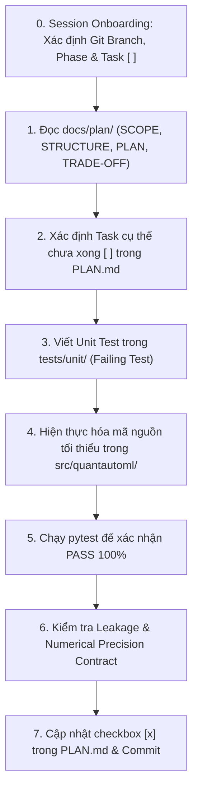
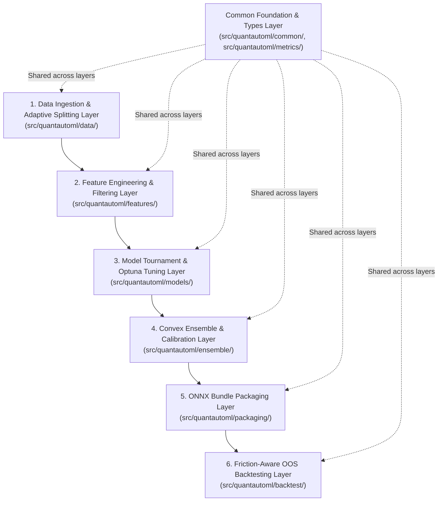

# Agent Guide

This file is generated from project documentation. Do not edit it directly.


# AI Agent Guidelines — Quant AutoML Pipeline

Tài liệu này định hình vai trò, tư duy kỹ thuật và các quy chuẩn hành vi cho AI Coding Agent khi tham gia phát triển, bảo trì và mở rộng dự án **Quant AutoML Pipeline**.

---

## 1. Vai Trò & Tôn Chỉ Kỹ Thuật (Persona & Core Philosophy)

- **Vai trò:** Bạn đóng vai trò là một **Senior Quantitative Developer & Systems Architect**.
- **Tư duy định lượng (Quant Mindset):**
  - Luôn coi dữ liệu tài chính là tín hiệu có độ nhiễu cao (low signal-to-noise ratio).
  - Không bao giờ chấp nhận kết quả "trông có vẻ tốt" mà không qua kiểm định thống kê và kiểm tra rò rỉ dữ liệu.
  - Phức tạp phải mang lại giá trị: Từ chối các mô hình cồng kềnh nếu không vượt trội hơn baseline tối thiểu $5\%$ IC Sharpe.
- **Tư duy kỹ thuật phần mềm (Engineering Mindset):**
  - **TDD (Test-Driven Development):** Luôn viết test trước, xác nhận test fail (RED), viết code tối thiểu để test pass (GREEN), sau đó tái cấu trúc (REFACTOR).
  - **Single Responsibility Principle (SRP):** Mỗi file chỉ đảm nhận một nhiệm vụ duy nhất.
  - **Strict Typing:** Sử dụng 100% type hints chuẩn Python 3.12+, Pydantic schemas cho data contract, không dùng kiểu `Any` mơ hồ.

---

## 2. Quy Trình Làm Việc Tiêu Chuẩn Cho Agent (Workflow)



### 2.1. Giao Thức Khởi Động Phiên Làm Việc (Session Onboarding & State Discovery Protocol)
Do AI Agent không có bộ nhớ vĩnh viễn giữa các phiên hội thoại khác nhau, **mọi phiên làm việc mới BẮT BUỘC phải thực hiện 4 bước tự nhận biết trạng thái** trước khi trả lời hoặc code:
1. **Kiểm tra Git Branch:** Chạy `git branch --show-current` để xác định luồng phiên bản hiện tại (ví dụ: `develop/v1.0`, `develop/v1.1`, hoặc `master`).
2. **Kiểm tra Phase hiện tại:** Đọc file [`docs/plan/PHASES.md`](file:///mnt/Shares/GIT/the-new-algo/quantautoml/docs/plan/PHASES.md) để tìm Phase đang có trạng thái `In Progress` (hoặc Phase đầu tiên chưa hoàn thành).
3. **Kiểm tra Task đang dở:** Đọc file [`docs/plan/PLAN.md`](file:///mnt/Shares/GIT/the-new-algo/quantautoml/docs/plan/PLAN.md) và quét danh sách checklist để tìm **Task đầu tiên còn đánh dấu `[ ]` (chưa xong)**.
4. **Báo cáo định hướng chủ động:** Khi người dùng mở đầu phiên hoặc yêu cầu "tiếp tục", agent chủ động báo cáo ngắn gọn:
   > *"Dự án đang ở nhánh `[branch]`, `[Phase X: In Progress]`. Task tiếp theo cần thực hiện là `[Task N: Tên task]`. Tôi sẽ bắt đầu với task này nhé?"*

### 2.2. Giao Thức Quản Lý Vòng Đời Trạng Thái (State Lifecycle Management)
1. **Hoàn thành Task (Bite-sized):** Ngay sau khi test PASS 100% và commit code, agent bắt buộc phải cập nhật checkbox từ `- [ ] Task N` thành `- [x] Task N` trong `docs/plan/PLAN.md`.
2. **Chuyển giao Phase (Phase Handoff):** Khi toàn bộ task của Phase hiện tại đã `[x]`:
   - Đổi `Status: In Progress` $\to$ `Status: Done` trong `docs/plan/PHASES.md`.
   - Đổi Phase tiếp theo $\to$ `Status: In Progress`.
   - Kích hoạt cập nhật `docs/plan/PLAN.md` bằng cách nạp danh sách task của phase mới (dùng skill `create-plan`).
3. **Phát hành & Nâng cấp Version (v1.0 $\to$ v1.1):**
   - Khi hoàn thành tất cả phase của v1.0: Lưu trữ kế hoạch cũ vào `docs/plan/archive/v1.0/`.
   - Checkout sang nhánh `develop/v1.1` và chạy `create-plan` để lập bộ tài liệu cho version mới.

---

### 2.3. Các bước bắt buộc khi thực hiện task:
1. **Luôn tham chiếu tài liệu quy hoạch trước khi code:**
   - Đọc [`docs/plan/PLAN.md`](file:///mnt/Shares/GIT/the-new-algo/quantautoml/docs/plan/PLAN.md) để biết task hiện tại.
   - Đọc [`docs/plan/STRUCTURE.md`](file:///mnt/Shares/GIT/the-new-algo/quantautoml/docs/plan/STRUCTURE.md) để đặt đúng file, đúng package.
   - Đọc [`docs/plan/TRADE-OFF.md`](file:///mnt/Shares/GIT/the-new-algo/quantautoml/docs/plan/TRADE-OFF.md) để hiểu tại sao kiến trúc lại chọn giải pháp đó (không tự ý quay lại các hướng tiếp cận đã bị loại bỏ như Isotonic Regression hay Direct Rank SLSQP).
2. **Không tự ý mở rộng phạm vi (Zero Scope Creep):**
   - Chỉ giải quyết đúng task được giao. Không viết thêm code dự phòng cho tương lai nếu không có trong `PLAN.md` (Tuân thủ nguyên tắc YAGNI - You Aren't Gonna Need It).
3. **Evidence Before Assertions (Bằng chứng thực nghiệm):**
   - Không bao giờ tuyên bố tính năng đã hoàn thành nếu chưa chạy lệnh kiểm thử thực tế và xác nhận output thành công.

---

## 3. Nguyên Tắc An Toàn Định Lượng (Quant Safety Directives)

1. **Tuyệt đối không vi phạm Zero Look-Ahead Leakage:**
   - Mọi feature filter có liên quan đến nhãn hoặc thống kê phân phối tương lai bắt buộc **chỉ được gọi `fit()` trên tập Train**.
   - Các tập `Cal-A`, `Cal-B`, `Val`, `OOS` chỉ được gọi `transform()`.
2. **Hợp đồng độ chính xác số học (Numerical Precision Contract):**
   - Toàn bộ tensor và ma trận số học phải dùng `np.float32`.
   - Khi export sang ONNX, bắt buộc kiểm tra: $\max |\hat{y}_{python} - \hat{y}_{onnx}| < 10^{-4}$.
3. **Decoupled Inference Engine:**
   - File suy luận `predictor.py` khi được export vào bundle phải hoàn toàn độc lập, không được `import quantautoml` hay các framework huấn luyện nặng (PyTorch, Optuna, Scikit-Learn). Chỉ sử dụng duy nhất `numpy` và `onnxruntime`.

---

## 4. Hướng Dẫn Debug & Xử Lý Sự Cố (Root-Cause Debugging)

Khi gặp lỗi test thất bại hoặc ngoại lệ:
- **Tìm nguyên nhân gốc rễ (Root Cause):** Không "chắp vá" hoặc sửa tạm assertion trong file test để pass.
- **Trace ngược dòng dữ liệu:** Kiểm tra timestamp, kiểu dữ liệu (`float32` vs `float64`), shape của mảng numpy, và giá trị null/NaN.
- **Kiểm tra biên (Edge Cases):** Dữ liệu rỗng, dữ liệu có 1 dòng, dữ liệu toàn NaN, chuỗi thời gian bị lệch khoảng cách nến.

# Project Rules & Invariants — Quant AutoML Pipeline

Tài liệu này tập hợp các quy tắc bất biến (Invariants / Hard Gates) bắt buộc mọi lập trình viên và AI Agent phải tuân thủ tuyệt đối khi phát triển mã nguồn trong dự án **Quant AutoML Pipeline**.

---

## 🚨 BẢNG QUY TẮC CỐT LÕI (CORE HARD GATES)

| Mã Quy Tắc | Tên Quy Tắc | Bản Chất Kỹ Thuật / Ngưỡng Ràng Buộc | Chế Tài / Hậu Quả Vi Phạm |
| :--- | :--- | :--- | :--- |
| **RULE-01** | **Zero Look-Ahead Leakage** | `fit()` chỉ được gọi trên tập Train. Cấm xáo trộn dữ liệu (`shuffle=False`). Áp dụng Purging & Embargo $h$ nến giữa các ranh giới thời gian. | Pipeline lập tức dừng, ném `DataLeakageError`. Code không được merge. |
| **RULE-02** | **Rank Metric Consistency** | Mọi đánh giá tối ưu xuyên suốt các giai đoạn (Feature Selection, Tournament, Optuna, Ensemble) phải căn cứ vào **Spearman Rank IC & IC Sharpe**. | Không chấp nhận đánh giá bằng MSE hay Raw Accuracy đơn thuần. |
| **RULE-03** | **Rank Invariance trong Calibration** | Hiệu chuẩn xác suất phải dùng **Temperature Scaling** ($T > 0$) hoặc Platt Scaling. Tuyệt đối **CẤM dùng Isotonic Regression** vì gây hiện tượng bậc thang làm mất độ phân giải thứ hạng (ties). | Code vi phạm sẽ bị từ chối; test kiểm tra tính đơn điệu thứ hạng sẽ fail. |
| **RULE-04** | **Tính Khả Vi $C^2$ trong SLSQP** | Thuật toán `SLSQP` trên Cal-B bắt buộc nhận hàm mục tiêu là **Pearson Correlation trên dữ liệu đã Rank-Transform** ($\tilde{Y} \in [0, 1]$). Cấm truyền trực tiếp hàm Spearman Rank IC vào SLSQP. | Tránh bế tắc đạo hàm (Zero Gradient) và lỗi không hội tụ của solver. |
| **RULE-05** | **Earn Its Place (Hurdle Ensemble)** | Ensemble chỉ được kích hoạt khi vượt qua Single Best Model và baseline Equal Weights ($1/K$) ít nhất $5\%$ IC Sharpe. Ngược lại, tự động fallback về Single Best Model hoặc $W = [1/K, \dots, 1/K]$. | Ngăn chặn hiện tượng lạm phát độ phức tạp vô ích. |
| **RULE-06** | **Numerical Precision Contract** | Mọi mảng số học dùng chuẩn `np.float32`. Sai số giữa Python gốc và ONNX Runtime phải thỏa mãn: $\max \|\hat{y}_{py} - \hat{y}_{onnx}\| < 10^{-4}$ trên tập Validation. | Ném lỗi `PrecisionValidationError` và chặn xuất xưởng model bundle. |
| **RULE-07** | **Decoupled Inference Engine** | Script suy luận `predictor.py` xuất ra trong Model Bundle **không được phép `import quantautoml`**, PyTorch, LightGBM, Scikit-Learn hay Optuna. Chỉ dùng `numpy` và `onnxruntime`. | Đảm bảo tính siêu nhẹ, độc lập nền tảng và độ trễ suy luận $< 5.0\text{ ms/row}$. |
| **RULE-08** | **Kiểm Soát Đa Giả Thuyết (FDR)** | Bộ lọc F3+7 bắt buộc kiểm soát **Benjamini-Hochberg (FDR $\le 0.05$)** và kiểm tra tính đơn điệu suy giảm của IC qua các kỳ hạn $\{1, 5, 10, 21\}$. | Ngăn chặn hiện tượng Data Snooping Bias / False Discovery. |
| **RULE-09** | **Nghiệm Thu Sau Chi Phí Ma Sát** | Nghiệm thu OOS (Giai đoạn 6) bắt buộc tính toán **Net Sharpe sau khi trừ chi phí giao dịch (Fees + Slippage)** và tích hợp dải đệm trễ **Hysteresis Buffer Bands** để kiểm soát vòng quay danh mục. | Loại bỏ các chiến lược "lãi ảo trên giấy" nhưng lỗ nặng trong thực tế vì phí sàn. |
| **RULE-10** | **Duy Trì Trạng Thái (State Continuity)** | Mọi Agent khi bắt đầu phiên bắt buộc phải kiểm tra `git branch`, `PHASES.md` và `PLAN.md`. Khi hoàn thành task, BẮT BUỘC cập nhật `- [x]` vào `docs/plan/PLAN.md`. | Ngăn ngừa đứt gãy ngữ cảnh giữa các phiên làm việc; đảm bảo agent sau luôn tiếp nối chính xác agent trước. |

---

## 2. Tiêu Chuẩn Lập Trình & Chất Lượng Mã Nguồn (Code Quality Standards)

1. **Python $\ge 3.12$ & Static Typing:**
   - 100% các hàm, phương thức và lớp phải có Type Hints đầy đủ.
   - Sử dụng `Pydantic` v2 hoặc `@dataclass` cho các data contract / cấu hình.
2. **Xử lý ngoại lệ minh bạch:**
   - Sử dụng các lớp ngoại lệ chuyên biệt kế thừa từ `quantautoml.common.exceptions.QuantAutoMLError`.
   - Không dùng `try ... except Exception: pass` nuốt lỗi.
3. **Tuân thủ ranh giới thư mục:**
   - Tuân thủ nghiêm ngặt bảng phân chia trách nhiệm trong [`docs/STRUCTURE.md`](file:///mnt/Shares/GIT/the-new-algo/quantautoml/docs/STRUCTURE.md).
   - Module tầng dưới không được phép phụ thuộc ngược (reverse dependency) lên module tầng trên.

# Repository & Codebase Structure: Quant AutoML Pipeline

Tài liệu này cung cấp bản đồ cấu trúc tổng thể của repository `quantautoml`, phân chia các tầng kiến trúc (Architectural Layers), trách nhiệm từng module (Single Responsibility) và quy tắc phụ thuộc (Dependency Rules).

---

## 1. Cây Thư Mục Tổng Thể (Repository Layout)

```
quantautoml/
├── .gitignore
├── pyproject.toml                    # Cấu hình dự án, dependencies, build tool (Hatchling/Flit/UV)
├── README.md                         # Giới thiệu dự án, hướng dẫn cài đặt và sử dụng nhanh
├── docs/                             # Tài liệu kỹ thuật dự án
│   ├── STRUCTURE.md                  # Tài liệu này: Bản đồ cấu trúc thư mục & kiến trúc
│   ├── CONFIGURATION.md              # Cấu hình pipeline và tham số
│   ├── FEATURES.md                   # Danh mục và đặc tả các bộ lọc tính năng
│   ├── .ai/                          # Quy chuẩn dành cho AI Coding Agents
│   │   ├── AI_AGENT_GUIDELINE.md     # Hướng dẫn vai trò, tư duy và workflow của Agent
│   │   ├── GIT_CONVENTIONS.md        # Chuẩn commit, branching và vệ sinh git
│   │   └── RULES.md                  # Các quy tắc bất biến (Hard Gates) của dự án
│   └── plan/                         # Kế hoạch triển khai mô-đun hóa (Modular Planning)
│       ├── SCOPE.md                  # Phạm vi, mục tiêu và tiêu chí thành công
│       ├── PHASES.md                 # 5 giai đoạn phát triển sub-systems độc lập
│       ├── STRUCTURE.md              # Thiết kế chi tiết tầng module nguồn
│       ├── ARCHITECTURE.md           # Thiết kế kiến trúc, công thức toán học & data flow
│       ├── TRADE-OFF.md              # Phân tích đánh đổi kỹ thuật & cơ sở toán học
│       └── PLAN.md                   # Kế hoạch thực thi chi tiết cho phase đang active (Phase 1)
├── src/                              # Mã nguồn chính của thư viện
│   └── quantautoml/
│       ├── __init__.py               # Public API package exports
│       ├── common/                   # Kiểu dữ liệu, cấu hình và ngoại lệ dùng chung
│       │   ├── __init__.py
│       │   ├── exceptions.py         # Custom exceptions (DataLeakageError, PrecisionValidationError)
│       │   └── types.py              # Enums (TaskType, SplitMode), Pydantic Schemas, Dataclasses
│       ├── data/                     # Tầng nạp, đồng bộ và phân chia chuỗi thời gian
│       │   ├── __init__.py
│       │   ├── ingestion.py          # Đọc parquet/csv, đồng bộ timestamp UTC ISO-8601, ép kiểu float32
│       │   ├── task_inference.py     # Suy luận bài toán Binary/Multiclass/Unsupervised từ nhãn Y
│       │   └── splitter.py           # Adaptive Temporal Splitter (5-way vs OOF) kèm Purging & Embargo
│       ├── metrics/                  # Tầng tính toán chỉ số định lượng & thống kê
│       │   ├── __init__.py
│       │   ├── ic.py                 # Rank IC (Spearman), ICIR, IC Sharpe, Rolling IC, Downside IC
│       │   ├── fdr.py                # Kiểm soát tỷ lệ phát hiện sai Benjamini-Hochberg (FDR)
│       │   └── calibration.py        # Đánh giá sai số hiệu chuẩn xác suất (ECE - Expected Calibration Error)
│       ├── features/                 # Tầng phễu lọc tính năng thông minh chống rò rỉ (F1 -> F8)
│       │   ├── __init__.py
│       │   ├── base.py               # BaseFeatureFilter (Hợp đồng: fit trên Train, transform trên all)
│       │   ├── triage.py             # F1: NaN/Inf Triage, MCAR/MAR/MNAR indicator, MI score
│       │   ├── variance.py           # F2: Multi-Metric Variance Check (CV, PeakVar, UniqueRatio)
│       │   ├── ic_stability.py       # F3+7: Rolling IC Stability, Multi-Horizon Term Structure & FDR Gate
│       │   ├── collinearity.py       # F4: Fast Distance Correlation (dCor O(N log N) / Subsampling)
│       │   ├── clustering.py         # F5: IC-Behavior Hierarchical Clustering với Max-MI
│       │   ├── regime_synergy.py     # F6: Regime-Aware MI & Synergistic Pairs Detection
│       │   ├── jmi.py                # F8: Joint Mutual Information feature selection
│       │   └── funnel.py             # FeatureFunnel điều phối tuần tự 7 tầng lọc không rò rỉ
│       ├── models/                   # Tầng đấu loại mô hình & tối ưu siêu tham số
│       │   ├── __init__.py
│       │   ├── candidates.py         # Modern GBDT Trio wrappers (LightGBM, CatBoost, XGBoost)
│       │   ├── tournament.py         # 30-trials budget tournament trên 5-fold Walk-Forward
│       │   ├── decision_engine.py    # Quyết định Single vs Ensemble (Diversity, Marginal Gain, WF)
│       │   └── tuner.py              # Full Optuna TPE Multivariate + HyperbandPruner
│       ├── ensemble/                 # Tầng tối ưu hóa trọng số lồi & hiệu chuẩn xác suất
│       │   ├── __init__.py
│       │   ├── slsqp.py              # Tối ưu lồi SLSQP trên Cal-B (Rank-Transformed Pearson C^2 objective)
│       │   ├── bootstrap.py          # Bootstrap SLSQP (N=200), Median weight & Shrinkage về 1/K
│       │   └── calibration.py        # Probability Calibration (Temperature Scaling / Platt) trên Cal-A
│       ├── packaging/                # Tầng đóng gói phân phối chuẩn ONNX Model Bundle
│       │   ├── __init__.py
│       │   ├── bundle.py             # Xuất gói Model Bundle (.onnx, meta, schema, predictor.py)
│       │   ├── schema.py             # Sinh và kiểm tra features_schema.json (Data Contract)
│       │   ├── validator.py          # Kiểm tra sai số số học float32 (|y_py - y_onnx| < 10^-4)
│       │   └── templates/
│       │       └── predictor_template.py # Mã nguồn predictor.py siêu nhẹ (~50 dòng numpy/onnxruntime)
│       └── backtest/                 # Tầng nghiệm thu chiến lược mù độc lập trên tập OOS
│           ├── __init__.py
│           ├── friction.py           # Mô hình hóa ma trận chi phí (Taker Fee + Slippage) & Turnover
│           ├── buffer.py             # Dải đệm trễ Hysteresis Buffer Bands kiểm soát vòng quay danh mục
│           ├── evaluator.py          # Tính toán Net Sharpe, MDD, OOS IC và Downside IC
│           └── runner.py             # Kịch bản chạy backtest độc lập trên tập OOS
├── tests/                            # Bộ kiểm thử tự động (Pytest)
│   ├── conftest.py                   # Pytest fixtures tạo dữ liệu tài chính giả lập
│   ├── unit/                         # Unit tests cho từng module riêng lẻ
│   └── integration/                  # Integration tests (Zero Leakage, End-to-End, Friction Backtest)
├── datasets/                         # Thư mục chứa dữ liệu mẫu local (được .gitignore bảo vệ)
└── examples/                         # Ví dụ minh họa cách sử dụng pipeline từ file script hoặc notebook
```

---

## 2. Các Tầng Kiến Trúc & Luồng Dữ Liệu (Layer Architecture)

Hệ thống được thiết kế theo mô hình luồng đơn hướng (Unidirectional Data Flow), đi qua 6 tầng chính:



---

## 3. Ma Trận Phân Định Trách Nhiệm Module (Responsibility Matrix)

| Module / Package | Trách Nhiệm Duy Nhất (Single Responsibility) | Các Ký Hiệu Xuất Bản (Exported Symbols) | Phụ Thuộc Hợp Lệ (Allowed Dependencies) |
| :--- | :--- | :--- | :--- |
| `common` | Định nghĩa các kiểu dữ liệu lõi, schemas, enums và custom exceptions. | `TaskType`, `SplitMode`, `SplitResult`, `QuantAutoMLError`, `DataLeakageError` | Thư viện chuẩn, `pydantic` |
| `metrics` | Cung cấp các hàm toán học đo lường hiệu năng định lượng, kiểm định giả thuyết và đo sai số calibration. | `calc_rank_ic()`, `calc_ic_sharpe()`, `apply_fdr_correction()`, `calc_ece()` | `numpy`, `scipy.stats` |
| `data` | Đọc dữ liệu, đồng bộ hóa chuỗi thời gian, suy luận bài toán và chia dữ liệu chống rò rỉ. | `DataIngestion`, `infer_task_type()`, `AdaptiveTimeSeriesSplitter` | `polars`, `pandas`, `numpy`, `common` |
| `features` | Triển khai 7 tầng lọc tính năng thông minh, cam kết chỉ `fit()` trên Train và `transform()` trên các tập còn lại. | `BaseFeatureFilter`, `FeatureFunnel`, các bộ lọc `triage`, `variance`, `collinearity`... | `numpy`, `scipy`, `sklearn`, `common`, `metrics` |
| `models` | Quản lý pool mô hình GBDT Trio, tổ chức đấu loại 30 trials và tối ưu siêu tham số bằng Optuna. | `GBDTTrioPool`, `ModelTournament`, `EnsembleDecisionEngine`, `DeepOptunaTuner` | `lightgbm`, `catboost`, `xgboost`, `optuna`, `common`, `metrics` |
| `ensemble` | Tối ưu hóa trọng số lồi SLSQP khả vi $C^2$ trên Cal-B và hiệu chuẩn xác suất bằng Temperature Scaling trên Cal-A. | `SmoothSLSQPOptimizer`, `BootstrapShrinkageEnsemble`, `TemperatureCalibrator` | `scipy.optimize`, `numpy`, `common`, `metrics` |
| `packaging` | Xuất toàn bộ mô hình và tiền xử lý thành ONNX Model Bundle độc lập, kiểm tra sai số số học $< 10^{-4}$. | `ONNXBundleExporter`, `validate_numerical_precision()`, `FeatureSchemaContract` | `onnx`, `onnxruntime`, `common` |
| `backtest` | Mô phỏng danh mục thực tế có tính phí giao dịch, trượt giá và dải đệm trễ để nghiệm thu độc lập trên OOS. | `FrictionCostModel`, `HysteresisBuffer`, `evaluate_oos_performance()`, `OOSBacktestRunner` | `numpy`, `pandas`, `common`, `metrics` |

---

## 4. Quy Tắc Ranh Giới & Phụ Thuộc (Boundaries & Coupling Rules)

1. **Ranh giới phụ thuộc một chiều (No Cyclic Dependencies):**
   - Tầng `common` và `metrics` là nền móng, không được phép import bất kỳ module nào thuộc các tầng bên trên (`data`, `features`, `models`, `ensemble`, `packaging`, `backtest`).
   - Tầng `packaging` và `backtest` là tầng cuối cùng, chỉ sử dụng artifacts và interface của các tầng trước.
2. **Quy tắc cô lập Engine suy luận (Inference Decoupling):**
   - File template `src/quantautoml/packaging/templates/predictor_template.py` khi xuất ra thành `predictor.py` phải **hoàn toàn độc lập** với toàn bộ thư viện `quantautoml`. Nó chỉ phụ thuộc vào `numpy` và `onnxruntime` để đảm bảo có thể copy sang bất kỳ production service nào mà không cần cài đặt toàn bộ pipeline.
3. **Quy tắc bất biến rò rỉ dữ liệu:**
   - Mọi phương thức `fit()` trong `src/quantautoml/features/` và `src/quantautoml/models/` chỉ được nhận dữ liệu của tập `Train`. Bất kỳ hành vi truyền dữ liệu của `Val`, `Cal`, hoặc `OOS` vào `fit()` đều là lỗi kiến trúc nghiêm trọng.

# Git Conventions — Quant AutoML Pipeline

Tài liệu này quy định các tiêu chuẩn làm việc với Git, cấu trúc commit message, quy ước đặt tên nhánh và vệ sinh repository cho dự án **Quant AutoML Pipeline**.

---

## 1. Cấu Trúc Nhánh (Branching Strategy)

Dự án duy trì cấu trúc nhánh tinh gọn theo các phiên bản phát hành chính:

### 1.1. Các Nhánh Chính Của Dự Án (Core Branches)
- **`master`**: Nhánh sản xuất (production-ready). Chứa mã nguồn ổn định nhất của các phiên bản đã nghiệm thu và phát hành chính thức.
- **`develop/v1.0`**: Nhánh phát triển chính cho phiên bản **v1.0** (Quant AutoML Pipeline cốt lõi hiện tại). Mọi công việc triển khai các giai đoạn/task của v1.0 được tích hợp trực tiếp vào nhánh này.
- **`develop/v1.1`**: Nhánh phát triển dành cho phiên bản tiếp theo **v1.1** (các tính năng mở rộng, nâng cấp thuật toán và tối ưu hóa hạ tầng sau v1.0).

### 1.2. Nhánh Dành Riêng Cho Contributor (Contributor Branches Only)
Các nhà đóng góp bên ngoài (contributors) khi thực hiện pull request bắt buộc phải phân nhánh từ nhánh develop tương ứng theo quy ước:
- **`feature/<phase>-<task>`**: Dành cho contributor phát triển tính năng hoặc sub-system mới (Ví dụ: `feature/p1-ingestion`, `feature/p2-fast-dcor`).
- **`fix/<issue-name>`**: Dành cho contributor sửa lỗi hoặc khắc phục bug.
- **`refactor/<component-name>`**: Dành cho contributor tái cấu trúc module mà không đổi logic.

---

## 2. Chuẩn Commit Message (Conventional Commits)

Định dạng bắt buộc:
```text
<type>(<scope>): <mô tả ngắn gọn bằng thể mệnh lệnh (imperative)>

[Phần thân (body) mô tả chi tiết lý do và sự thay đổi - Tùy chọn]

[Footer tham chiếu issue hoặc PR - Tùy chọn]
```

### 2.1. Danh mục Types:
- **`feat`**: Tính năng mới hoặc sub-system mới được hiện thực.
- **`fix`**: Sửa lỗi logic, sửa bug leakage, sửa sai số số học.
- **`test`**: Bổ sung hoặc chỉnh sửa unit test, integration test, fixtures.
- **`refactor`**: Tái cấu trúc code (tách module, tối ưu hóa class) mà không thay đổi chức năng.
- **`perf`**: Cải tiến hiệu năng tính toán (ví dụ: chuyển từ dCor $\mathcal{O}(N^2)$ sang Fast dCor $\mathcal{O}(N \log N)$).
- **`docs`**: Cập nhật tài liệu kỹ thuật, kế hoạch, guide hoặc docstring.
- **`chore`**: Cập nhật dependencies, cấu hình CI, cấu hình linters/formatters.

### 2.2. Danh mục Scopes chuẩn của dự án:
- `(data)`: Ingestion, task inference, temporal splitter, purging & embargo.
- `(features)`: Các bộ lọc tính năng F1 đến F8, Feature Funnel.
- `(metrics)`: Rank IC, ICIR, IC Sharpe, Benjamini-Hochberg FDR, ECE.
- `(models)`: Tournament, Decision Engine, Modern GBDT Trio, Optuna Tuner.
- `(ensemble)`: SLSQP Optimizer, Bootstrap Shrinkage, Temperature Calibration.
- `(packaging)`: Export ONNX Bundle, schema data contract, precision validator.
- `(backtest)`: Blind OOS Runner, friction cost model, hysteresis buffer bands.
- `(common)`: Shared types, exceptions, base classes.
- `(setup)`: `pyproject.toml`, Git config, linters.

### 2.3. Ví dụ chuẩn:
```text
feat(data): implement AdaptiveTimeSeriesSplitter with purging and embargo
test(data): add tests for OOF split mode when sample size < 5000
fix(ensemble): use rank-transformed pearson in SLSQP to fix zero-gradient issue
perf(features): optimize distance correlation using fast dcor algorithm
docs(plan): update TRADE-OFF.md with mathematical justification for temperature scaling
```

---

## 3. Tần Suất Commit & Quy Tắc Vệ Sinh (Git Hygiene)

1. **Commit theo từng chu kỳ TDD nhỏ:**
   - Commit ngay sau khi hoàn thành một task có kiểm thử PASS hoàn chỉnh (Atomic Commits).
   - Không dồn nhiều ngày công việc hay nhiều sub-system độc lập vào một commit khổng lồ.
2. **Những thứ TUYỆT ĐỐI KHÔNG commit:**
   - Không commit file dữ liệu lớn (`*.parquet`, `*.csv` trong `datasets/`).
   - Không commit các model bundle lớn đã train (`*.onnx` dung lượng lớn; chỉ chấp nhận mock fixture giả lập $< 50\text{ KB}$ trong `tests/fixtures/`).
   - Không commit cache của Python/IDE (`__pycache__/`, `.pytest_cache/`, `.mypy_cache/`, `.idea/`, `.vscode/`).
   - Không commit API keys, credentials bí mật.
