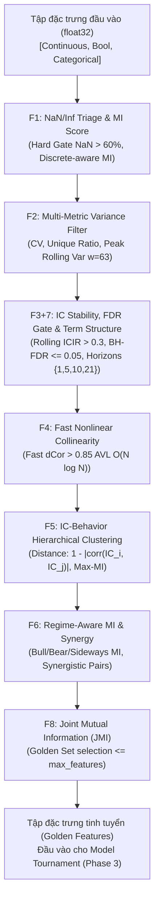
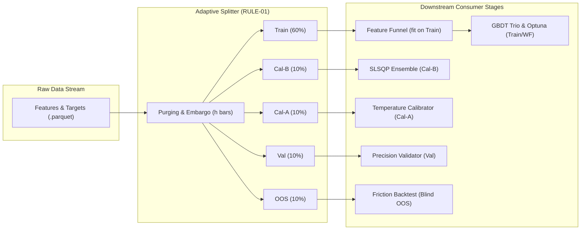
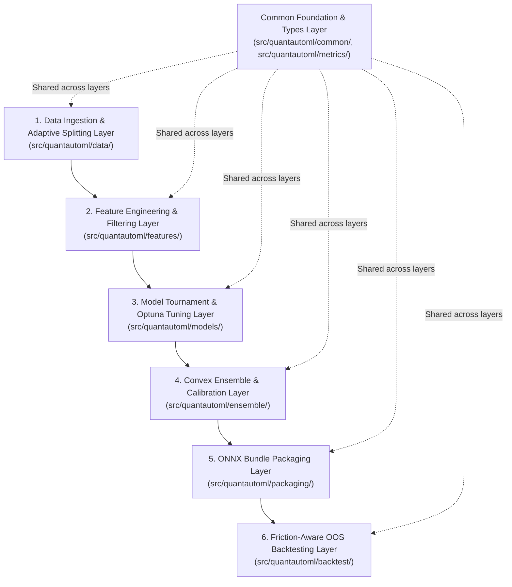

<!-- This file is generated from docs/*.md by scripts/generate_readme.sh. Do not edit it directly. -->

# Quant AutoML Pipeline

> **End-to-End Autonomous Quantitative AutoML Pipeline** — Hệ thống tự động hóa xây dựng, tinh tuyển đặc trưng, huấn luyện tổ hợp mô hình GBDT, đóng gói ONNX siêu nhẹ (`< 5 ms/row`) và kiểm thử mù có tính chi phí ma sát (Friction-Aware Blind OOS Backtesting) cho dữ liệu chuỗi thời gian tài chính.



---

## Điểm Nổi Bật & Quy Tắc Bất Biến (Core Hard Gates)

| Mã Quy Tắc | Tên Quy Tắc | Bản Chất Kỹ Thuật & Ngưỡng Ràng Buộc |
| :--- | :--- | :--- |
| **RULE-01** | **Zero Look-Ahead Leakage** | `fit()` chỉ được gọi trên tập **Train**. Không xáo trộn dữ liệu (`shuffle=False`). Áp dụng **Purging & Embargo** $h$ nến giữa mọi phân vùng thời gian (`Train`, `Cal-A`, `Cal-B`, `Val`, `OOS`). |
| **RULE-02** | **Rank Metric Consistency** | Mọi đánh giá và tối ưu xuyên suốt các giai đoạn (Feature Funnel, Tournament, Optuna, SLSQP) đều căn cứ vào **Spearman Rank IC, ICIR & IC Sharpe**. |
| **RULE-03** | **Rank Invariance Calibration** | Hiệu chuẩn xác suất bằng **Temperature Scaling** ($T > 0$) trên tập `Cal-A`, đảm bảo $\text{ECE} < 0.05$ và **bảo toàn 100% thứ hạng Rank IC** (tuyệt đối không dùng Isotonic Regression gây hiện tượng bậc thang / ties). |
| **RULE-04** | **Tính Khả Vi $C^2$ trong SLSQP** | Tối ưu trọng số tổ hợp bằng `SLSQP` trên tập `Cal-B` với hàm mục tiêu **Pearson Correlation trên dữ liệu đã Rank-Transform** ($\tilde{Y} \in [0, 1]$), kết hợp Bootstrap $N=200$ và Shrinkage về $1/K$. |
| **RULE-05** | **Earn Its Place (Hurdle Rule)** | Chỉ kích hoạt Ensemble khi Diversity thỏa mãn ($\text{corr} < 0.88$) và vượt qua Single Best Model / Equal Weights ít nhất **$+5\%$ IC Sharpe**; ngược lại tự động fallback về Single Best Model. |
| **RULE-06** | **Numerical Precision Contract** | Toàn bộ ma trận số học dùng chuẩn `np.float32`. Sai số giữa Python gốc và ONNX Runtime bắt buộc thỏa mãn $\max |\hat{y}_{py} - \hat{y}_{onnx}| < 10^{-4}$ trên tập `Val`. |
| **RULE-07** | **Decoupled Inference Engine** | Script suy luận `bundle/predictor.py` hoàn toàn độc lập (chỉ import `numpy`, `onnxruntime` và thư viện chuẩn), độ trễ $< 5.0\text{ ms/row}$, tích hợp cảnh báo `DistributionShiftWarning` khi $|z\text{-score}| > 3.0$. |
| **RULE-08** | **Kiểm Soát Đa Giả Thuyết (FDR)** | Phễu lọc F3+7 kiểm soát **Benjamini-Hochberg FDR $\le 0.05$** và kiểm tra tính đơn điệu suy giảm của ICIR qua cấu trúc kỳ hạn $\{1, 5, 10, 21\}$. |
| **RULE-09** | **Dual-Tier Friction Backtest** | Nghiệm thu độc lập trên tập `OOS` với phí giao dịch (`fee_bps`) + trượt giá (`slippage_bps`), dải đệm trễ **Hysteresis Buffer Bands** (Tier 1 NumPy) và khớp lệnh thực chiến tại `Open[t+1]` qua `backtesting.py` (Tier 2). |

---

# Quick Start & Hướng Dẫn Sử Dụng (`QUICKSTART`)

Tài liệu này hướng dẫn cách cài đặt môi trường, sinh file cấu hình `config.toml` bằng `scripts/generate_config.py` (bao gồm cách đổi nhãn mục tiêu `selected`), chạy toàn bộ pipeline và sử dụng mô hình ONNX xuất xưởng.

---

## 1. Yêu Cầu Hệ Thống & Cài Đặt

- **Hệ điều hành:** Linux / macOS / Windows (WSL2)
- **Python:** $\ge 3.12$
- **Trình quản lý gói:** [`uv`](https://docs.astral.sh/uv/)

```bash
# Cài đặt toàn bộ dependencies (bao gồm cả dev group và backtesting.py)
uv sync
```

---

## 2. Sinh File Cấu Hình `config.toml` Tự Động (`scripts/generate_config.py`)

Dự án cung cấp sẵn script [`scripts/generate_config.py`](scripts/generate_config.py) để tự động quét header của file dữ liệu (`datasets/feature.parquet`, `datasets/label.csv`) và sinh ra file `config.toml` hoàn chỉnh cho cả 5 Phase (có thể chạy được ngay).

### 2.1. Sinh cấu hình mặc định (nhãn nhị phân `is_peak_10`)

```bash
uv run python scripts/generate_config.py --force
```

### 2.2. Đổi nhãn mục tiêu sang nhãn giao dịch có hướng (`allow_entry`)

Khi bạn chọn nhãn dạng chữ có hướng như `allow_entry` (`"Yes - Buy"`, `"Yes - Sell"`, `"No - None"`, `"No - Sideway"`) hoặc `direction_filter` (`"Long"`, `"Short"`, `"None"`), script sẽ **tự động**:
1. Bật `ignore_other_columns = true` trong `[labels]` để bỏ qua các cột nhãn phụ không phải kiểu số trong `datasets/label.csv`.
2. Sinh bảng ánh xạ `[labels.mapping]` chuẩn (`+1` cho Buy/Long, `-1` cho Sell/Short, `0` cho None/Sideway).

```bash
# Đổi sang nhãn allow_entry và ghi đè vào config.toml
uv run python scripts/generate_config.py --selected-label allow_entry --force

# Hoặc xuất ra một file config riêng cho từng thí nghiệm
uv run python scripts/generate_config.py --selected-label allow_entry --output config_allow_entry.toml --force
uv run python scripts/generate_config.py --selected-label direction_filter --output config_direction.toml --force
uv run python scripts/generate_config.py --selected-label entry_filter --output config_entry_filter.toml --force
```

### 2.3. Tùy chỉnh kỳ hạn (`horizon-h`, `target-horizon`) và số lượng Trials

```bash
uv run python scripts/generate_config.py \
  --selected-label allow_entry \
  --horizon-h 21 \
  --target-horizon 5 \
  --tournament-trials 30 \
  --tuning-trials 50 \
  --output config.toml \
  --force
```

### 2.4. Sinh cấu hình cho bài toán Không giám sát (Unsupervised Mode)

```bash
uv run python scripts/generate_config.py --labels-path "" --output config_unsupervised.toml --force
```

### 2.5. Bảng tham số CLI của `scripts/generate_config.py`

| Tham số CLI | Mặc định | Ý nghĩa |
| :--- | :--- | :--- |
| `-o`, `--output` | `config.toml` | Đường dẫn file cấu hình TOML đầu ra. |
| `--features-path` | `datasets/feature.parquet` | Đường dẫn tới file đặc trưng (`.parquet` hoặc `.csv`). |
| `--labels-path` | `datasets/label.csv` | Đường dẫn tới file nhãn (truyền `""` nếu chạy Unsupervised). |
| `--timestamp-col` | Auto-detect (`Date`) | Tên cột thời gian chung giữa file features và labels. |
| `--price-col` | Auto-detect (`Close`) | Tên cột giá dùng để tự suy `fwd_ret_*` và tính P&L trong backtest. |
| `--min-match-ratio` | `0.95` | Tỷ lệ khớp timestamp tối thiểu khi inner-join features và labels. |
| `--selected-label` | Auto (`is_peak_10`) | Tên cột nhãn mục tiêu cần huấn luyện (`is_peak_10`, `allow_entry`, `direction_filter`, ...). |
| `--keep-all-labels` | `False` | Nếu bật cờ này, sẽ đặt `ignore_other_columns = false` (yêu cầu mọi cột trong file nhãn đều là số). |
| `--horizon-h` | `21` | Số nến Purging & Embargo giữa các tập dữ liệu (phải $\ge$ kỳ hạn lớn nhất trong `ic_horizons`). |
| `--target-horizon` | `5` | Kỳ hạn mục tiêu chính (nến) để tính ICIR và lọc đặc trưng ở Phase 2. |
| `--tournament-trials` | `30` | Số lượt thử ngẫu nhiên cho mỗi mô hình GBDT ở vòng đấu loại. |
| `--tuning-trials` | `50` | Số lượt tối ưu sâu bằng Optuna Bayesian TPE. |
| `--force` | `False` | Ghi đè file cấu hình đã tồn tại mà không hỏi xác nhận. |

---

## 3. Chạy Toàn Bộ Pipeline

```bash
# Chạy với config.toml mặc định và xuất toàn bộ báo cáo + model bundle vào runs/default
uv run quantautoml run --config config.toml --out runs/default

# Hoặc chạy với cấu hình nhãn allow_entry
uv run quantautoml run --config config_allow_entry.toml --out runs/allow_entry
```

---

## 4. Sử Dụng Gói Suy Luận Độc Lập (`bundle/predictor.py`)

Sau khi chạy xong pipeline, thư mục `runs/default/bundle/` chứa trọn bộ mô hình ONNX và file `predictor.py` **không phụ thuộc vào thư viện `quantautoml` hay bất kỳ framework huấn luyện nào** (chỉ cần `numpy` và `onnxruntime`):

```python
import numpy as np
from runs.default.bundle.predictor import Predictor

# 1. Khởi tạo Predictor từ thư mục bundle
predictor = Predictor("runs/default/bundle")

# 2. Chuẩn bị ma trận đặc trưng thô X (shape: [N, n_raw_features], dtype: np.float32)
X_live = np.zeros((1, 824), dtype=np.float32)

# 3. Dự báo điểm tín hiệu đã hiệu chuẩn Temperature Scaling
# - Bài toán nhị phân: trả về xác suất lớp 1 P(y=1)
# - Bài toán đa lớp có hướng (-1, 0, +1): trả về kỳ vọng lớp có hướng
scores = predictor.predict(X_live)

# 4. Hoặc lấy toàn bộ ma trận xác suất của từng lớp [N, n_classes]
probs = predictor.predict_proba(X_live)
```

---

# Configuration (`config.toml`)

Pipeline được cấu hình bằng file TOML, được kiểm tra hợp lệ chặt chẽ bằng Pydantic v2 (`quantautoml.common.config.PipelineConfig`, `load_config(path)`). Mọi khóa lạ (extra fields) hoặc sai kiểu dữ liệu đều bị từ chối ngay khi nạp.

---

## Tổng Hợp Toàn Bộ Tham Số Thời Gian & Cửa Sổ Nến (Time & Horizon Parameters)

Tất cả các tham số thời gian trong `config.toml` đều được tính theo đơn vị **số lượng cây nến (bars/candles)**. Bảng dưới đây tổng hợp ý nghĩa của từng tham số và quy đổi tương đương trên **khung nến 5 phút** (giả định ~51 nến/ngày giao dịch như VN30F1M hoặc 288 nến/ngày với thị trường 24/7):

| Tham số trong `config.toml` | Mặc định | Đơn vị | Quy đổi trên nến 5 phút (VN30 ~51 nến/ngày) | Ý nghĩa & Vai trò trong Pipeline |
| :--- | :--- | :--- | :--- | :--- |
| `split.horizon_h` | `21` | Nến (bars) | ~105 phút (~2 giờ giao dịch) | **Khoảng đệm Purging & Embargo:** Số cây nến bị cắt bỏ tại ranh giới giữa các tập (`Train`, `Cal-A`, `Cal-B`, `Val`, `OOS`) và giữa các fold Walk-Forward để triệt tiêu rò rỉ nhãn tương lai. **Bắt buộc $\ge$ kỳ hạn lớn nhất trong `ic_horizons` và $\ge$ số NaN ở cuối của mọi cột nhãn.** |
| `features.ic_horizons` | `{1, 5, 10, 21}` | Nến $\to$ Cột | 5 phút, 25 phút, 50 phút, 105 phút | **Cấu trúc kỳ hạn đa chiều (Term Structure):** Ánh xạ từ độ trễ $h$ nến sang cột lợi suất tương lai `fwd_ret_h = Close[t+h]/Close[t] - 1`. Dùng ở tầng F3+7 để kiểm tra tính đơn điệu suy giảm của tín hiệu theo thời gian. |
| `features.target_horizon` | `5` | Nến (bars) | 25 phút (5 nến 5 phút) | **Kỳ hạn mục tiêu chính ($h_{\text{target}}$):** Kỳ hạn chuẩn (phải thuộc khóa của `ic_horizons`) dùng để tính `ICIR`, kiểm định `Benjamini-Hochberg FDR` (F3+7), so sánh loại đa cộng tuyến `dCor` (F4) và gom cụm hành vi IC (F5). |
| `features.rolling_window` | `63` | Nến (bars) | ~315 phút (~1.2 phiên giao dịch) | **Cửa sổ trượt tính đặc trưng (Feature Rolling Window):** Độ dài cửa sổ cuộn để tính: (1) Peak Rolling Variance ở tầng F2; (2) Chuỗi Rolling Spearman IC & ICIR ở tầng F3+7 và F5; (3) Phân vùng 3 pha thị trường Bull/Bear/Sideways ($\pm 0.5\sigma$) ở tầng F6. |
| `backtest.rank_window` | `2000` | Nến (bars) | ~39 phiên (~2 tháng giao dịch) | **Cửa sổ xếp hạng phân vị nhân quả (Causal Percentile Window):** Tại mỗi nến OOS $t$, điểm dự báo `scores[t]` được xếp hạng phần trăm so với `2000` cây nến quá khứ gần nhất $[t - 1999, t]$ để quyết định vào/thoát lệnh qua `HysteresisBuffer`. (`2000 - 1` nến đầu tiên của OOS sẽ ở trạng thái đứng ngoài `pos = 0` để tích lũy đủ cửa sổ). |
| `backtest.ic_window` | `500` | Nến (bars) | ~10 phiên (~2 tuần giao dịch) | **Cửa sổ đánh giá rủi ro OOS (OOS Rolling IC & Stress Window):** Dùng trong `OOSBacktestRunner` cho 2 mục đích: (1) Tính chuỗi Rolling Rank IC trên tập OOS để suy ra chỉ số `ICIR`; (2) Tính lợi suất thị trường trượt `500` nến để xác định các cây nến sụt giảm mạnh nhất (`downside_quantile` 20% thấp nhất) khi đo `Downside IC`. |

---

## Phase 1 — Ingestion, Labels & Adaptive Temporal Split (`[data]`, `[labels]`, `[split]`)

```toml
[data]
features_path   = "datasets/feature.parquet"
labels_path     = "datasets/label.csv"   # bỏ trống / lược bỏ -> Unsupervised
timestamp_col   = "Date"
min_match_ratio = 0.95

[labels]
selected             = "is_peak_10"      # cột nhãn mục tiêu; hoặc "allow_entry", "direction_filter"
ignore_other_columns = true              # true: bỏ qua các cột nhãn phụ khác trong labels_path

[split]
horizon_h = 21                           # số nến Purging & Embargo ở mọi ranh giới tập dữ liệu; >= 1
```

| Khóa | Mặc định | Bắt buộc | Mô tả chi tiết |
| :--- | :--- | :--- | :--- |
| `data.features_path` | — | Có | Đường dẫn tới file ma trận đặc trưng (`.parquet` hoặc `.csv`). |
| `data.labels_path` | `None` | Không | Đường dẫn tới file nhãn (`.parquet` hoặc `.csv`); nếu lược bỏ $\to$ chạy chế độ `UNSUPERVISED`. |
| `data.timestamp_col` | `"timestamp"` | Không | Tên cột thời gian ở cả hai file. Được chuẩn hóa tự động về UTC `datetime64[us]` và kiểm tra tăng dần nghiêm ngặt. |
| `data.min_match_ratio` | `0.95` | Không | Tỷ lệ khớp timestamp tối thiểu `(0.0, 1.0]` khi inner-join `features` và `labels`. Nếu thấp hơn sẽ ném `TimestampAlignmentError`. |
| `labels.selected` | `None` | Có (nếu có `labels_path`) | Tên cột nhãn dùng để suy luận loại bài toán (`binary_classification` hoặc `multiclass_classification`) và huấn luyện mô hình. |
| `labels.ignore_other_columns` | `false` | Không | Khi đặt `true`, bộ nạp dữ liệu chỉ giữ lại đúng cột `labels.selected` và bỏ qua mọi cột khác trong file nhãn (rất hữu ích khi file `label.csv` chứa nhiều cột chữ/boolean khác không dùng tới). Các cột `fwd_ret_*` cho Phase 2 sẽ được tự động tính từ cột giá `Close`. |
| `labels.mapping` | `None` | Không | Bảng `[labels.mapping]` ánh xạ nhãn dạng **chuỗi văn bản** sang **số có hướng** trước khi suy luận bài toán (xem mục `[labels.mapping]` bên dưới). |
| `split.horizon_h` | — | Có | Số cây nến Purging & Embargo bị loại bỏ tại mỗi ranh giới giữa các tập `Train`, `Cal-A`, `Cal-B`, `Val`, `OOS` ($\ge 1$). |

### Nhãn có hướng (`[labels.mapping]`)

Khi huấn luyện trên các nhãn văn bản có hướng như `allow_entry` hoặc `direction_filter`, khai báo thêm bảng `[labels.mapping]`:

```toml
[labels]
selected = "allow_entry"
ignore_other_columns = true

[labels.mapping]
"Yes - Buy"    = 1
"Yes - Sell"   = -1
"No - None"    = 0
"No - Sideway" = 0
"NaN"          = 0        # Tùy chọn: gán các dòng trống giữa chuỗi (mid-series NaN/null) về lớp 0
```

- Nhiều nhãn chữ có thể ánh xạ về cùng một con số (ví dụ `"No - None"` và `"No - Sideway"` cùng gộp về lớp trung tính `0`).
- **Ánh xạ giá trị trống (`"NaN" = 0` hoặc `NaN = 0`):** Nếu trong `[labels.mapping]` có khai báo khóa `"NaN"` (hoặc `"nan"`, `""`, `"null"`, `"None"`), toàn bộ các dòng bị trống nhãn ở giữa chuỗi (`mid-series NaN`, ví dụ 2 cây nến cuối mỗi phiên giao dịch trong `allow_entry`) sẽ được gán thẳng về lớp `0` thay vì tạo ra mã `UNLABELED = -1`, trong khi các dòng `NaN` ở cuối toàn bộ chuỗi dữ liệu (`trailing NaN` do forward-looking horizon) vẫn được bảo toàn để cắt bỏ an toàn.
- Mô hình GBDT sẽ huấn luyện trên mã lớp `0..K-1` theo thứ tự tăng dần của số đã map (`-1` $\to$ lớp `0` Sell, `0` $\to$ lớp `1` Flat, `+1` $\to$ lớp `2` Buy).
- Khi suy luận trong `predictor.py` và chạy Backtest, điểm dự báo (`score`) của bài toán đa lớp được tính bằng kỳ vọng lớp $\sum_{c=0}^{K-1} c \cdot P(y=c) = 1 + P(\text{Buy}) - P(\text{Sell})$, đồng biến 100% với hiệu xác suất có hướng $P(\text{Buy}) - P(\text{Sell})$ mà `HysteresisBuffer` sử dụng để vào lệnh Long/Short.

### Quy tắc chia phân vùng tự động (`AdaptiveTimeSeriesSplitter`)
- **Khi $N \ge 10,000$ dòng (`STATIC_5WAY`):** Chia tĩnh 5 tập liên tiếp theo thời gian: **Train (60%) $\to$ Cal-A (10%) $\to$ Cal-B (10%) $\to$ Val (10%) $\to$ OOS (10%)**, mỗi ranh giới cách nhau đúng `horizon_h` nến.
- **Khi $500 \le N < 10,000$ dòng (`OOF_ASSISTED`):** Chia **Train (80%) $\to$ Val (10%) $\to$ OOS (10%)** và tự động tạo 5-fold Expanding Walk-Forward OOF trên Train để cấp dữ liệu cho `Cal-A` và `Cal-B`.

---

## Phase 2 — 7-Stage Leakage-Free Feature Funnel (`[features]`)

```toml
[features]
ic_horizons = { 1 = "fwd_ret_1", 5 = "fwd_ret_5", 10 = "fwd_ret_10", 21 = "fwd_ret_21" }
target_horizon = 5
price_col = "Close"
icir_min = 0.30
fdr_alpha = 0.05
rolling_window = 63
dcor_threshold = 0.85
cluster_distance = 0.30
max_nan_ratio = 0.60
min_unique_ratio = 0.01
min_cv = 1e-6
max_peak_var_ratio = 50.0
max_features = 30
monotonic_tolerance = 0.05
mi_floor = 0.0
synergy_delta = 0.01
```

| Khóa | Mặc định | Ràng buộc | Tầng lọc | Ý nghĩa chi tiết |
| :--- | :--- | :--- | :--- | :--- |
| `features.ic_horizons` | — | Bắt buộc | F3+7 | Từ điển ánh xạ kỳ hạn (số nến $h$) sang tên cột lợi suất tương lai. Nếu cột chưa có trong `labels_aux`, `DataIngestion` tự động tính `fwd_ret_h = Close[t+h]/Close[t] - 1` từ cột `price_col`. |
| `features.target_horizon` | — | Thuộc `ic_horizons` | F3–F5 | Kỳ hạn mục tiêu chính ($h_{\text{target}}$) để chấm điểm IC và ICIR. |
| `features.price_col` | `"Close"` | Tên cột trong `X` | Ingestion | Tên cột giá đóng cửa trong file features dùng để tự suy `fwd_ret_*`. |
| `features.max_nan_ratio` | `0.60` | `(0.0, 1.0]` | **F1 (Triage)** | Loại bỏ ngay các cột có tỷ lệ giá trị thiếu (`NaN`/`Inf`) vượt quá 60% trên tập Train. |
| `features.min_unique_ratio` | `0.01` | `[0.0, 1.0]` | **F2 (Variance)** | Tỷ lệ giá trị duy nhất tối thiểu $n_{\text{unique}} / N_{\text{train}}$ (miễn trừ cho biến nhị phân 2 giá trị). |
| `features.min_cv` | `1e-6` | `>= 0.0` | **F2 (Variance)** | Hệ số biến thiên tối thiểu $|\sigma / \mu|$; loại bỏ các cột gần như hằng số. |
| `features.max_peak_var_ratio` | `50.0` | `> 0.0` | **F2 (Variance)** | Tỷ số tối đa giữa phân vị 90 của phương sai trượt (`rolling_window`) và phương sai toàn tập Train. |
| `features.rolling_window` | `63` | `>= 2` | **F2, F3+7, F5, F6** | Kích thước cửa sổ cuộn (nến) để tính Rolling Variance, Rolling Rank IC và phân loại Regime. |
| `features.icir_min` | `0.30` | float | **F3+7 (IC Stability)** | Ngưỡng $|\text{ICIR}(h_{\text{target}})|$ tối thiểu để đặc trưng được giữ lại. |
| `features.fdr_alpha` | `0.05` | `(0.0, 0.05]` | **F3+7 (FDR Gate)** | Mức ý nghĩa kiểm soát tỷ lệ phát hiện sai Benjamini-Hochberg (RULE-08, tối đa 5%). |
| `features.monotonic_tolerance` | `0.05` | `>= 0.0` | **F3+7 (Term Struct)** | Dung sai cho phép khi kiểm tra tính đơn điệu suy giảm $|\text{ICIR}(h_i)| \ge |\text{ICIR}(h_{i+1})| - \epsilon$ qua các kỳ hạn $\{1, 5, 10, 21\}$. |
| `features.dcor_threshold` | `0.85` | `(0.0, 1.0]` | **F4 (Collinearity)** | Ngưỡng Fast Distance Correlation tối đa giữa 2 đặc trưng; nếu $\text{dCor} > 0.85$, loại đặc trưng có $|\text{Rank IC}|$ thấp hơn. |
| `features.cluster_distance` | `0.30` | `(0.0, 1.0)` | **F5 (Clustering)** | Ngưỡng khoảng cách gom cụm phân cấp $d = 1 - |\text{corr}(\text{Rolling IC}_i, \text{Rolling IC}_j)|$; mỗi cụm chỉ giữ 1 đại diện có Mutual Information (MI) cao nhất. |
| `features.mi_floor` | `0.0` | `>= 0.0` | **F6 (Regime MI)** | Ngưỡng MI hiệu chỉnh chi-square tối thiểu trong ít nhất một trạng thái thị trường (Bull / Bear / Sideways). |
| `features.synergy_delta` | `0.01` | `>= 0.0` | **F6 (Synergy)** | Mức tăng tương tác thông tin tối thiểu $I(X_i, X_j; Y) - I(X_i; Y) - I(X_j; Y)$ (sau hiệu chỉnh bias) để bảo vệ cặp đặc trưng hiệp đồng. |
| `features.max_features` | `30` | `>= 1` | **F8 (JMI Selector)** | Số lượng đặc trưng tối đa được chọn vào tập **Golden Feature Set** cuối cùng bằng thuật toán Joint Mutual Information. |

---

## Phase 3 — Modern GBDT Tournament & Deep Optuna Tuning (`[models]`)

```toml
[models]
tournament_trials        = 30
tuning_trials            = 50
n_wf_folds               = 5
diversity_threshold      = 0.88
marginal_gain_threshold  = 0.015
wf_consistency_threshold = 0.60
complexity_penalty       = 0.05
random_state             = 42
enabled_models           = ["lightgbm", "xgboost", "catboost"]
```

| Khóa | Mặc định | Ràng buộc | Mô tả chi tiết |
| :--- | :--- | :--- | :--- |
| `models.tournament_trials` | `30` | `>= 1` | Ngân sách số lượt thử `RandomSampler` đồng nhất cấp cho **mỗi** họ mô hình ở vòng đấu loại. |
| `models.tuning_trials` | `50` | `>= 1` | Số lượt tối ưu hóa siêu tham số sâu bằng `TPESampler(multivariate=True)` + `HyperbandPruner` cho các mô hình được chọn. |
| `models.n_wf_folds` | `5` | `>= 2` | Số fold Expanding Window Walk-Forward trên tập Train (mỗi fold đều áp dụng embargo `horizon_h` nến). |
| `models.diversity_threshold` | `0.88` | `(0.0, 1.0]` | Ngưỡng tương quan dự đoán tối đa cho phép giữa các mô hình trong Ensemble. Nếu $\max \text{corr} \ge 0.88$ $\to$ tự động fallback về Single Best Model. |
| `models.marginal_gain_threshold` | `0.015` | `>= 0.0` | Mức cải thiện Rank IC tối thiểu ($+1.5\%$) của tổ hợp so với mô hình đơn tốt nhất để chấp nhận Ensemble. |
| `models.wf_consistency_threshold` | `0.60` | `(0.0, 1.0]` | Tỷ lệ số fold Walk-Forward tối thiểu ($\ge 60\%$, tức $\ge 3/5$ folds) mà tổ hợp phải thắng mô hình đơn tốt nhất. |
| `models.complexity_penalty` | `0.05` | `>= 0.0` | Hệ số phạt độ phức tạp cây trong hàm mục tiêu Optuna: $\text{Score} = \text{IC Sharpe}_{\text{WF}} - 0.05 \times \text{Complexity}$. |
| `models.random_state` | `42` | `int` | Hạt giống ngẫu nhiên đảm bảo tính tái lập 100%. |
| `models.enabled_models` | `["lightgbm", "xgboost", "catboost"]` | Tập con hợp lệ | Danh sách các họ mô hình GBDT tham gia đấu loại. |

---

## Phase 4 — Convex SLSQP Ensemble & Temperature Calibration (`[ensemble]`)

```toml
[ensemble]
min_weight             = 0.05
max_weight             = 0.60
n_bootstrap            = 200
bootstrap_sample_ratio = 0.80
shrinkage_factor       = 0.10
hurdle_ratio           = 0.05
max_ece_threshold      = 0.05
random_state           = 42
```

| Khóa | Mặc định | Ràng buộc | Mô tả chi tiết |
| :--- | :--- | :--- | :--- |
| `ensemble.min_weight` | `0.05` | `[0.0, 1.0]` | Cận dưới trọng số $w_i$ của mỗi mô hình trong bài toán tối ưu lồi SLSQP trên tập `Cal-B` (`min_weight < max_weight`). |
| `ensemble.max_weight` | `0.60` | `(0.0, 1.0]` | Cận trên trọng số $w_i$ của mỗi mô hình trong SLSQP, chống tập trung rủi ro vào một mô hình duy nhất. |
| `ensemble.n_bootstrap` | `200` | `>= 10` | Số vòng lấy mẫu Bootstrap trên tập `Cal-B` để giải SLSQP và lấy vector trọng số trung vị (median weights). |
| `ensemble.bootstrap_sample_ratio` | `0.80` | `(0.0, 1.0]` | Tỷ lệ kích thước mẫu trong mỗi lần lấy mẫu Bootstrap trên `Cal-B` (80% số dòng). |
| `ensemble.shrinkage_factor` | `0.10` | `[0.0, 1.0]` | Hệ số co cụm $\lambda$ kéo trọng số trung vị về trọng số đều $1/K$: $w_{\text{shrunk}} = (1-\lambda)w_{\text{med}} + \lambda (1/K)$. |
| `ensemble.hurdle_ratio` | `0.05` | `>= 0.0` | **RULE-05 Hurdle Gate:** Trọng số SLSQP phải vượt qua cả Single Best Model và Equal Weights ($1/K$) ít nhất $+5\%$ IC Sharpe trên `Cal-B`; nếu không đạt sẽ tự động fallback về trọng số đều $1/K$. |
| `ensemble.max_ece_threshold` | `0.05` | `(0.0, 1.0]` | Ngưỡng sai số hiệu chuẩn kỳ vọng tối đa (Expected Calibration Error $< 0.05$) sau khi tối ưu Temperature Scaling ($T > 0$) trên tập `Cal-A`. |
| `ensemble.random_state` | `42` | `int` | Hạt giống ngẫu nhiên cho quá trình lấy mẫu Bootstrap. |

---

## Phase 5 — ONNX Bundle Packaging & Dual-Tier Friction Backtest (`[packaging]`, `[backtest]`)

```toml
[packaging]
precision_tol     = 1e-4
drift_z_threshold = 3.0
latency_budget_ms = 5.0
std_floor         = 1e-8
latency_repeats   = 200

[backtest]
price_col         = "Close"
fee_bps           = 4.0
slippage_bps      = 1.0
top_pct           = 0.20
exit_pct          = 0.30
rank_window       = 2000
ic_window         = 500
min_rank_ic       = 0.035
min_icir          = 0.40
min_net_sharpe    = 1.20
max_mdd           = 0.18
downside_quantile = 0.20
min_downside_ic   = 0.0
```

### 1. Tham số Đóng gói ONNX (`[packaging]`)

| Khóa | Mặc định | Ràng buộc | Mô tả chi tiết |
| :--- | :--- | :--- | :--- |
| `packaging.precision_tol` | `1e-4` | `> 0.0` | **RULE-06 Gate:** Độ lệch tuyệt đối tối đa cho phép $\max |\hat{y}_{\text{py}} - \hat{y}_{\text{onnx}}|$ trên toàn bộ tập `Val`. Nếu vượt ngưỡng, pipeline ném `PrecisionValidationError` và hủy xuất bundle. |
| `packaging.drift_z_threshold` | `3.0` | `> 0.0` | Ngưỡng $|z\text{-score}|$ (so với `train_mean` và `train_std` lưu trong `features_schema.json`) để `predictor.py` phát cảnh báo `DistributionShiftWarning` khi suy luận. |
| `packaging.latency_budget_ms` | `5.0` | `> 0.0` | Ngân sách độ trễ suy luận tối đa cho phép (ms/dòng) đối với batch 1 dòng. |
| `packaging.std_floor` | `1e-8` | `> 0.0` | Giá trị sàn cho độ lệch chuẩn `train_std` nhằm tránh lỗi chia cho 0 đối với các đặc trưng có phương sai cực nhỏ. |
| `packaging.latency_repeats` | `200` | `>= 1` | Số lần lặp đo thời gian suy luận batch 1 dòng (lấy trung vị median) để nghiệm thu gate độ trễ. |

### 2. Tham số Kiểm thử mù OOS & Chi phí ma sát (`[backtest]`)

| Khóa | Mặc định | Ràng buộc | Mô tả chi tiết |
| :--- | :--- | :--- | :--- |
| `backtest.price_col` | `"Close"` | Tên cột trong `X` | Cột giá đóng cửa trong ma trận đặc trưng thô của tập `OOS` dùng để tính lợi suất thị trường $r_t = \text{Close}_{t+1}/\text{Close}_t - 1$. |
| `backtest.fee_bps` | `4.0` | `>= 0.0` | Phí giao dịch (Taker fee) tính theo **Basis Points** ($1\text{ bps} = 0.01\% = 10^{-4}$). |
| `backtest.slippage_bps` | `1.0` | `>= 0.0` | Độ trượt giá khớp lệnh (Slippage) tính theo **Basis Points**. Tổng chi phí mỗi đơn vị turnover là `(fee_bps + slippage_bps) / 10000`. |
| `backtest.top_pct` | `0.20` | `(0.0, 0.5)` | **Ngưỡng mở vị thế (Entry Percentile):** Mở Long (`+1`) khi phân vị tín hiệu $\ge 1 - \text{top\_pct}$ (`0.80`, tức Top 20%); mở Short (`-1`) khi phân vị $\le \text{top\_pct}$ (`0.20`, tức Bottom 20%). |
| `backtest.exit_pct` | `0.30` | `[top_pct, 0.5)` | **Ngưỡng đóng vị thế (Hysteresis Exit Percentile):** Đang Long chỉ đóng về Flat (`0`) khi phân vị tụt xuống $< 1 - \text{exit\_pct}$ (`0.70`); đang Short chỉ đóng khi phân vị vượt lên $> \text{exit\_pct}$ (`0.30`). Khoảng đệm `[0.20, 0.30]` giúp triệt tiêu nhiễu đảo lệnh liên tục quanh ngưỡng. |
| `backtest.rank_window` | `2000` | `>= 20` | Số cây nến quá khứ trong cửa sổ trượt nhân quả dùng để tính phân vị tín hiệu cho `HysteresisBuffer`. |
| `backtest.ic_window` | `500` | `>= 20` | Cửa sổ trượt (số nến) trên tập OOS để tính chuỗi Rolling Rank IC (cho `ICIR`) và lợi suất thị trường trượt (cho `Downside IC`). |
| `backtest.min_rank_ic` | `0.035` | float | **Hard Gate 1:** Rank IC tối thiểu trên toàn tập OOS (`rank_ic > 0.035`). |
| `backtest.min_icir` | `0.40` | float | **Hard Gate 2:** ICIR tối thiểu trên tập OOS (`icir > 0.40`). |
| `backtest.min_net_sharpe` | `1.20` | float | **Hard Gate 3 (RULE-09):** Net Sharpe thường niên hóa tối thiểu sau khi đã trừ phí giao dịch và trượt giá (`net_sharpe > 1.20`). |
| `backtest.max_mdd` | `0.18` | `> 0.0` | **Hard Gate 4:** Mức sụt giảm vốn tối đa (Max Drawdown) cho phép trên đường cong vốn ròng (`max_drawdown < 0.18` tức $< 18\%$). |
| `backtest.downside_quantile` | `0.20` | `(0.0, 0.5)` | Phân vị xác định các cây nến thị trường sụt giảm mạnh (20% các kỳ có lợi suất trượt `ic_window` thấp nhất). |
| `backtest.min_downside_ic` | `0.0` | float | **Hard Gate 5:** Rank IC tối thiểu trong các kỳ thị trường sụt giảm (`downside_ic >= 0.0`), đảm bảo mô hình không gãy khi thị trường stress. |

### 3. Tham số Mô phỏng Khớp lệnh Thực chiến Tier 2 (`[realworld]` — `backtesting.py`)

```toml
[realworld]
enabled          = false         # true: tự động chạy Tier 2 backtesting.py sau khi Tier 1 accepted
cash             = 1000000.0
commission       = 0.00025
margin           = 1.0
size             = "auto"        # "auto", "start_cash" ("_start_cash"), số nguyên >= 1 (vd: 1), hoặc tỷ lệ vốn (0, 1)
trade_on_close   = false
ohlcv_open_col   = "Open"
ohlcv_high_col   = "High"
ohlcv_low_col    = "Low"
ohlcv_close_col  = "Close"
ohlcv_volume_col = "Volume"
```

| Khóa | Mặc định | Ràng buộc | Mô tả chi tiết |
| :--- | :--- | :--- | :--- |
| `realworld.enabled` | `false` | `bool` | Cờ bật/tắt tầng backtest thực chiến Tier 2 (`backtesting.py`). Đặt `false` để chỉ chạy Tier 1 (NumPy vectorized); đặt `true` để tự động xuất thêm `realworld_report.json`, `trades.csv` và `backtest_report.html` khi Tier 1 `accepted = true`. |
| `realworld.cash` | `1_000_000.0` | `> 0.0` | Số vốn khởi tạo ban đầu (`initial_cash`) của tài khoản mô phỏng. |
| `realworld.commission` | `0.0005` | `>= 0.0` | Tỷ lệ phí giao dịch trên mỗi chiều khớp lệnh (`0.0005` = `0.05%` = `5 bps`). |
| `realworld.margin` | `1.0` | `> 0.0` | Tỷ lệ ký quỹ (`1.0` = không dùng đòn bẩy; `0.2` = đòn bẩy 5x). |
| `realworld.size` | `"auto"` | Xem các chế độ bên dưới | **Chế độ đi khối lượng lệnh (`Size`) cho mỗi giao dịch:**<br>• `"auto"`: Dùng toàn bộ vốn khả dụng hiện tại (`equity` lãi kép / compounding, hành vi mặc định của `backtesting.py`).<br>• `"start_cash"` hoặc `"_start_cash"`: Cố định ngân sách mỗi lệnh theo vốn ban đầu `cash` (không nhân lãi kép khi thắng; tự động giới hạn theo `equity` hiện có nếu tài khoản đang sụt giảm).<br>• Số nguyên $\ge 1$ (ví dụ `size = 1` hoặc `size = 5`): **Cố định số lượng hợp đồng/cổ phiếu** cho mỗi lệnh (ví dụ `size = 1` = đánh cố định 1 hợp đồng VN30F1M để cột `PnL` trong `trades.csv` phản ánh trực tiếp số điểm chỉ số).<br>• Số thực trong khoảng `(0.0, 1.0)` (ví dụ `size = 0.5`): Dùng một tỷ lệ phần trăm cố định (50%) của vốn `equity` hiện tại cho mỗi lệnh. |
| `realworld.trade_on_close` | `false` | `bool` | `false`: Tín hiệu tại nến $t$ sẽ khớp lệnh Market tại giá `Open` của nến $t+1$ (chống thiên kiến giá đóng cửa). |
| `realworld.out_html` | `None` | `str \| None` | Đường dẫn xuất biểu đồ nến HTML tương tác (`backtest_report.html`). |
| `realworld.out_trades_csv` | `None` | `str \| None` | Đường dẫn xuất nhật ký lệnh chi tiết (`trades.csv`). |


---

# Danh Mục Báo Cáo & Artifacts Đầu Ra (`OUTPUTS`)

Khi chạy lệnh `uv run quantautoml run --config config.toml --out runs/default`, pipeline sẽ tạo ra các báo cáo JSON, tập dữ liệu phân đoạn `.npz` và gói mô hình `bundle/` trong thư mục đích. Dưới đây là ý nghĩa và cách đọc từng file:

---

## 1. Cấu Trúc Thư Mục Kết Quả (`runs/default/`)

```
runs/default/
├── ingestion_report.json        # Báo cáo nạp dữ liệu, đồng bộ UTC, ép kiểu float32 & suy diễn fwd_ret_*
├── task.json                    # Loại bài toán (binary/multiclass/unsupervised), danh sách lớp và 824 cột thô
├── split_report.json            # Báo cáo chia tập dữ liệu (Static 5-way hoặc OOF) & số dòng Purging/Embargo
├── train.npz                    # Dữ liệu phân đoạn Train (X, y, timestamps, index)
├── cal_a.npz                    # Dữ liệu phân đoạn Cal-A (dùng cho Temperature Calibration)
├── cal_b.npz                    # Dữ liệu phân đoạn Cal-B (dùng cho SLSQP Ensemble Optimization)
├── val.npz                      # Dữ liệu phân đoạn Validation (dùng kiểm tra sai số số học ONNX < 1e-4)
├── oos.npz                      # Dữ liệu phân đoạn Out-of-Sample (chỉ đọc bởi OOSBacktestRunner)
├── funnel_report.json           # Nhật ký chi tiết 7 tầng lọc đặc trưng (F1 -> F8): số cột vào/ra & lý do loại
├── selected_features.json       # Danh sách các đặc trưng tinh tuyển cuối cùng (Golden Feature Set)
├── tournament_report.json       # Kết quả đấu loại 30 trials x 3 mô hình (LightGBM, CatBoost, XGBoost)
├── decision_report.json         # Quyết định chọn Single Best Model hay Ensemble (Diversity, Marginal Gain, WF)
├── tuning_report.json           # Kết quả tối ưu siêu tham số chuyên sâu bằng Optuna TPE + Hyperband
├── ensemble_report.json         # Trọng số tối ưu SLSQP (Bootstrap N=200 + Shrinkage 1/K + Hurdle 5% check)
├── calibration_report.json      # Tham số nhiệt độ T > 0, ECE trước/sau hiệu chuẩn & xác nhận bảo toàn Rank IC
├── backtest_report.json         # Báo cáo nghiệm thu mù OOS (Rank IC, ICIR, Gross/Net Sharpe, MDD, Latency, Gates)
└── bundle/                      # Gói mô hình ONNX độc lập sẵn sàng triển khai Production
    ├── bundle_manifest.json     # Danh mục file trong bundle & sai số max_abs_diff thực tế trên tập Val
    ├── ensemble_meta.json       # Trọng số mô hình, tham số nhiệt độ T, ngưỡng drift_z_threshold
    ├── features_schema.json     # Hợp đồng dữ liệu (input_features, model_features, train_mean, train_std)
    ├── preprocessor.onnx        # Đồ thị ONNX tiền xử lý (xử lý Inf/NaN, bool fill, sinh cột is_nan_*, trích cột)
    ├── model_0.onnx             # Các mô hình GBDT đã biên dịch sang ONNX
    └── predictor.py             # Engine suy luận độc lập (~75 dòng thuần numpy + onnxruntime)
```

---

## 2. File Nào Lưu Các Đặc Trưng Cuối Cùng Được Chọn?

Có **3 file** giúp bạn tra cứu và kiểm toán các đặc trưng (features) được chọn:

1. **`selected_features.json` (Tra cứu nhanh danh sách cuối cùng):**
   Lưu mảng `"selected_features"` chứa tên các đặc trưng sống sót sau tầng lọc cuối cùng (F8 JMI).
   ```json
   {
     "selected_features": [
       "rvi",
       "close_vs_session_range",
       "vortex_diff",
       "kdjdk"
     ]
   }
   ```
2. **`bundle/features_schema.json` (Hợp đồng đầu vào & thống kê chuẩn hóa):**
   Lưu cả `input_features` (toàn bộ 824 cột thô đầu vào), `model_features` (các cột sau `preprocessor.onnx`), cùng vector `train_mean` và `train_std` được tính thuần túy trên tập `Train` để kiểm tra cảnh báo trôi phân phối (`DistributionShiftWarning` khi $|z| > 3.0$).
3. **`funnel_report.json` (Giải thích vì sao từng đặc trưng được giữ hoặc bị loại):**
   Ghi lại toàn bộ 7 bước lọc (`f1_triage` $\to$ `f2_variance` $\to$ `f3_ic_stability` $\to$ `f4_collinearity` $\to$ `f5_clustering` $\to$ `f6_regime_synergy` $\to$ `f8_jmi`). Với mỗi cột bị loại trong trường `"dropped"`, file ghi rõ lý do định lượng (ví dụ: `icir |0.154| <= icir_min 0.3`, `dcor=0.9850 > 0.85 with kept 'vortex_diff'`, hoặc `cluster 11: represented by 'close_vs_session_range'`).

---

## 3. Cách Đọc Báo Cáo Nghiệm Thu `backtest_report.json`

File `backtest_report.json` tổng hợp toàn bộ chỉ số kiểm định mù trên tập `OOS` và kết quả kiểm tra **6 Hard Gates**:

| Trường trong `backtest_report.json` | Ý nghĩa định lượng | Điều kiện PASS Gate |
| :--- | :--- | :--- |
| `rank_ic` | Hệ số tương quan hạng Spearman giữa điểm dự báo và nhãn trên toàn tập OOS. | `> min_rank_ic` (`0.035`) |
| `icir` | Tỷ số $\text{Mean}(\text{Rolling IC}) / \text{Std}(\text{Rolling IC})$ với cửa sổ `ic_window` nến. | `> min_icir` (`0.40`) |
| `gross_sharpe` | Sharpe thường niên hóa trước khi trừ phí giao dịch và trượt giá. | *(Tham khảo đối chiếu)* |
| `net_sharpe` | Sharpe thường niên hóa **sau khi trừ phí sàn (`fee_bps`) + trượt giá (`slippage_bps`)**. | `> min_net_sharpe` (`1.20`) |
| `max_drawdown` | Mức sụt giảm vốn tối đa từ đỉnh (MDD) trên đường cong vốn ròng (`cumprod(1 + R_net)`). | `< max_mdd` (`0.18` tức 18%) |
| `downside_ic` | Rank IC tính riêng trên các cây nến thị trường sụt giảm mạnh nhất (`downside_quantile` 20% thấp nhất). | `>= min_downside_ic` (`0.0`) |
| `mean_turnover` | Vòng quay danh mục trung bình trên mỗi cây nến: $\frac{1}{2}|\text{pos}_t - \text{pos}_{t-1}|$. | *(Đo tần suất đảo lệnh)* |
| `latency_ms` | Độ trễ suy luận trung vị (median) cho 1 dòng dữ liệu qua `predictor.py`. | `< latency_budget_ms` (`5.0` ms) |
| `periods_per_year` | Số cây nến trung bình mỗi năm (suy tự động từ timestamps thực tế của tập OOS). | *(Dùng để thường niên hóa Sharpe)* |
| `n_overnight_gaps` | Số khoảng nghỉ qua đêm / cuối tuần (bước nhảy thời gian $> 3\times$ bước nến trung vị). | *(Kiểm tra tính liên tục chuỗi)* |
| `accepted` | `true` nếu và chỉ nếu **tất cả 6 gates** trong `"gates"` đều đạt `true`. | `failed_gates == []` |

---

# Feature Funnel Specification & Policies: Quant AutoML Pipeline

Tài liệu này cung cấp đặc tả kỹ thuật chi tiết cho phễu lọc tính năng thông minh 7 tầng (**Feature Funnel: F1 $\to$ F2 $\to$ F3+7 $\to$ F4 $\to$ F5 $\to$ F6 $\to$ F8**), bao gồm các công thức toán học, ngưỡng lọc, cơ chế kiểm soát rò rỉ dữ liệu và chính sách xử lý đặc thù cho từng loại đặc trưng (Continuous, Boolean, Categorical).

---

## 1. Kiến Trúc Tổng Thể & Luồng Dữ Liệu (Funnel Architecture)

Phễu thanh lọc tính năng được thiết kế theo nguyên tắc **Single Responsibility Principle (SRP)** và tuân thủ tuyệt đối quy tắc **Zero Look-Ahead Leakage (RULE-01)**:
- **`fit()`** chỉ được nhận phân đoạn **Train** của dữ liệu.
- Mọi phân đoạn khác (**Cal-A, Cal-B, Val, OOS**) chỉ được gọi **`transform()`** theo đúng metadata và tham số đã học được từ Train.
- Dữ liệu đầu vào và đầu ra của mọi bộ lọc luôn đảm bảo chuẩn số học **`np.float32` (RULE-06)**.



---

## 2. Đặc Tả Chi Tiết 7 Tầng Lọc Tính Năng

### 2.1. Tầng F1: NaN/Inf Triage & MI Score (`triage.py`)
- **Mục tiêu:** Dọn dẹp dữ liệu bất thường ($\pm\text{Inf}$), loại bỏ đặc trưng rác thiếu hụt trầm trọng, phân loại cơ chế thiếu hụt (MCAR/MAR/MNAR) và chấm điểm chất lượng ban đầu.
- **Quy tắc & Ngưỡng:**
  - Thay thế $\pm\text{Inf} \to \text{NaN}$.
  - **Hard Gate:** Loại bỏ bất kỳ cột nào có $\text{NaN\_Ratio} > \text{max\_nan\_ratio}$ (mặc định $0.60$) hoặc toàn bộ giá trị là $\text{NaN}$.
  - **Điểm số chất lượng:** $\text{Score} = \text{MI}(X, Y) \times (1 - \text{NaN\_Ratio})$.
- **Chính sách phân loại Missing:**
  - `MNAR` (Missing Not At Random) nếu $\text{MI}(\text{indicator}, Y) > \text{indicator\_mi\_min}$.
  - `MAR` (Missing At Random) nếu $\max |\text{Spearman}(\text{indicator}, X_{\text{other}})| > 0.30$.
  - Còn lại là `MCAR` (Missing Completely At Random).
  - Chỉ các cột `MNAR` và `MAR` mới sinh thêm cột chỉ báo $\text{is\_nan\_<col>}$ ($0.0 / 1.0$).
- **Chính sách xử lý biến Boolean & Categorical:**
  - **Không bỏ qua (No Skip):** Biến bool và categorical vẫn phải chịu kiểm tra Hard Gate bình đẳng để dọn sạch dữ liệu rác.
  - **Tối ưu hóa MI rời rạc:** Nhận biết danh sách `discrete_features` từ `FitContext` (truy xuất từ `IngestionReport.bool_cols` và `string_maps.keys()`), truyền mask vào `mutual_info_classif(..., discrete_features=mask)` để tính toán MI theo phân phối xác suất rời rạc giải tích, tránh sai số do xấp xỉ $k$-NN liên tục và tăng tốc độ $3-5$ lần.
  - **Chống cột đối ngẫu trùng lặp (Anti-Dual Indicator):** Với biến boolean vốn chỉ có một giá trị kèm $\text{NaN}$ (ví dụ chỉ có $\{1.0, \text{NaN}\}$ hoặc $\{0.0, \text{NaN}\}$), không sinh thêm cột $\text{is\_nan\_<col>}$ (để tránh tạo bản sao đối ngẫu $1 - X$), mà chỉ impute giá trị bù đối ứng ($0.0$ hoặc $1.0$).

---

### 2.2. Tầng F2: Multi-Metric Variance Check (`variance.py`)
- **Mục tiêu:** Loại bỏ các đặc trưng hằng số, gần như không biến thiên, hoặc có biến động phương sai cục bộ bất thường.
- **Quy tắc & Ngưỡng:**
  - **Hệ số biến thiên:** $|CV| = \frac{\sigma}{\max(|\mu|, \epsilon)} < \text{min\_cv}$ ($10^{-6}$) $\to$ Loại.
  - **Tỷ lệ giá trị duy nhất:** Nếu $n_{\text{unique}} < 2$ $\to$ Loại. Nếu $n_{\text{unique}} > 2$ và $\frac{n_{\text{unique}}}{N} < \text{min\_unique\_ratio}$ ($0.01$) $\to$ Loại. *(Lưu ý: Biến nhị phân cân bằng có $n_{\text{unique}}=2$ được miễn trừ quy tắc unique_ratio)*.
  - **Đột biến phương sai cuộn:** $\text{peak\_var\_ratio} = \frac{\text{Percentile}_{90}(\text{Var}_{w=63})}{\text{Var}_{\text{train}}} > \text{max\_peak\_var\_ratio}$ ($50.0$) $\to$ Loại.

---

### 2.3. Tầng F3+7: IC Stability, FDR Gate & Term Structure (`ic_stability.py`)
- **Mục tiêu:** Đảm bảo khả năng dự báo bền vững theo thời gian, kiểm soát đa giả thuyết (FDR) và kiểm tra tính đơn điệu của cấu trúc kỳ hạn.
- **Quy tắc & Ngưỡng:**
  1. **ICIR trên Target Horizon:** $\text{ICIR}(h_{\text{target}}) = \frac{\text{Mean}(\text{Rolling\_IC})}{\text{Std}(\text{Rolling\_IC})} > \text{icir\_min}$ ($0.30$) với cửa sổ cuộn $w=63$. Dấu của IC phải đồng nhất qua các kỳ hạn.
  2. **Kiểm soát đa giả thuyết Benjamini-Hochberg (RULE-08):**
     $$p_{(1)} \le p_{(2)} \le \dots \le p_{(M)}, \quad k = \max \left\{ i : p_{(i)} \le \frac{i}{M} \alpha \right\} \quad (\alpha = 0.05)$$
     Chỉ giữ các feature có $p \le p_{(k)}$.
  3. **Cấu trúc kỳ hạn đơn điệu (Term Structure Monotonicity):** Trên các horizons $\{1, 5, 10, 21\}$, mức độ thông tin phải suy giảm tự nhiên:
     $$|\text{ICIR}(h_i)| \ge |\text{ICIR}(h_{i+1})| - \epsilon_{\text{tolerance}} \quad (\epsilon = 0.05)$$

---

### 2.4. Tầng F4: Fast Nonlinear Collinearity (`collinearity.py`)
- **Mục tiêu:** Loại bỏ đặc trưng đa cộng tuyến phi tuyến mà Pearson/Spearman bỏ sót.
- **Phương pháp:** Tính Distance Correlation bằng thuật toán Fast AVL $\mathcal{O}(N \log N)$ (thông qua thư viện `dcor`).
- **Quy tắc:**
  - Nếu $\text{dCor}(X_i, X_j) > \text{dcor\_threshold}$ ($0.85$):
  - So sánh $|Rank IC(h_{\text{target}})|$ giữa 2 đặc trưng; loại bỏ đặc trưng có IC thấp hơn.
  - Duyệt tham lam từ feature có $|Rank IC|$ cao nhất, độ phức tạp $\mathcal{O}(F \cdot K)$, không bao giờ tạo ma trận $N \times N$.

---

### 2.5. Tầng F5: IC-Behavior Hierarchical Clustering (`clustering.py`)
- **Mục tiêu:** Gom cụm các chỉ báo có hành vi dự báo biến thiên đồng pha theo thời gian, tránh nhồi nhét nhiều biến thể của cùng một họ tín hiệu.
- **Phương pháp:**
  - Ma trận đặc trưng: Chuỗi $\text{Rolling\_IC}_{w=63}(t)$ của từng feature trên target horizon.
  - Khoảng cách hành vi: $d(i, j) = 1 - |\text{corr}(\text{IC}_i, \text{IC}_j)|$.
  - Thuật toán gom cụm: `scipy.cluster.hierarchy.linkage(method="average")` kết hợp `fcluster(criterion="distance", t=0.30)`.
  - Trong mỗi cụm, chọn **1 đại diện duy nhất** có $\text{MI}(X, Y)$ cao nhất (hòa $\to$ chọn $|Rank IC|$ cao hơn).

---

### 2.6. Tầng F6: Regime-Aware MI & Synergy Detection (`regime_synergy.py`)
- **Mục tiêu:** Bảo vệ các đặc trưng chuyên biệt cho từng pha thị trường và các cặp tương tác phi tuyến (Synergy / XOR).
- **Quy tắc:**
  1. **Xác định Regime:** Chia Bull ($+1$), Bear ($-1$), Sideways ($0$) dựa trên tỷ suất lợi nhuận $h=1$ đã realized ($\text{ret}_{h1}[:t]$ dịch 1 nến), ngưỡng $\pm 0.5\sigma$ trên cửa sổ $w=63$.
  2. **Regime MI Floor:** Giữ lại feature nếu $\max_{\text{regime}} \text{MI}_{\text{regime}}(X, Y) \ge \text{mi\_floor}$ (bảo vệ feature chỉ hiệu quả khi Bear hoặc Sideways).
  3. **Cặp Hiệp Đồng (Synergy Gate):** Phát hiện cặp $(X_i, X_j)$ thỏa mãn:
     $$I(X_i, X_j; Y) - I(X_i; Y) - I(X_j; Y) > \text{synergy\_delta}$$
     Cả 2 feature thuộc cặp hiệp đồng sẽ được tự động bảo vệ qua vòng này.

---

### 2.7. Tầng F8: Joint Mutual Information Selector (`jmi.py`)
- **Mục tiêu:** Chọn lọc tập đặc trưng tối ưu cuối cùng (Golden Feature Set) tối đa hóa lượng thông tin bổ sung và phạt trùng lặp.
- **Thuật toán JMI:**
  - Bước 1: Chọn feature đầu tiên có $\text{MI}(X, Y)$ cao nhất.
  - Bước $k$: Chọn feature $f \notin S$ tối đa hóa:
    $$J(f) = \sum_{s \in S} I(f, s; Y)$$
  - Dừng lại khi số lượng đạt $\min(\text{max\_features}, n_{\text{features}})$ (mặc định $\text{max\_features} = 30$).

---

## 3. Báo Cáo Phễu Lọc (Funnel Reporting)

Mỗi tầng lọc trả về một đối tượng `FilterReport`:
```python
@dataclass(frozen=True)
class FilterReport:
    stage: str                  # Tên tầng lọc (F1, F2, ...)
    n_in: int                   # Số lượng feature nhận vào
    n_out: int                  # Số lượng feature sống sót
    dropped: dict[str, str]     # Ánh xạ: tên feature -> lý do bị loại
    notes: tuple[str, ...] = () # Ghi chú vận hành (cảnh báo, missing kind, ...)
```

Khi kết thúc pipeline, toàn bộ kết quả lọc được ghi ra artifact `funnel_report.json` và `selected_features.json` để phục vụ audit và kiểm tra suy luận độc lập.

---

# System Architecture & Technical Specifications: Quant AutoML Pipeline

**System:** Quant AutoML Pipeline  
**Version:** `v1.0.0-PROD-SPEC`  
**Status:** Approved & Implemented (Phases 1–5 + Dual-Tier Realistic Backtest)  
**Standalone Diagrams:**
- 🌐 **Interactive HTML Diagram (Editorial Design):** [`docs/diagrams/architecture.html`](file:///mnt/Shares/GIT/the-new-algo/quantautoml/docs/diagrams/architecture.html)
- 📐 **Vector SVG Diagram:** [`docs/diagrams/architecture.svg`](file:///mnt/Shares/GIT/the-new-algo/quantautoml/docs/diagrams/architecture.svg)

---

## 1. System Overview & Core Philosophy

Quant AutoML Pipeline là hệ thống tự động hóa xây dựng mô hình dự báo alpha phục vụ giao dịch định lượng (Quantitative Trading). Kiến trúc hệ thống tuân thủ 4 nguyên tắc cốt lõi:

1. **Zero Look-ahead Leakage:** Cô lập tuyệt đối dữ liệu tương lai trước khi thực hiện bất kỳ phép tính toán nào. `fit()` chỉ được gọi trên tập Train.
2. **Metric Consistency & Mathematical Soundness:** Nhất quán tối ưu hóa theo Rank IC (Spearman), bảo toàn tính khả vi liên tục $C^2$ trong tối ưu hóa phi tuyến SLSQP và bảo toàn 100% thứ hạng (Rank Invariance) trong hiệu chuẩn xác suất Temperature Scaling.
3. **Earn Its Place & Anti-Overfitting:** Tích hợp kiểm soát đa giả thuyết FDR (Benjamini-Hochberg $\le 0.05$), phạt độ phức tạp mô hình, và áp dụng quy tắc Hurdle Rule $+5\%$ IC Sharpe cho mô hình Ensemble.
4. **Decoupled Low-Latency Inference:** Đóng gói độc lập sang chuẩn ONNX Model Bundle. File suy luận `predictor.py` không phụ thuộc vào framework huấn luyện nặng, đạt độ trễ suy luận $< 5.0\text{ ms/row}$.

---

## 2. End-to-End Pipeline Architecture Diagram

```mermaid
flowchart TD
    subgraph DataStage["Giai đoạn 1: Data Ingestion & Adaptive Temporal Split"]
        RawData["Raw Parquet / CSV\n(features & labels)"] --> Ingest["Ingestion & Timestamp Sync\n(UTC ISO-8601, float32, No Shuffle)"]
        Ingest --> SplitCheck{"Adaptive Check:\nN >= 10,000?"}
        SplitCheck -->|"Yes (N >= 10k)"| StaticSplit["Static 5-Way Split (Purging & Embargo)\nTrain 60% | Cal-A 10% | Cal-B 10% | Val 10% | OOS 10%"]
        SplitCheck -->|"No (N < 5k)"| OOFSplit["OOF-Assisted Split (Purging & Embargo)\nTrain 80% (OOF for Cal-A/B) | Val 10% | OOS 10%"]
    end

    subgraph FeatureStage["Giai đoạn 2: Leakage-Free Feature Funnel"]
        StaticSplit -->|"Train only: fit()\nAll: transform()"| Funnel["7-Stage Feature Funnel\nF1 (NaN/Inf) -> F2 (Variance) -> F3+7 (IC Stability & FDR) ->\nF4 (Fast dCor) -> F5 (Cluster) -> F6 (Regime) -> F8 (JMI)"]
        OOFSplit -->|"Train only: fit()\nAll: transform()"| Funnel
    end

    subgraph ModelStage["Giai đoạn 3: Tournament & Tuning"]
        Funnel -->|"Train (5-fold WF)"| Tourn["30-Trial Budget Tournament\n(Modern GBDT Trio: LightGBM, CatBoost, XGBoost)"]
        Tourn --> DecEng{"Decision Engine:\nDiversity < 0.88\nGain >= 1.5%\nWF Cons >= 60%?"}
        DecEng -->|"Yes"| EnsemblePool["Candidate Ensemble Pool\n(K <= 3 models)"]
        DecEng -->|"No"| SingleBest["Single Best Model"]
        EnsemblePool --> FullOptuna["Deep Optuna Tuning\n(TPE Multivariate + Hyperband)"]
        SingleBest --> FullOptuna
    end

    subgraph OptimizationStage["Giai đoạn 4: Ensemble & Calibration"]
        FullOptuna -->|"Cal-B (or OOF)"| SLSQP["Smooth SLSQP Optimization (N=200 Bootstrap)\nObjective: Pearson on Rank-Transformed Data (C2)\nBounds [0.05, 0.60] + Shrinkage 1/K"]
        SLSQP -->|"Cal-A (or OOF)"| Calib["Temperature Scaling (T > 0)\n100% Rank Invariant, ECE < 0.05"]
    end

    subgraph PackagingStage["Giai đoạn 5: Packaging & Dual-Tier Friction-Aware Acceptance"]
        Calib --> Bundle["ONNX Model Bundle Packaging\n(preprocessor.onnx, model_*.onnx, meta, schema, predictor.py)"]
        Bundle --> PrecisionCheck{"Numerical Precision\n|y_py - y_onnx| < 1e-4?"}
        PrecisionCheck -->|"Pass"| Tier1Test["Tier 1: Fast Vectorized OOS Acceptance (NumPy)\n+ Friction Matrix (Fee + Slippage)\n+ Hysteresis Buffer (Turnover Cap)\n+ Downside IC & Latency (< 5ms) Gate"]
        PrecisionCheck -->|"Fail"| ErrorStop["Raise PrecisionValidationError"]
        Tier1Test -->|"accepted = True"| Tier2Test["Tier 2: Realistic Execution Simulation (backtesting.py)\n+ Next-Bar Open Fill (trade_on_close=False)\n+ Interactive HTML Chart + trades.csv"]
        Tier1Test -->|"accepted = False"| Report["Production Artifacts & Acceptance Report (backtest_report.json)"]
        Tier2Test --> Report
    end
```



---

## 3. Data Flow & Temporal Isolation Architecture



---

## 4. Mathematical Formulations & Optimization Engines

### 4.1. Smooth SLSQP Objective ($C^2$ Differentiability)
Để loại bỏ bế tắc đạo hàm (Zero-Gradient trap) do hàm bậc thang của Spearman Rank IC, ma trận dự đoán được chuẩn hóa thứ hạng sang thang liên tục:
$$\tilde{Y}_i = \frac{\text{Rank}(\hat{Y}_i)}{N} \in [0, 1], \quad \tilde{Y}_{target} = \frac{\text{Rank}(Y_{true})}{N} \in [0, 1]$$
Tổ hợp dự đoán ensemble: $\hat{Y}_{ens}(w) = \sum_{i=1}^K w_i \tilde{Y}_i$.  
Hàm mục tiêu SLSQP được xây dựng qua hệ số tương quan Pearson khả vi liên tục cấp 2 ($C^2$):
$$\min_{w} \quad f(w) = - \frac{\text{Cov}(\hat{Y}_{ens}(w), \tilde{Y}_{target})}{\sigma_{\hat{Y}_{ens}(w)} \cdot \sigma_{\tilde{Y}_{target}}}$$
Thỏa mãn hệ ràng buộc:
$$\sum_{i=1}^K w_i = 1, \quad 0.05 \le w_i \le 0.60 \quad (\forall i \in [1, K])$$

### 4.2. Temperature Scaling & 100% Rank Invariance Contract (RULE-03)
Hiệu chuẩn xác suất thực hiện trên tập `Cal-A` qua tham số nhiệt độ duy nhất $T > 0$:
$$\hat{P}_i = \sigma\left(\frac{z_i}{T}\right) = \frac{1}{1 + e^{-z_i / T}}$$
Do $g(z) = z/T$ và hàm sigmoid $\sigma(u)$ đồng biến nghiêm ngặt trên $\mathbb{R}$:
$$\forall a, b: \quad z_a > z_b \iff \sigma\left(\frac{z_a}{T}\right) > \sigma\left(\frac{z_b}{T}\right)$$
$\implies$ **Rank IC trước và sau khi hiệu chuẩn xác suất là đồng nhất $100\%$:**
$$\text{Rank IC}(\hat{P}, Y) \equiv \text{Rank IC}(z, Y)$$

### 4.3. Multi-Horizon Term Structure & FDR Control (RULE-08)
Với $M$ features ứng viên, p-values kiểm định giả thuyết được sắp xếp tăng dần: $p_{(1)} \le p_{(2)} \le \dots \le p_{(M)}$.  
Ngưỡng phát hiện sai Benjamini-Hochberg tại mức ý nghĩa $\alpha = 0.05$:
$$k = \max \left\{ i : p_{(i)} \le \frac{i}{M} \alpha \right\}$$
Ràng buộc đơn điệu cấu trúc kỳ hạn (Term Structure Monotonicity):
$$\text{ICIR}(h=1) \ge \text{ICIR}(h=5) \ge \text{ICIR}(h=10) \ge \text{ICIR}(h=21) - \epsilon_{tolerance}$$

### 4.4. Friction Cost Matrix & Hysteresis Buffer (RULE-09)
Lợi nhuận ròng của danh mục sau ma sát thị trường:
$$R_{net, t} = R_{gross, t} - \text{Turnover}_t \times (\text{Fee}_{bps} + \text{Slippage}_{bps})$$
Trong đó $\text{Turnover}_t = \frac{1}{2} \sum_j |w_{j, t} - w_{j, t^-}|$.  
**Dải đệm trễ (Hysteresis Buffer):** Vị thế trong Top 20% chỉ bị loại nếu thứ hạng tụt xuống dưới phân vị $30\%$, giúp giảm $40-60\%$ phí giao dịch và trượt giá thực tế.

---

## 5. Technology Stack & Component Topology

| Layer / Component | Technology | Trách nhiệm kiến trúc |
| :--- | :--- | :--- |
| **Runtime & Language** | Python $\ge 3.12$ | Tối ưu hiệu năng CPU, type hints tĩnh 100%. |
| **Data Ingestion** | `polars`, `numpy` (`np.float32`) | Đọc parquet siêu tốc, đồng bộ UTC ISO-8601 không tạo bản sao. |
| **Feature Analytics** | `scipy.stats`, `scikit-learn` | Fast Distance Correlation, Benjamini-Hochberg FDR, Clustering. |
| **GBDT Trio Pool** | `lightgbm`, `catboost`, `xgboost` | Huấn luyện tabular quant, kích thước model nhỏ, tối ưu Rank IC. |
| **Hyperparameter Tuning** | `optuna` (TPE Multivariate) | Tối ưu hóa Bayesian đa biến kết hợp tỉa sớm Hyperband. |
| **Convex Optimizer** | `scipy.optimize` (SLSQP) | Tối ưu hóa lồi có ràng buộc hộp với hàm Pearson Rank $C^2$. |
| **Inference Packaging** | `onnx`, `onnxruntime` | Xuất Model Bundle siêu nhẹ, độc lập nền tảng, độ trễ $< 5.0\text{ ms}$. |
| **Testing & CI Gates** | `pytest`, `pytest-cov` | Kiểm thử TDD, bảo đảm không rò rỉ dữ liệu và sai số số học $< 10^{-4}$. |

---

## 6. Visual Diagrams Gallery

Để xem bản vẽ kiến trúc trực quan có thể tương tác hoặc chèn vào slide báo cáo:
- Mở [`docs/diagrams/architecture.html`](file:///mnt/Shares/GIT/the-new-algo/quantautoml/docs/diagrams/architecture.html) trên trình duyệt.
- Sử dụng file vector [`docs/diagrams/architecture.svg`](file:///mnt/Shares/GIT/the-new-algo/quantautoml/docs/diagrams/architecture.svg) cho tài liệu in ấn hoặc vector editor.

---

# Repository & Codebase Structure: Quant AutoML Pipeline

Tài liệu này cung cấp bản đồ cấu trúc tổng thể của repository `quantautoml`, phân chia các tầng kiến trúc (Architectural Layers), trách nhiệm từng module (Single Responsibility) và quy tắc phụ thuộc (Dependency Rules).

---

## 1. Cây Thư Mục Tổng Thể (Repository Layout)

```
quantautoml/
├── .gitignore
├── pyproject.toml                    # Cấu hình dự án, dependencies, build tool (Hatchling/Flit/UV)
├── README.md                         # Giới thiệu dự án, hướng dẫn cài đặt và sử dụng nhanh
├── docs/                             # Tài liệu kỹ thuật dự án
│   ├── STRUCTURE.md                  # Tài liệu này: Bản đồ cấu trúc thư mục & kiến trúc
│   ├── CONFIGURATION.md              # Cấu hình pipeline và tham số
│   ├── FEATURES.md                   # Danh mục và đặc tả các bộ lọc tính năng
│   ├── .ai/                          # Quy chuẩn dành cho AI Coding Agents
│   │   ├── AI_AGENT_GUIDELINE.md     # Hướng dẫn vai trò, tư duy và workflow của Agent
│   │   ├── GIT_CONVENTIONS.md        # Chuẩn commit, branching và vệ sinh git
│   │   └── RULES.md                  # Các quy tắc bất biến (Hard Gates) của dự án
│   └── plan/                         # Kế hoạch triển khai mô-đun hóa (Modular Planning)
│       ├── SCOPE.md                  # Phạm vi, mục tiêu và tiêu chí thành công
│       ├── PHASES.md                 # 5 giai đoạn phát triển sub-systems độc lập
│       ├── STRUCTURE.md              # Thiết kế chi tiết tầng module nguồn
│       ├── ARCHITECTURE.md           # Thiết kế kiến trúc, công thức toán học & data flow
│       ├── TRADE-OFF.md              # Phân tích đánh đổi kỹ thuật & cơ sở toán học
│       └── PLAN.md                   # Kế hoạch thực thi chi tiết cho phase đang active (Phase 1)
├── src/                              # Mã nguồn chính của thư viện
│   └── quantautoml/
│       ├── __init__.py               # Public API package exports
│       ├── common/                   # Kiểu dữ liệu, cấu hình và ngoại lệ dùng chung
│       │   ├── __init__.py
│       │   ├── exceptions.py         # Custom exceptions (DataLeakageError, PrecisionValidationError)
│       │   └── types.py              # Enums (TaskType, SplitMode), Pydantic Schemas, Dataclasses
│       ├── data/                     # Tầng nạp, đồng bộ và phân chia chuỗi thời gian
│       │   ├── __init__.py
│       │   ├── ingestion.py          # Đọc parquet/csv, đồng bộ timestamp UTC ISO-8601, ép kiểu float32
│       │   ├── task_inference.py     # Suy luận bài toán Binary/Multiclass/Unsupervised từ nhãn Y
│       │   └── splitter.py           # Adaptive Temporal Splitter (5-way vs OOF) kèm Purging & Embargo
│       ├── metrics/                  # Tầng tính toán chỉ số định lượng & thống kê
│       │   ├── __init__.py
│       │   ├── ic.py                 # Rank IC (Spearman), ICIR, IC Sharpe, Rolling IC, Downside IC
│       │   ├── fdr.py                # Kiểm soát tỷ lệ phát hiện sai Benjamini-Hochberg (FDR)
│       │   └── calibration.py        # Đánh giá sai số hiệu chuẩn xác suất (ECE - Expected Calibration Error)
│       ├── features/                 # Tầng phễu lọc tính năng thông minh chống rò rỉ (F1 -> F8)
│       │   ├── __init__.py
│       │   ├── base.py               # BaseFeatureFilter (Hợp đồng: fit trên Train, transform trên all)
│       │   ├── triage.py             # F1: NaN/Inf Triage, MCAR/MAR/MNAR indicator, MI score
│       │   ├── variance.py           # F2: Multi-Metric Variance Check (CV, PeakVar, UniqueRatio)
│       │   ├── ic_stability.py       # F3+7: Rolling IC Stability, Multi-Horizon Term Structure & FDR Gate
│       │   ├── collinearity.py       # F4: Fast Distance Correlation (dCor O(N log N) / Subsampling)
│       │   ├── clustering.py         # F5: IC-Behavior Hierarchical Clustering với Max-MI
│       │   ├── regime_synergy.py     # F6: Regime-Aware MI & Synergistic Pairs Detection
│       │   ├── jmi.py                # F8: Joint Mutual Information feature selection
│       │   └── funnel.py             # FeatureFunnel điều phối tuần tự 7 tầng lọc không rò rỉ
│       ├── models/                   # Tầng đấu loại mô hình & tối ưu siêu tham số
│       │   ├── __init__.py
│       │   ├── candidates.py         # Modern GBDT Trio wrappers (LightGBM, CatBoost, XGBoost)
│       │   ├── tournament.py         # 30-trials budget tournament trên 5-fold Walk-Forward
│       │   ├── decision_engine.py    # Quyết định Single vs Ensemble (Diversity, Marginal Gain, WF)
│       │   └── tuner.py              # Full Optuna TPE Multivariate + HyperbandPruner
│       ├── ensemble/                 # Tầng tối ưu hóa trọng số lồi & hiệu chuẩn xác suất
│       │   ├── __init__.py
│       │   ├── slsqp.py              # Tối ưu lồi SLSQP trên Cal-B (Rank-Transformed Pearson C^2 objective)
│       │   ├── bootstrap.py          # Bootstrap SLSQP (N=200), Median weight & Shrinkage về 1/K
│       │   └── calibration.py        # Probability Calibration (Temperature Scaling / Platt) trên Cal-A
│       ├── packaging/                # Tầng đóng gói phân phối chuẩn ONNX Model Bundle
│       │   ├── __init__.py
│       │   ├── bundle.py             # Xuất gói Model Bundle (.onnx, meta, schema, predictor.py)
│       │   ├── preprocessor.py       # Dựng preprocessor.onnx từ PreprocessorSpec của FeatureFunnel
│       │   ├── converters.py         # Chuyển LightGBM/XGBoost/CatBoost sang ONNX (I/O thống nhất)
│       │   ├── predictor_loader.py   # Nạp predictor.py của bundle (dùng bởi exporter & backtest runner)
│       │   ├── schema.py             # Sinh và kiểm tra features_schema.json (Data Contract)
│       │   ├── validator.py          # Kiểm tra sai số số học float32 (|y_py - y_onnx| < 10^-4)
│       │   └── templates/
│       │       └── predictor_template.py # Mã nguồn predictor.py siêu nhẹ (~50 dòng numpy/onnxruntime)
│       └── backtest/                 # Tầng nghiệm thu chiến lược mù độc lập trên tập OOS
│           ├── __init__.py
│           ├── friction.py           # Mô hình hóa ma trận chi phí (Taker Fee + Slippage) & Turnover
│           ├── buffer.py             # Dải đệm trễ Hysteresis Buffer Bands kiểm soát vòng quay danh mục
│           ├── evaluator.py          # Tính toán Net Sharpe, MDD, OOS IC và Downside IC
│           └── runner.py             # Kịch bản chạy backtest độc lập trên tập OOS
├── tests/                            # Bộ kiểm thử tự động (Pytest)
│   ├── conftest.py                   # Pytest fixtures tạo dữ liệu tài chính giả lập
│   ├── unit/                         # Unit tests cho từng module riêng lẻ
│   └── integration/                  # Integration tests (Zero Leakage, End-to-End, Friction Backtest)
├── datasets/                         # Thư mục chứa dữ liệu mẫu local (được .gitignore bảo vệ)
└── examples/                         # Ví dụ minh họa cách sử dụng pipeline từ file script hoặc notebook
```

---

## 2. Các Tầng Kiến Trúc & Luồng Dữ Liệu (Layer Architecture)

Hệ thống được thiết kế theo mô hình luồng đơn hướng (Unidirectional Data Flow), đi qua 6 tầng chính:



---

## 3. Ma Trận Phân Định Trách Nhiệm Module (Responsibility Matrix)

| Module / Package | Trách Nhiệm Duy Nhất (Single Responsibility) | Các Ký Hiệu Xuất Bản (Exported Symbols) | Phụ Thuộc Hợp Lệ (Allowed Dependencies) |
| :--- | :--- | :--- | :--- |
| `common` | Định nghĩa các kiểu dữ liệu lõi, schemas, enums và custom exceptions. | `TaskType`, `SplitMode`, `SplitResult`, `QuantAutoMLError`, `DataLeakageError` | Thư viện chuẩn, `pydantic` |
| `metrics` | Cung cấp các hàm toán học đo lường hiệu năng định lượng, kiểm định giả thuyết và đo sai số calibration. | `calc_rank_ic()`, `calc_ic_sharpe()`, `apply_fdr_correction()`, `calc_ece()` | `numpy`, `scipy.stats` |
| `data` | Đọc dữ liệu, đồng bộ hóa chuỗi thời gian, suy luận bài toán và chia dữ liệu chống rò rỉ. | `DataIngestion`, `infer_task_type()`, `AdaptiveTimeSeriesSplitter` | `polars`, `pandas`, `numpy`, `common` |
| `features` | Triển khai 7 tầng lọc tính năng thông minh, cam kết chỉ `fit()` trên Train và `transform()` trên các tập còn lại. | `BaseFeatureFilter`, `FeatureFunnel`, các bộ lọc `triage`, `variance`, `collinearity`... | `numpy`, `scipy`, `sklearn`, `common`, `metrics` |
| `models` | Quản lý pool mô hình GBDT Trio, tổ chức đấu loại 30 trials và tối ưu siêu tham số bằng Optuna. | `GBDTTrioPool`, `ModelTournament`, `EnsembleDecisionEngine`, `DeepOptunaTuner` | `lightgbm`, `catboost`, `xgboost`, `optuna`, `common`, `metrics` |
| `ensemble` | Tối ưu hóa trọng số lồi SLSQP khả vi $C^2$ trên Cal-B và hiệu chuẩn xác suất bằng Temperature Scaling trên Cal-A. | `SmoothSLSQPOptimizer`, `BootstrapShrinkageEnsemble`, `TemperatureCalibrator` | `scipy.optimize`, `numpy`, `common`, `metrics` |
| `packaging` | Xuất toàn bộ mô hình và tiền xử lý thành ONNX Model Bundle độc lập, kiểm tra sai số số học $< 10^{-4}$. | `ONNXBundleExporter`, `validate_numerical_precision()`, `FeatureSchemaContract` | `onnx`, `onnxruntime`, `common` |
| `backtest` | Mô phỏng danh mục thực tế có tính phí giao dịch, trượt giá và dải đệm trễ để nghiệm thu độc lập trên OOS. | `FrictionCostModel`, `HysteresisBuffer`, `evaluate_oos_performance()`, `OOSBacktestRunner` | `numpy`, `pandas`, `common`, `metrics` |

---

## 4. Quy Tắc Ranh Giới & Phụ Thuộc (Boundaries & Coupling Rules)

1. **Ranh giới phụ thuộc một chiều (No Cyclic Dependencies):**
   - Tầng `common` và `metrics` là nền móng, không được phép import bất kỳ module nào thuộc các tầng bên trên (`data`, `features`, `models`, `ensemble`, `packaging`, `backtest`).
   - Tầng `packaging` và `backtest` là tầng cuối cùng, chỉ sử dụng artifacts và interface của các tầng trước.
2. **Quy tắc cô lập Engine suy luận (Inference Decoupling):**
   - File template `src/quantautoml/packaging/templates/predictor_template.py` khi xuất ra thành `predictor.py` phải **hoàn toàn độc lập** với toàn bộ thư viện `quantautoml`. Nó chỉ phụ thuộc vào `numpy` và `onnxruntime` để đảm bảo có thể copy sang bất kỳ production service nào mà không cần cài đặt toàn bộ pipeline.
3. **Quy tắc bất biến rò rỉ dữ liệu:**
   - Mọi phương thức `fit()` trong `src/quantautoml/features/` và `src/quantautoml/models/` chỉ được nhận dữ liệu của tập `Train`. Bất kỳ hành vi truyền dữ liệu của `Val`, `Cal`, hoặc `OOS` vào `fit()` đều là lỗi kiến trúc nghiêm trọng.
