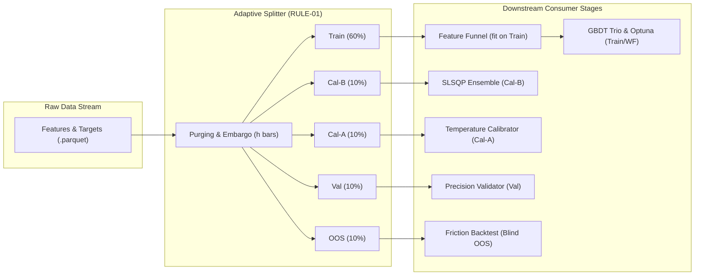

# System Architecture & Technical Specifications: Quant AutoML Pipeline

**System:** Quant AutoML Pipeline  
**Version:** `v1.0.0-PROD-SPEC`  
**Status:** Approved & Implemented (Phases 1–5 + Dual-Tier Realistic Backtest)  
**Standalone Diagrams:**
- 🌐 **Interactive HTML Diagram (Editorial Design):** [`docs/diagrams/architecture.html`](file:///mnt/Shares/GIT/the-new-algo/quantautoml/docs/diagrams/architecture.html)
- 📐 **Vector SVG Diagram:** [`docs/diagrams/architecture.svg`](file:///mnt/Shares/GIT/the-new-algo/quantautoml/docs/diagrams/architecture.svg)

---

## 1. System Overview & Core Philosophy

Quant AutoML Pipeline là hệ thống tự động hóa xây dựng mô hình dự báo alpha phục vụ giao dịch định lượng (Quantitative Trading). Kiến trúc hệ thống tuân thủ 4 nguyên tắc cốt lõi:

1. **Zero Look-ahead Leakage:** Cô lập tuyệt đối dữ liệu tương lai trước khi thực hiện bất kỳ phép tính toán nào. `fit()` chỉ được gọi trên tập Train.
2. **Metric Consistency & Mathematical Soundness:** Nhất quán tối ưu hóa theo Rank IC (Spearman), bảo toàn tính khả vi liên tục $C^2$ trong tối ưu hóa phi tuyến SLSQP và bảo toàn 100% thứ hạng (Rank Invariance) trong hiệu chuẩn xác suất Temperature Scaling.
3. **Earn Its Place & Anti-Overfitting:** Tích hợp kiểm soát đa giả thuyết FDR (Benjamini-Hochberg $\le 0.05$), phạt độ phức tạp mô hình, và áp dụng quy tắc Hurdle Rule $+5\%$ IC Sharpe cho mô hình Ensemble.
4. **Decoupled Low-Latency Inference:** Đóng gói độc lập sang chuẩn ONNX Model Bundle. File suy luận `predictor.py` không phụ thuộc vào framework huấn luyện nặng, đạt độ trễ suy luận $< 5.0\text{ ms/row}$.

---

## 2. End-to-End Pipeline Architecture Diagram

```mermaid
flowchart TD
    subgraph DataStage["Giai đoạn 1: Data Ingestion & Adaptive Temporal Split"]
        RawData["Raw Parquet / CSV\n(features & labels)"] --> Ingest["Ingestion & Timestamp Sync\n(UTC ISO-8601, float32, No Shuffle)"]
        Ingest --> SplitCheck{"Adaptive Check:\nN >= 10,000?"}
        SplitCheck -->|"Yes (N >= 10k)"| StaticSplit["Static 5-Way Split (Purging & Embargo)\nTrain 60% | Cal-A 10% | Cal-B 10% | Val 10% | OOS 10%"]
        SplitCheck -->|"No (N < 5k)"| OOFSplit["OOF-Assisted Split (Purging & Embargo)\nTrain 80% (OOF for Cal-A/B) | Val 10% | OOS 10%"]
    end

    subgraph FeatureStage["Giai đoạn 2: Leakage-Free Feature Funnel"]
        StaticSplit -->|"Train only: fit()\nAll: transform()"| Funnel["7-Stage Feature Funnel\nF1 (NaN/Inf) -> F2 (Variance) -> F3+7 (IC Stability & FDR) ->\nF4 (Fast dCor) -> F5 (Cluster) -> F6 (Regime) -> F8 (JMI)"]
        OOFSplit -->|"Train only: fit()\nAll: transform()"| Funnel
    end

    subgraph ModelStage["Giai đoạn 3: Tournament & Tuning"]
        Funnel -->|"Train (5-fold WF)"| Tourn["30-Trial Budget Tournament\n(Modern GBDT Trio: LightGBM, CatBoost, XGBoost)"]
        Tourn --> DecEng{"Decision Engine:\nDiversity < 0.88\nGain >= 1.5%\nWF Cons >= 60%?"}
        DecEng -->|"Yes"| EnsemblePool["Candidate Ensemble Pool\n(K <= 3 models)"]
        DecEng -->|"No"| SingleBest["Single Best Model"]
        EnsemblePool --> FullOptuna["Deep Optuna Tuning\n(TPE Multivariate + Hyperband)"]
        SingleBest --> FullOptuna
    end

    subgraph OptimizationStage["Giai đoạn 4: Ensemble & Calibration"]
        FullOptuna -->|"Cal-B (or OOF)"| SLSQP["Smooth SLSQP Optimization (N=200 Bootstrap)\nObjective: Pearson on Rank-Transformed Data (C2)\nBounds [0.05, 0.60] + Shrinkage 1/K"]
        SLSQP -->|"Cal-A (or OOF)"| Calib["Temperature Scaling (T > 0)\n100% Rank Invariant, ECE < 0.05"]
    end

    subgraph PackagingStage["Giai đoạn 5: Packaging & Dual-Tier Friction-Aware Acceptance"]
        Calib --> Bundle["ONNX Model Bundle Packaging\n(preprocessor.onnx, model_*.onnx, meta, schema, predictor.py)"]
        Bundle --> PrecisionCheck{"Numerical Precision\n|y_py - y_onnx| < 1e-4?"}
        PrecisionCheck -->|"Pass"| Tier1Test["Tier 1: Fast Vectorized OOS Acceptance (NumPy)\n+ Friction Matrix (Fee + Slippage)\n+ Hysteresis Buffer (Turnover Cap)\n+ Downside IC & Latency (< 5ms) Gate"]
        PrecisionCheck -->|"Fail"| ErrorStop["Raise PrecisionValidationError"]
        Tier1Test -->|"accepted = True"| Tier2Test["Tier 2: Realistic Execution Simulation (backtesting.py)\n+ Next-Bar Open Fill (trade_on_close=False)\n+ Interactive HTML Chart + trades.csv"]
        Tier1Test -->|"accepted = False"| Report["Production Artifacts & Acceptance Report (backtest_report.json)"]
        Tier2Test --> Report
    end
```

---

## 3. Data Flow & Temporal Isolation Architecture

---

## 4. Mathematical Formulations & Optimization Engines

### 4.1. Smooth SLSQP Objective ($C^2$ Differentiability)
Để loại bỏ bế tắc đạo hàm (Zero-Gradient trap) do hàm bậc thang của Spearman Rank IC, ma trận dự đoán được chuẩn hóa thứ hạng sang thang liên tục:
$$\tilde{Y}_i = \frac{\text{Rank}(\hat{Y}_i)}{N} \in [0, 1], \quad \tilde{Y}_{target} = \frac{\text{Rank}(Y_{true})}{N} \in [0, 1]$$
Tổ hợp dự đoán ensemble: $\hat{Y}_{ens}(w) = \sum_{i=1}^K w_i \tilde{Y}_i$.  
Hàm mục tiêu SLSQP được xây dựng qua hệ số tương quan Pearson khả vi liên tục cấp 2 ($C^2$):
$$\min_{w} \quad f(w) = - \frac{\text{Cov}(\hat{Y}_{ens}(w), \tilde{Y}_{target})}{\sigma_{\hat{Y}_{ens}(w)} \cdot \sigma_{\tilde{Y}_{target}}}$$
Thỏa mãn hệ ràng buộc:
$$\sum_{i=1}^K w_i = 1, \quad 0.05 \le w_i \le 0.60 \quad (\forall i \in [1, K])$$

### 4.2. Temperature Scaling & 100% Rank Invariance Contract (RULE-03)
Hiệu chuẩn xác suất thực hiện trên tập `Cal-A` qua tham số nhiệt độ duy nhất $T > 0$:
$$\hat{P}_i = \sigma\left(\frac{z_i}{T}\right) = \frac{1}{1 + e^{-z_i / T}}$$
Do $g(z) = z/T$ và hàm sigmoid $\sigma(u)$ đồng biến nghiêm ngặt trên $\mathbb{R}$:
$$\forall a, b: \quad z_a > z_b \iff \sigma\left(\frac{z_a}{T}\right) > \sigma\left(\frac{z_b}{T}\right)$$
$\implies$ **Rank IC trước và sau khi hiệu chuẩn xác suất là đồng nhất $100\%$:**
$$\text{Rank IC}(\hat{P}, Y) \equiv \text{Rank IC}(z, Y)$$

### 4.3. Multi-Horizon Term Structure & FDR Control (RULE-08)
Với $M$ features ứng viên, p-values kiểm định giả thuyết được sắp xếp tăng dần: $p_{(1)} \le p_{(2)} \le \dots \le p_{(M)}$.  
Ngưỡng phát hiện sai Benjamini-Hochberg tại mức ý nghĩa $\alpha = 0.05$:
$$k = \max \left\{ i : p_{(i)} \le \frac{i}{M} \alpha \right\}$$
Ràng buộc đơn điệu cấu trúc kỳ hạn (Term Structure Monotonicity):
$$\text{ICIR}(h=1) \ge \text{ICIR}(h=5) \ge \text{ICIR}(h=10) \ge \text{ICIR}(h=21) - \epsilon_{tolerance}$$

### 4.4. Friction Cost Matrix & Hysteresis Buffer (RULE-09)
Lợi nhuận ròng của danh mục sau ma sát thị trường:
$$R_{net, t} = R_{gross, t} - \text{Turnover}_t \times (\text{Fee}_{bps} + \text{Slippage}_{bps})$$
Trong đó $\text{Turnover}_t = \frac{1}{2} \sum_j |w_{j, t} - w_{j, t^-}|$.  
**Dải đệm trễ (Hysteresis Buffer):** Vị thế trong Top 20% chỉ bị loại nếu thứ hạng tụt xuống dưới phân vị $30\%$, giúp giảm $40-60\%$ phí giao dịch và trượt giá thực tế.

---

## 5. Technology Stack & Component Topology

| Layer / Component | Technology | Trách nhiệm kiến trúc |
| :--- | :--- | :--- |
| **Runtime & Language** | Python $\ge 3.12$ | Tối ưu hiệu năng CPU, type hints tĩnh 100%. |
| **Data Ingestion** | `polars`, `numpy` (`np.float32`) | Đọc parquet siêu tốc, đồng bộ UTC ISO-8601 không tạo bản sao. |
| **Feature Analytics** | `scipy.stats`, `scikit-learn` | Fast Distance Correlation, Benjamini-Hochberg FDR, Clustering. |
| **GBDT Trio Pool** | `lightgbm`, `catboost`, `xgboost` | Huấn luyện tabular quant, kích thước model nhỏ, tối ưu Rank IC. |
| **Hyperparameter Tuning** | `optuna` (TPE Multivariate) | Tối ưu hóa Bayesian đa biến kết hợp tỉa sớm Hyperband. |
| **Convex Optimizer** | `scipy.optimize` (SLSQP) | Tối ưu hóa lồi có ràng buộc hộp với hàm Pearson Rank $C^2$. |
| **Inference Packaging** | `onnx`, `onnxruntime` | Xuất Model Bundle siêu nhẹ, độc lập nền tảng, độ trễ $< 5.0\text{ ms}$. |
| **Testing & CI Gates** | `pytest`, `pytest-cov` | Kiểm thử TDD, bảo đảm không rò rỉ dữ liệu và sai số số học $< 10^{-4}$. |

---

## 6. Visual Diagrams Gallery

Để xem bản vẽ kiến trúc trực quan có thể tương tác hoặc chèn vào slide báo cáo:
- Mở [`docs/diagrams/architecture.html`](file:///mnt/Shares/GIT/the-new-algo/quantautoml/docs/diagrams/architecture.html) trên trình duyệt.
- Sử dụng file vector [`docs/diagrams/architecture.svg`](file:///mnt/Shares/GIT/the-new-algo/quantautoml/docs/diagrams/architecture.svg) cho tài liệu in ấn hoặc vector editor.
