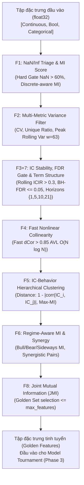

# Feature Funnel Specification & Policies: Quant AutoML Pipeline

Tài liệu này cung cấp đặc tả kỹ thuật chi tiết cho phễu lọc tính năng thông minh 7 tầng (**Feature Funnel: F1 $\to$ F2 $\to$ F3+7 $\to$ F4 $\to$ F5 $\to$ F6 $\to$ F8**), bao gồm các công thức toán học, ngưỡng lọc, cơ chế kiểm soát rò rỉ dữ liệu và chính sách xử lý đặc thù cho từng loại đặc trưng (Continuous, Boolean, Categorical).

---

## 1. Kiến Trúc Tổng Thể & Luồng Dữ Liệu (Funnel Architecture)

Phễu thanh lọc tính năng được thiết kế theo nguyên tắc **Single Responsibility Principle (SRP)** và tuân thủ tuyệt đối quy tắc **Zero Look-Ahead Leakage (RULE-01)**:
- **`fit()`** chỉ được nhận phân đoạn **Train** của dữ liệu.
- Mọi phân đoạn khác (**Cal-A, Cal-B, Val, OOS**) chỉ được gọi **`transform()`** theo đúng metadata và tham số đã học được từ Train.
- Dữ liệu đầu vào và đầu ra của mọi bộ lọc luôn đảm bảo chuẩn số học **`np.float32` (RULE-06)**.



---

## 2. Đặc Tả Chi Tiết 7 Tầng Lọc Tính Năng

### 2.1. Tầng F1: NaN/Inf Triage & MI Score (`triage.py`)
- **Mục tiêu:** Dọn dẹp dữ liệu bất thường ($\pm\text{Inf}$), loại bỏ đặc trưng rác thiếu hụt trầm trọng, phân loại cơ chế thiếu hụt (MCAR/MAR/MNAR) và chấm điểm chất lượng ban đầu.
- **Quy tắc & Ngưỡng:**
  - Thay thế $\pm\text{Inf} \to \text{NaN}$.
  - **Hard Gate:** Loại bỏ bất kỳ cột nào có $\text{NaN\_Ratio} > \text{max\_nan\_ratio}$ (mặc định $0.60$) hoặc toàn bộ giá trị là $\text{NaN}$.
  - **Điểm số chất lượng:** $\text{Score} = \text{MI}(X, Y) \times (1 - \text{NaN\_Ratio})$.
- **Chính sách phân loại Missing:**
  - `MNAR` (Missing Not At Random) nếu $\text{MI}(\text{indicator}, Y) > \text{indicator\_mi\_min}$.
  - `MAR` (Missing At Random) nếu $\max |\text{Spearman}(\text{indicator}, X_{\text{other}})| > 0.30$.
  - Còn lại là `MCAR` (Missing Completely At Random).
  - Chỉ các cột `MNAR` và `MAR` mới sinh thêm cột chỉ báo $\text{is\_nan\_<col>}$ ($0.0 / 1.0$).
- **Chính sách xử lý biến Boolean & Categorical:**
  - **Không bỏ qua (No Skip):** Biến bool và categorical vẫn phải chịu kiểm tra Hard Gate bình đẳng để dọn sạch dữ liệu rác.
  - **Tối ưu hóa MI rời rạc:** Nhận biết danh sách `discrete_features` từ `FitContext` (truy xuất từ `IngestionReport.bool_cols` và `string_maps.keys()`), truyền mask vào `mutual_info_classif(..., discrete_features=mask)` để tính toán MI theo phân phối xác suất rời rạc giải tích, tránh sai số do xấp xỉ $k$-NN liên tục và tăng tốc độ $3-5$ lần.
  - **Chống cột đối ngẫu trùng lặp (Anti-Dual Indicator):** Với biến boolean vốn chỉ có một giá trị kèm $\text{NaN}$ (ví dụ chỉ có $\{1.0, \text{NaN}\}$ hoặc $\{0.0, \text{NaN}\}$), không sinh thêm cột $\text{is\_nan\_<col>}$ (để tránh tạo bản sao đối ngẫu $1 - X$), mà chỉ impute giá trị bù đối ứng ($0.0$ hoặc $1.0$).

---

### 2.2. Tầng F2: Multi-Metric Variance Check (`variance.py`)
- **Mục tiêu:** Loại bỏ các đặc trưng hằng số, gần như không biến thiên, hoặc có biến động phương sai cục bộ bất thường.
- **Quy tắc & Ngưỡng:**
  - **Hệ số biến thiên:** $|CV| = \frac{\sigma}{\max(|\mu|, \epsilon)} < \text{min\_cv}$ ($10^{-6}$) $\to$ Loại.
  - **Tỷ lệ giá trị duy nhất:** Nếu $n_{\text{unique}} < 2$ $\to$ Loại. Nếu $n_{\text{unique}} > 2$ và $\frac{n_{\text{unique}}}{N} < \text{min\_unique\_ratio}$ ($0.01$) $\to$ Loại. *(Lưu ý: Biến nhị phân cân bằng có $n_{\text{unique}}=2$ được miễn trừ quy tắc unique_ratio)*.
  - **Đột biến phương sai cuộn:** $\text{peak\_var\_ratio} = \frac{\text{Percentile}_{90}(\text{Var}_{w=63})}{\text{Var}_{\text{train}}} > \text{max\_peak\_var\_ratio}$ ($50.0$) $\to$ Loại.

---

### 2.3. Tầng F3+7: IC Stability, FDR Gate & Term Structure (`ic_stability.py`)
- **Mục tiêu:** Đảm bảo khả năng dự báo bền vững theo thời gian, kiểm soát đa giả thuyết (FDR) và kiểm tra tính đơn điệu của cấu trúc kỳ hạn.
- **Quy tắc & Ngưỡng:**
  1. **ICIR trên Target Horizon:** $\text{ICIR}(h_{\text{target}}) = \frac{\text{Mean}(\text{Rolling\_IC})}{\text{Std}(\text{Rolling\_IC})} > \text{icir\_min}$ ($0.30$) với cửa sổ cuộn $w=63$. Dấu của IC phải đồng nhất qua các kỳ hạn.
  2. **Kiểm soát đa giả thuyết Benjamini-Hochberg (RULE-08):**
     $$p_{(1)} \le p_{(2)} \le \dots \le p_{(M)}, \quad k = \max \left\{ i : p_{(i)} \le \frac{i}{M} \alpha \right\} \quad (\alpha = 0.05)$$
     Chỉ giữ các feature có $p \le p_{(k)}$.
  3. **Cấu trúc kỳ hạn đơn điệu (Term Structure Monotonicity):** Trên các horizons $\{1, 5, 10, 21\}$, mức độ thông tin phải suy giảm tự nhiên:
     $$|\text{ICIR}(h_i)| \ge |\text{ICIR}(h_{i+1})| - \epsilon_{\text{tolerance}} \quad (\epsilon = 0.05)$$

---

### 2.4. Tầng F4: Fast Nonlinear Collinearity (`collinearity.py`)
- **Mục tiêu:** Loại bỏ đặc trưng đa cộng tuyến phi tuyến mà Pearson/Spearman bỏ sót.
- **Phương pháp:** Tính Distance Correlation bằng thuật toán Fast AVL $\mathcal{O}(N \log N)$ (thông qua thư viện `dcor`).
- **Quy tắc:**
  - Nếu $\text{dCor}(X_i, X_j) > \text{dcor\_threshold}$ ($0.85$):
  - So sánh $|Rank IC(h_{\text{target}})|$ giữa 2 đặc trưng; loại bỏ đặc trưng có IC thấp hơn.
  - Duyệt tham lam từ feature có $|Rank IC|$ cao nhất, độ phức tạp $\mathcal{O}(F \cdot K)$, không bao giờ tạo ma trận $N \times N$.

---

### 2.5. Tầng F5: IC-Behavior Hierarchical Clustering (`clustering.py`)
- **Mục tiêu:** Gom cụm các chỉ báo có hành vi dự báo biến thiên đồng pha theo thời gian, tránh nhồi nhét nhiều biến thể của cùng một họ tín hiệu.
- **Phương pháp:**
  - Ma trận đặc trưng: Chuỗi $\text{Rolling\_IC}_{w=63}(t)$ của từng feature trên target horizon.
  - Khoảng cách hành vi: $d(i, j) = 1 - |\text{corr}(\text{IC}_i, \text{IC}_j)|$.
  - Thuật toán gom cụm: `scipy.cluster.hierarchy.linkage(method="average")` kết hợp `fcluster(criterion="distance", t=0.30)`.
  - Trong mỗi cụm, chọn **1 đại diện duy nhất** có $\text{MI}(X, Y)$ cao nhất (hòa $\to$ chọn $|Rank IC|$ cao hơn).

---

### 2.6. Tầng F6: Regime-Aware MI & Synergy Detection (`regime_synergy.py`)
- **Mục tiêu:** Bảo vệ các đặc trưng chuyên biệt cho từng pha thị trường và các cặp tương tác phi tuyến (Synergy / XOR).
- **Quy tắc:**
  1. **Xác định Regime:** Chia Bull ($+1$), Bear ($-1$), Sideways ($0$) dựa trên tỷ suất lợi nhuận $h=1$ đã realized ($\text{ret}_{h1}[:t]$ dịch 1 nến), ngưỡng $\pm 0.5\sigma$ trên cửa sổ $w=63$.
  2. **Regime MI Floor:** Giữ lại feature nếu $\max_{\text{regime}} \text{MI}_{\text{regime}}(X, Y) \ge \text{mi\_floor}$ (bảo vệ feature chỉ hiệu quả khi Bear hoặc Sideways).
  3. **Cặp Hiệp Đồng (Synergy Gate):** Phát hiện cặp $(X_i, X_j)$ thỏa mãn:
     $$I(X_i, X_j; Y) - I(X_i; Y) - I(X_j; Y) > \text{synergy\_delta}$$
     Cả 2 feature thuộc cặp hiệp đồng sẽ được tự động bảo vệ qua vòng này.

---

### 2.7. Tầng F8: Joint Mutual Information Selector (`jmi.py`)
- **Mục tiêu:** Chọn lọc tập đặc trưng tối ưu cuối cùng (Golden Feature Set) tối đa hóa lượng thông tin bổ sung và phạt trùng lặp.
- **Thuật toán JMI:**
  - Bước 1: Chọn feature đầu tiên có $\text{MI}(X, Y)$ cao nhất.
  - Bước $k$: Chọn feature $f \notin S$ tối đa hóa:
    $$J(f) = \sum_{s \in S} I(f, s; Y)$$
  - Dừng lại khi số lượng đạt $\min(\text{max\_features}, n_{\text{features}})$ (mặc định $\text{max\_features} = 30$).

---

## 3. Báo Cáo Phễu Lọc (Funnel Reporting)

Mỗi tầng lọc trả về một đối tượng `FilterReport`:
```python
@dataclass(frozen=True)
class FilterReport:
    stage: str                  # Tên tầng lọc (F1, F2, ...)
    n_in: int                   # Số lượng feature nhận vào
    n_out: int                  # Số lượng feature sống sót
    dropped: dict[str, str]     # Ánh xạ: tên feature -> lý do bị loại
    notes: tuple[str, ...] = () # Ghi chú vận hành (cảnh báo, missing kind, ...)
```

Khi kết thúc pipeline, toàn bộ kết quả lọc được ghi ra artifact `funnel_report.json` và `selected_features.json` để phục vụ audit và kiểm tra suy luận độc lập.
