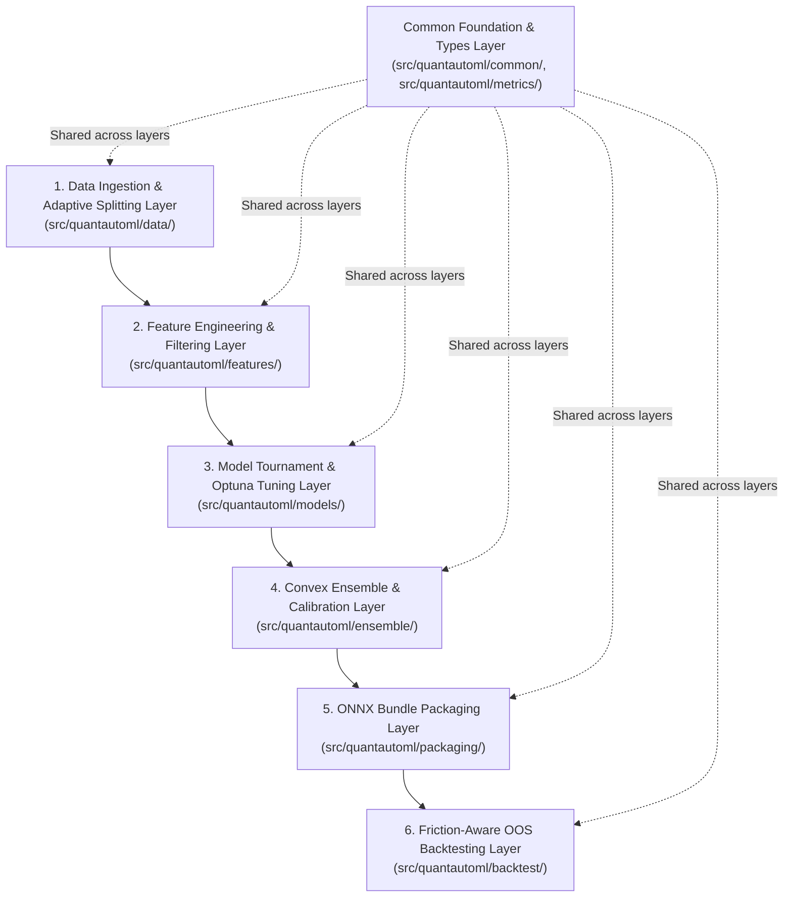

# Repository & Codebase Structure: Quant AutoML Pipeline

Tài liệu này cung cấp bản đồ cấu trúc tổng thể của repository `quantautoml`, phân chia các tầng kiến trúc (Architectural Layers), trách nhiệm từng module (Single Responsibility) và quy tắc phụ thuộc (Dependency Rules).

---

## 1. Cây Thư Mục Tổng Thể (Repository Layout)

```
quantautoml/
├── .gitignore
├── pyproject.toml                    # Cấu hình dự án, dependencies, build tool (Hatchling/Flit/UV)
├── README.md                         # Giới thiệu dự án, hướng dẫn cài đặt và sử dụng nhanh
├── docs/                             # Tài liệu kỹ thuật dự án
│   ├── STRUCTURE.md                  # Tài liệu này: Bản đồ cấu trúc thư mục & kiến trúc
│   ├── CONFIGURATION.md              # Cấu hình pipeline và tham số
│   ├── FEATURES.md                   # Danh mục và đặc tả các bộ lọc tính năng
│   ├── .ai/                          # Quy chuẩn dành cho AI Coding Agents
│   │   ├── AI_AGENT_GUIDELINE.md     # Hướng dẫn vai trò, tư duy và workflow của Agent
│   │   ├── GIT_CONVENTIONS.md        # Chuẩn commit, branching và vệ sinh git
│   │   └── RULES.md                  # Các quy tắc bất biến (Hard Gates) của dự án
│   └── plan/                         # Kế hoạch triển khai mô-đun hóa (Modular Planning)
│       ├── SCOPE.md                  # Phạm vi, mục tiêu và tiêu chí thành công
│       ├── PHASES.md                 # 5 giai đoạn phát triển sub-systems độc lập
│       ├── STRUCTURE.md              # Thiết kế chi tiết tầng module nguồn
│       ├── ARCHITECTURE.md           # Thiết kế kiến trúc, công thức toán học & data flow
│       ├── TRADE-OFF.md              # Phân tích đánh đổi kỹ thuật & cơ sở toán học
│       └── PLAN.md                   # Kế hoạch thực thi chi tiết cho phase đang active (Phase 1)
├── src/                              # Mã nguồn chính của thư viện
│   └── quantautoml/
│       ├── __init__.py               # Public API package exports
│       ├── common/                   # Kiểu dữ liệu, cấu hình và ngoại lệ dùng chung
│       │   ├── __init__.py
│       │   ├── exceptions.py         # Custom exceptions (DataLeakageError, PrecisionValidationError)
│       │   └── types.py              # Enums (TaskType, SplitMode), Pydantic Schemas, Dataclasses
│       ├── data/                     # Tầng nạp, đồng bộ và phân chia chuỗi thời gian
│       │   ├── __init__.py
│       │   ├── ingestion.py          # Đọc parquet/csv, đồng bộ timestamp UTC ISO-8601, ép kiểu float32
│       │   ├── task_inference.py     # Suy luận bài toán Binary/Multiclass/Unsupervised từ nhãn Y
│       │   └── splitter.py           # Adaptive Temporal Splitter (5-way vs OOF) kèm Purging & Embargo
│       ├── metrics/                  # Tầng tính toán chỉ số định lượng & thống kê
│       │   ├── __init__.py
│       │   ├── ic.py                 # Rank IC (Spearman), ICIR, IC Sharpe, Rolling IC, Downside IC
│       │   ├── fdr.py                # Kiểm soát tỷ lệ phát hiện sai Benjamini-Hochberg (FDR)
│       │   └── calibration.py        # Đánh giá sai số hiệu chuẩn xác suất (ECE - Expected Calibration Error)
│       ├── features/                 # Tầng phễu lọc tính năng thông minh chống rò rỉ (F1 -> F8)
│       │   ├── __init__.py
│       │   ├── base.py               # BaseFeatureFilter (Hợp đồng: fit trên Train, transform trên all)
│       │   ├── triage.py             # F1: NaN/Inf Triage, MCAR/MAR/MNAR indicator, MI score
│       │   ├── variance.py           # F2: Multi-Metric Variance Check (CV, PeakVar, UniqueRatio)
│       │   ├── ic_stability.py       # F3+7: Rolling IC Stability, Multi-Horizon Term Structure & FDR Gate
│       │   ├── collinearity.py       # F4: Fast Distance Correlation (dCor O(N log N) / Subsampling)
│       │   ├── clustering.py         # F5: IC-Behavior Hierarchical Clustering với Max-MI
│       │   ├── regime_synergy.py     # F6: Regime-Aware MI & Synergistic Pairs Detection
│       │   ├── jmi.py                # F8: Joint Mutual Information feature selection
│       │   └── funnel.py             # FeatureFunnel điều phối tuần tự 7 tầng lọc không rò rỉ
│       ├── models/                   # Tầng đấu loại mô hình & tối ưu siêu tham số
│       │   ├── __init__.py
│       │   ├── candidates.py         # Modern GBDT Trio wrappers (LightGBM, CatBoost, XGBoost)
│       │   ├── tournament.py         # 30-trials budget tournament trên 5-fold Walk-Forward
│       │   ├── decision_engine.py    # Quyết định Single vs Ensemble (Diversity, Marginal Gain, WF)
│       │   └── tuner.py              # Full Optuna TPE Multivariate + HyperbandPruner
│       ├── ensemble/                 # Tầng tối ưu hóa trọng số lồi & hiệu chuẩn xác suất
│       │   ├── __init__.py
│       │   ├── slsqp.py              # Tối ưu lồi SLSQP trên Cal-B (Rank-Transformed Pearson C^2 objective)
│       │   ├── bootstrap.py          # Bootstrap SLSQP (N=200), Median weight & Shrinkage về 1/K
│       │   └── calibration.py        # Probability Calibration (Temperature Scaling / Platt) trên Cal-A
│       ├── packaging/                # Tầng đóng gói phân phối chuẩn ONNX Model Bundle
│       │   ├── __init__.py
│       │   ├── bundle.py             # Xuất gói Model Bundle (.onnx, meta, schema, predictor.py)
│       │   ├── schema.py             # Sinh và kiểm tra features_schema.json (Data Contract)
│       │   ├── validator.py          # Kiểm tra sai số số học float32 (|y_py - y_onnx| < 10^-4)
│       │   └── templates/
│       │       └── predictor_template.py # Mã nguồn predictor.py siêu nhẹ (~50 dòng numpy/onnxruntime)
│       └── backtest/                 # Tầng nghiệm thu chiến lược mù độc lập trên tập OOS
│           ├── __init__.py
│           ├── friction.py           # Mô hình hóa ma trận chi phí (Taker Fee + Slippage) & Turnover
│           ├── buffer.py             # Dải đệm trễ Hysteresis Buffer Bands kiểm soát vòng quay danh mục
│           ├── evaluator.py          # Tính toán Net Sharpe, MDD, OOS IC và Downside IC
│           └── runner.py             # Kịch bản chạy backtest độc lập trên tập OOS
├── tests/                            # Bộ kiểm thử tự động (Pytest)
│   ├── conftest.py                   # Pytest fixtures tạo dữ liệu tài chính giả lập
│   ├── unit/                         # Unit tests cho từng module riêng lẻ
│   └── integration/                  # Integration tests (Zero Leakage, End-to-End, Friction Backtest)
├── datasets/                         # Thư mục chứa dữ liệu mẫu local (được .gitignore bảo vệ)
└── examples/                         # Ví dụ minh họa cách sử dụng pipeline từ file script hoặc notebook
```

---

## 2. Các Tầng Kiến Trúc & Luồng Dữ Liệu (Layer Architecture)

Hệ thống được thiết kế theo mô hình luồng đơn hướng (Unidirectional Data Flow), đi qua 6 tầng chính:



---

## 3. Ma Trận Phân Định Trách Nhiệm Module (Responsibility Matrix)

| Module / Package | Trách Nhiệm Duy Nhất (Single Responsibility) | Các Ký Hiệu Xuất Bản (Exported Symbols) | Phụ Thuộc Hợp Lệ (Allowed Dependencies) |
| :--- | :--- | :--- | :--- |
| `common` | Định nghĩa các kiểu dữ liệu lõi, schemas, enums và custom exceptions. | `TaskType`, `SplitMode`, `SplitResult`, `QuantAutoMLError`, `DataLeakageError` | Thư viện chuẩn, `pydantic` |
| `metrics` | Cung cấp các hàm toán học đo lường hiệu năng định lượng, kiểm định giả thuyết và đo sai số calibration. | `calc_rank_ic()`, `calc_ic_sharpe()`, `apply_fdr_correction()`, `calc_ece()` | `numpy`, `scipy.stats` |
| `data` | Đọc dữ liệu, đồng bộ hóa chuỗi thời gian, suy luận bài toán và chia dữ liệu chống rò rỉ. | `DataIngestion`, `infer_task_type()`, `AdaptiveTimeSeriesSplitter` | `polars`, `pandas`, `numpy`, `common` |
| `features` | Triển khai 7 tầng lọc tính năng thông minh, cam kết chỉ `fit()` trên Train và `transform()` trên các tập còn lại. | `BaseFeatureFilter`, `FeatureFunnel`, các bộ lọc `triage`, `variance`, `collinearity`... | `numpy`, `scipy`, `sklearn`, `common`, `metrics` |
| `models` | Quản lý pool mô hình GBDT Trio, tổ chức đấu loại 30 trials và tối ưu siêu tham số bằng Optuna. | `GBDTTrioPool`, `ModelTournament`, `EnsembleDecisionEngine`, `DeepOptunaTuner` | `lightgbm`, `catboost`, `xgboost`, `optuna`, `common`, `metrics` |
| `ensemble` | Tối ưu hóa trọng số lồi SLSQP khả vi $C^2$ trên Cal-B và hiệu chuẩn xác suất bằng Temperature Scaling trên Cal-A. | `SmoothSLSQPOptimizer`, `BootstrapShrinkageEnsemble`, `TemperatureCalibrator` | `scipy.optimize`, `numpy`, `common`, `metrics` |
| `packaging` | Xuất toàn bộ mô hình và tiền xử lý thành ONNX Model Bundle độc lập, kiểm tra sai số số học $< 10^{-4}$. | `ONNXBundleExporter`, `validate_numerical_precision()`, `FeatureSchemaContract` | `onnx`, `onnxruntime`, `common` |
| `backtest` | Mô phỏng danh mục thực tế có tính phí giao dịch, trượt giá và dải đệm trễ để nghiệm thu độc lập trên OOS. | `FrictionCostModel`, `HysteresisBuffer`, `evaluate_oos_performance()`, `OOSBacktestRunner` | `numpy`, `pandas`, `common`, `metrics` |

---

## 4. Quy Tắc Ranh Giới & Phụ Thuộc (Boundaries & Coupling Rules)

1. **Ranh giới phụ thuộc một chiều (No Cyclic Dependencies):**
   - Tầng `common` và `metrics` là nền móng, không được phép import bất kỳ module nào thuộc các tầng bên trên (`data`, `features`, `models`, `ensemble`, `packaging`, `backtest`).
   - Tầng `packaging` và `backtest` là tầng cuối cùng, chỉ sử dụng artifacts và interface của các tầng trước.
2. **Quy tắc cô lập Engine suy luận (Inference Decoupling):**
   - File template `src/quantautoml/packaging/templates/predictor_template.py` khi xuất ra thành `predictor.py` phải **hoàn toàn độc lập** với toàn bộ thư viện `quantautoml`. Nó chỉ phụ thuộc vào `numpy` và `onnxruntime` để đảm bảo có thể copy sang bất kỳ production service nào mà không cần cài đặt toàn bộ pipeline.
3. **Quy tắc bất biến rò rỉ dữ liệu:**
   - Mọi phương thức `fit()` trong `src/quantautoml/features/` và `src/quantautoml/models/` chỉ được nhận dữ liệu của tập `Train`. Bất kỳ hành vi truyền dữ liệu của `Val`, `Cal`, hoặc `OOS` vào `fit()` đều là lỗi kiến trúc nghiêm trọng.
