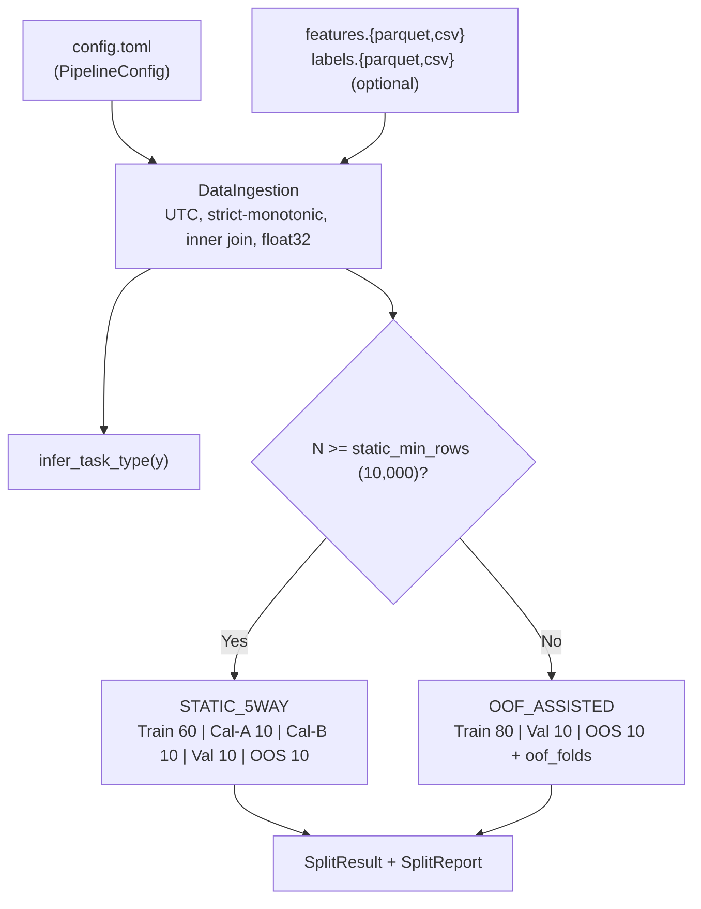

# Step 01 — Design: Ingestion & Adaptive Temporal Split

## Data flow



## 1. Input

`PipelineConfig` (Pydantic v2, nạp từ TOML — xem `docs/CONFIGURATION.md`):

| Trường | Ý nghĩa |
| :--- | :--- |
| `data.features_path`, `data.labels_path` | Đường dẫn file; `labels_path` có thể vắng → Unsupervised |
| `data.timestamp_col` | Tên cột timestamp (mặc định `timestamp`) |
| `data.min_match_ratio` | Tỷ lệ timestamp khớp tối thiểu khi inner join (mặc định 0.95) |
| `labels.selected` | Cột nhãn mục tiêu; các cột nhãn khác thành `labels_aux` |
| `split.horizon_h` | Horizon lớn nhất (số nến) của mọi cột nhãn; $\ge 1$ |

Hằng số trong code (không cấu hình): `STATIC_MIN_ROWS = 10_000`, `MIN_ROWS = 500`, `OOF_N_FOLDS = 5`, tỷ lệ chia.

## 2. Xử lý

### 2.1 DataIngestion
1. Đọc bằng polars → numpy. Timestamp → UTC `datetime64[ns]` (naive coi là UTC, ghi vào report).
2. Từng file: timestamp tăng nghiêm ngặt, không trùng, nếu không → `TimestampAlignmentError`. Không tự sort.
3. Inner join; tỷ lệ khớp < `min_match_ratio` → `TimestampAlignmentError`.
4. Feature phải là số; cast `float32`; cast gây tràn thành Inf → `InvalidDataError`. NaN/Inf gốc giữ nguyên.
5. `labels.selected` phải tồn tại, nếu không → `InvalidDataError` (kèm danh sách cột).
6. Nhãn forward-looking: kiểm tra số NaN cuối lớn nhất của mọi cột nhãn $\le$ `horizon_h`, nếu không → `InvalidDataError`.
7. Nhãn chọn: NaN cuối bị drop (dòng bị drop khỏi toàn bộ dataset); NaN giữa → `InvalidDataError`. Nhãn phụ giữ nguyên NaN.

### 2.2 infer_task_type(y)

| Điều kiện | Kết quả |
| :--- | :--- |
| `y is None` | `UNSUPERVISED` |
| 2 giá trị unique | `BINARY_CLASSIFICATION` (remap về {0,1}, lưu `classes_`) |
| 3–10 giá trị unique, đều nguyên | `MULTICLASS_CLASSIFICATION` |
| 1 giá trị unique, hoặc >10 / không nguyên | `InvalidDataError` |

### 2.3 AdaptiveTimeSeriesSplitter
- Điểm cắt $c_i = \text{round}(N \cdot \text{cumulative ratio})$.
- Segment đầu: $[0, c_1)$. Segment sau: $[c_{i-1} + h, c_i)$ — bỏ `h` dòng đầu (purge). Lý do: nhãn dòng cuối segment trước nhìn tới $h$ nến phía sau.
- OOF: Train chia 6 block; fold $k$ train trên block $0..k$, validate trên block $k+1$ bỏ `h` dòng đầu.
- Hậu điều kiện (vi phạm → `DataLeakageError`): segment không rỗng; `index` tăng và không chồng lấn; khoảng trống giữa hai segment liền kề đúng bằng `h` dòng; mỗi fold OOF có `min(val_idx) - max(train_idx) - 1 >= h`.

## 3. Output

```python
@dataclass(frozen=True)
class Segment:
    X: np.ndarray                    # (n, F) float32
    y: np.ndarray | None             # int32; None nếu Unsupervised
    labels_aux: dict[str, np.ndarray]  # float32, giữ NaN
    timestamps: np.ndarray           # datetime64[ns]
    index: np.ndarray                # vị trí gốc trong Dataset

@dataclass(frozen=True)
class Dataset:
    X; y; labels_aux; timestamps; feature_names; task_type; classes_; selected_label
    report: IngestionReport

@dataclass(frozen=True)
class SplitResult:
    mode: SplitMode
    train: Segment; val: Segment; oos: Segment
    cal_a: Segment | None; cal_b: Segment | None        # chỉ STATIC_5WAY
    oof_folds: list[tuple[np.ndarray, np.ndarray]] | None  # chỉ OOF_ASSISTED
    report: SplitReport
```

## 4. Report (dataclass + `to_dict()` + `logging`)

- `IngestionReport`: số dòng features / labels / sau join / bị loại; số dòng nhãn NaN cuối bị drop; timezone gốc và cờ naive→UTC; số feature; đếm NaN/Inf; `[t_min, t_max]`; số NaN từng cột nhãn; NaN cuối lớn nhất so với `horizon_h`.
- `SplitReport`: `mode`, `N`, `h`; mỗi segment: số dòng, `t_start`, `t_end`; số dòng bị bỏ ở mỗi ranh giới; phân phối lớp từng segment (cảnh báo nếu mất một lớp); OOF: kích thước từng fold.

## 5. Exceptions (kế thừa `QuantAutoMLError`)

| Lỗi | Khi nào |
| :--- | :--- |
| `InvalidDataError` | Feature không phải số, cast tràn, nhãn không hợp lệ, `selected` không tồn tại, N quá nhỏ, `h` làm segment rỗng, NaN cuối > `horizon_h` |
| `TimestampAlignmentError` | Timestamp không tăng nghiêm ngặt, trùng, tỷ lệ khớp thấp |
| `DataLeakageError` | Hậu điều kiện splitter bị vi phạm |

## Source layout

```
src/quantautoml/
├── common/
│   ├── exceptions.py   # QuantAutoMLError, InvalidDataError, TimestampAlignmentError, DataLeakageError
│   ├── types.py        # TaskType, SplitMode, Segment, Dataset, SplitResult, IngestionReport, SplitReport
│   └── config.py       # PipelineConfig (Pydantic) + load_config(path) từ TOML
└── data/
    ├── ingestion.py
    ├── task_inference.py
    └── splitter.py
tests/
├── conftest.py
├── unit/  test_types.py, test_config.py, test_ingestion.py, test_task_inference.py, test_splitter.py
└── integration/  test_zero_leakage.py
```

## Design rule

- **Ranh giới Fit / Transform:** `fit()` chỉ nhận tập Train; `transform()` áp dụng cho mọi tập mà không đổi internal state (xem [`../02-feature-selection/DESIGN.md`](../02-feature-selection/DESIGN.md)).
