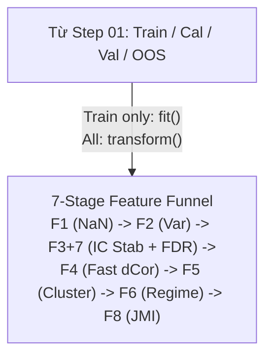

# Step 02 — Design: Feature Funnel

## Data flow



## Multi-Horizon Term Structure & FDR Control

Với tập các features ứng viên, p-values của các kiểm định giả thuyết được sắp xếp: $p_{(1)} \le p_{(2)} \le \dots \le p_{(M)}$.
Ngưỡng phát hiện sai Benjamini-Hochberg tại mức ý nghĩa $\alpha = 0.05$:
$$k = \max \left\{ i : p_{(i)} \le \frac{i}{M} \alpha \right\}$$
Điều kiện cấu trúc kỳ hạn (Term Structure Monotonicity):
$$\text{ICIR}(h=1) \ge \text{ICIR}(h=5) \ge \text{ICIR}(h=10) \ge \text{ICIR}(h=21) - \epsilon_{tolerance}$$

## Source layout

```
src/quantautoml/
├── metrics/
│   ├── ic.py                 # Rank IC (Spearman), ICIR, IC Sharpe, Rolling IC, Downside IC
│   ├── fdr.py                # Benjamini-Hochberg False Discovery Rate correction
│   └── calibration.py        # Expected Calibration Error (ECE) — dùng ở Step 05
└── features/
    ├── base.py               # BaseFeatureFilter interface (fit trên Train, transform trên all)
    ├── triage.py             # F1: NaN/Inf Triage, MCAR/MAR/MNAR indicator, MI score
    ├── variance.py           # F2: Multi-Metric Variance Check (CV, PeakVar, UniqueRatio)
    ├── ic_stability.py       # F3+7: Rolling IC Stability, Multi-Horizon Term Structure & FDR Gate
    ├── collinearity.py       # F4: Fast Distance Correlation (dCor O(N log N) / Subsampling)
    ├── clustering.py         # F5: IC-Behavior Hierarchical Clustering với Max-MI
    ├── regime_synergy.py     # F6: Regime-Aware MI & Synergistic Pairs Detection
    ├── jmi.py                # F8: Joint Mutual Information feature selection
    └── funnel.py             # FeatureFunnel pipeline điều phối 7 bộ lọc
tests/unit/  test_fast_dcor.py, test_fdr.py, test_feature_filters.py
```

## Responsibilities

| Module / File | Trách nhiệm duy nhất | Interface / Exports chính | Dependencies |
| :--- | :--- | :--- | :--- |
| `metrics/fdr.py` | Kiểm soát tỷ lệ phát hiện sai (False Discovery Rate) theo Benjamini-Hochberg. | `apply_fdr_correction()` | `numpy`, `scipy` |
| `features/collinearity.py` | Lọc cộng tuyến phi tuyến bằng Fast Distance Correlation ($\mathcal{O}(N \log N)$). | `FastNonlinearCollinearityFilter` | `numpy`, `scipy` |

## Design rule

- **Ranh giới Fit / Transform:** Phương thức `fit()` chỉ nhận tập Train; `transform()` áp dụng cho mọi tập mà không thay đổi internal state. Truyền dữ liệu của `Val`, `Cal`, `OOS` vào `fit()` là lỗi kiến trúc nghiêm trọng.
