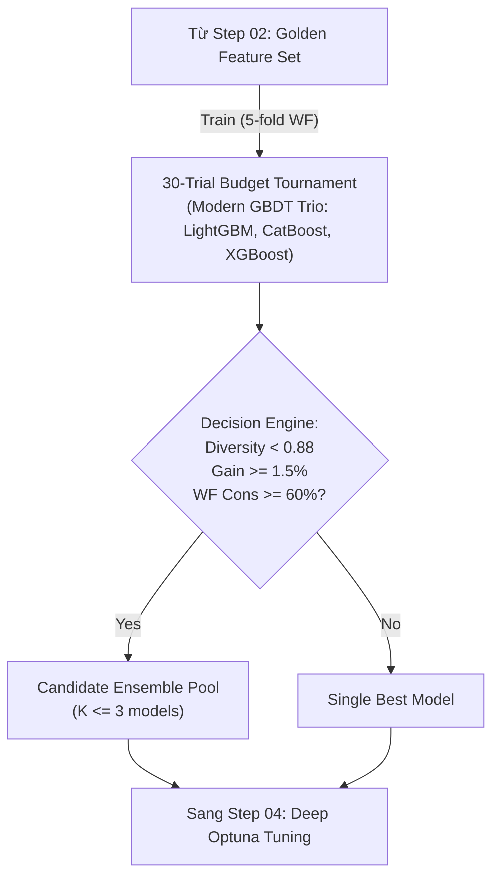

# Step 03 — Design: Tournament & Decision Engine

## Data flow



## Fallback

- Nếu Diversity giữa các mô hình $< 0.12$ (tương quan $> 0.88$), fallback về Single Best Model.

## Source layout

```
src/quantautoml/models/
├── candidates.py         # Modern GBDT Trio wrappers (LightGBM, CatBoost, XGBoost)
├── tournament.py         # 30-trials budget tournament trên Walk-Forward
└── decision_engine.py    # Quyết định Single vs. Ensemble (Diversity, Marginal Gain, WF)
tests/unit/  test_tournament.py
```

## Responsibilities

| Module / File | Trách nhiệm duy nhất | Interface / Exports chính | Dependencies |
| :--- | :--- | :--- | :--- |
| `models/candidates.py` | Gói gọn 3 thuật toán GBDT hiện đại với giao diện chuẩn. | `GBDTTrioPool` | `lightgbm`, `catboost`, `xgboost` |

## Công nghệ

| Component | Technology | Rationale |
| :--- | :--- | :--- |
| Machine Learning Pool | **LightGBM, CatBoost, XGBoost** | Tối ưu cho tabular quant, kích thước file nhỏ, suy luận $< 1.5\text{ ms/row}$. |
