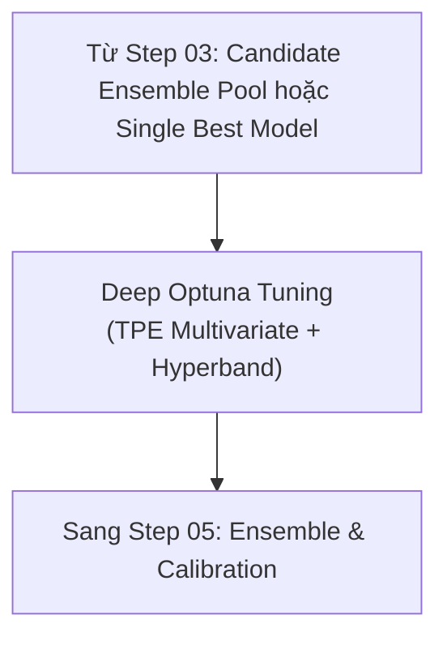

# Step 04 — Design: Deep Optuna Tuning

## Data flow



## Source layout

```
src/quantautoml/models/
└── tuner.py              # Full Optuna TPE Multivariate + HyperbandPruner
```

## Công nghệ

| Component | Technology | Rationale |
| :--- | :--- | :--- |
| Hyperparameter Tuning | `optuna` (`TPESampler(multivariate=True)`, `HyperbandPruner`) | Tìm kiếm Bayesian đa biến với cơ chế tỉa sớm thông minh. |

## Ràng buộc

- Hàm mục tiêu nhất quán theo IC Sharpe (RULE-02), không dùng MSE hay Raw Accuracy đơn thuần.
- `fit()` chỉ trên tập Train (RULE-01).
