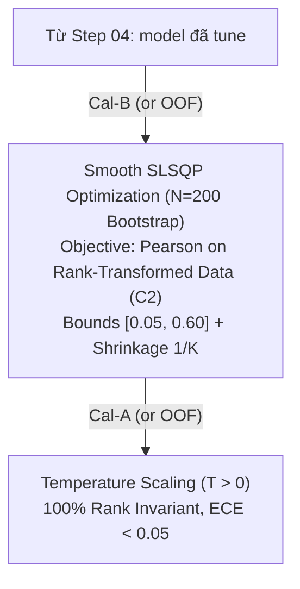

# Step 05 — Design: Smooth SLSQP & Temperature Calibration

## Data flow



## Smooth SLSQP Objective ($C^2$ Differentiability)

Để tránh bế tắc gradient do hàm bậc thang của Spearman Rank, trước khi tối ưu SLSQP, vector dự đoán của các mô hình được chuẩn hóa thứ hạng:
$$\tilde{Y}_i = \frac{\text{Rank}(\hat{Y}_i)}{N} \in [0, 1], \quad \tilde{Y}_{target} = \frac{\text{Rank}(Y_{true})}{N} \in [0, 1]$$
Tổ hợp dự đoán ensemble: $\hat{Y}_{ens}(w) = \sum_{i=1}^K w_i \tilde{Y}_i$.
Hàm mục tiêu SLSQP được định nghĩa qua hệ số tương quan Pearson khả vi liên tục:
$$\min_{w} \quad f(w) = - \frac{\text{Cov}(\hat{Y}_{ens}(w), \tilde{Y}_{target})}{\sigma_{\hat{Y}_{ens}(w)} \cdot \sigma_{\tilde{Y}_{target}}}$$
Thỏa mãn ràng buộc:
$$\sum_{i=1}^K w_i = 1, \quad 0.05 \le w_i \le 0.60 \quad (\forall i \in [1, K])$$

## Temperature Scaling (Rank Invariance Contract)

Hiệu chuẩn xác suất được thực hiện qua một tham số nhiệt độ duy nhất $T > 0$:
$$\hat{P}_i = \sigma\left(\frac{z_i}{T}\right) = \frac{1}{1 + e^{-z_i / T}}$$
Do hàm $g(z) = z/T$ và hàm sigmoid $\sigma(u)$ là các hàm đồng biến nghiêm ngặt trên $\mathbb{R}$:
$$\forall a, b: \quad z_a > z_b \iff \sigma\left(\frac{z_a}{T}\right) > \sigma\left(\frac{z_b}{T}\right)$$
$\implies$ **Rank IC trước và sau khi hiệu chuẩn xác suất là đồng nhất $100\%$:**
$$\text{Rank IC}(\hat{P}, Y) \equiv \text{Rank IC}(z, Y)$$

## Fallback

- Nếu nghiệm SLSQP không vượt qua Equal Weights ($1/K$) ít nhất 5% IC Sharpe, fallback về $W = [1/K, \dots, 1/K]$.

## Source layout

```
src/quantautoml/ensemble/
├── slsqp.py              # Tối ưu lồi SLSQP trên Cal-B (Rank-Transformed Pearson C^2 objective)
├── bootstrap.py          # Bootstrap SLSQP (N=200), Median weight & Shrinkage 1/K
└── calibration.py        # Probability Calibration (Temperature Scaling / Platt) trên Cal-A
tests/unit/  test_slsqp_smooth.py, test_temperature_calibration.py
```

## Responsibilities

| Module / File | Trách nhiệm duy nhất | Interface / Exports chính | Dependencies |
| :--- | :--- | :--- | :--- |
| `ensemble/slsqp.py` | Tối ưu hóa trọng số lồi SLSQP với hàm mục tiêu Pearson trên dữ liệu đã Rank-Transform ($C^2$). | `SmoothSLSQPOptimizer` | `scipy.optimize` |
| `ensemble/calibration.py` | Hiệu chuẩn xác suất bảo toàn thứ hạng (Temperature Scaling, Platt) trên Cal-A. | `TemperatureCalibrator` | `scipy.optimize` |

## Công nghệ

| Component | Technology | Rationale |
| :--- | :--- | :--- |
| Optimization Engine | `scipy.optimize.minimize(method='SLSQP')` | Quy hoạch phi tuyến lồi với ràng buộc hộp và tổng trọng số. |

## Design rule

- **Rank Invariance Contract:** Bất kỳ phương pháp Calibration nào được sử dụng bắt buộc phải thỏa mãn tính đơn điệu: $\text{Rank}(y_{calibrated}) \equiv \text{Rank}(y_{raw})$.
