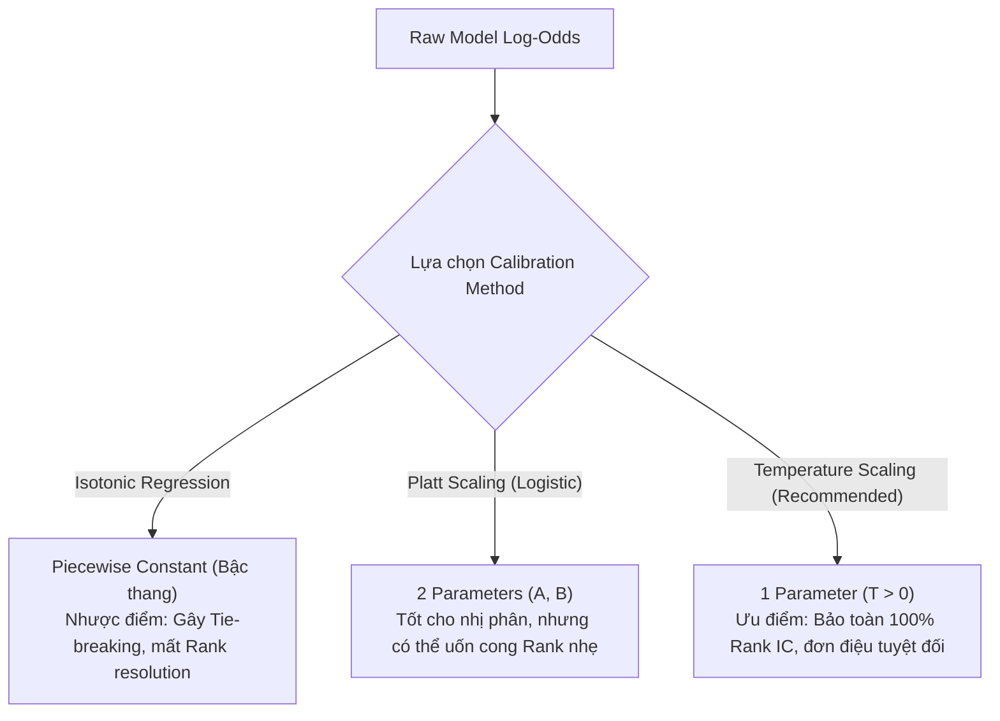

# Step 05 — Trade-offs: Calibration & SLSQP Objective

## 1. Probability Calibration: Temperature Scaling vs. Platt vs. Isotonic Regression

### So sánh các hướng tiếp cận
| Tiêu chí | Isotonic Regression | Platt Scaling (Sigmoid) | Temperature Scaling (Được chọn) |
| :--- | :--- | :--- | :--- |
| **Bản chất toán học** | Phi tham số, đơn điệu cục bộ (Piecewise constant step function). | Tham số hóa Logistic 2 tham số: $\sigma(Ax + B)$. | Tham số hóa nhiệt độ 1 tham số: $\sigma(x / T), T > 0$. |
| **Bảo toàn thứ hạng (Rank Invariance)** | ❌ **Kém:** Tạo các đoạn phẳng dẫn đến nhiều mẫu có cùng xác suất (ties). | ⚠️ **Khá:** Giữ thứ tự nếu $A > 0$, nhưng có thể méo biên. | ✅ **Hoàn hảo (100%):** Do hàm chia cho hằng số $T > 0$ là phép biến đổi đơn điệu thuần nhất. |
| **Khả năng overfit mẫu nhỏ** | Rất cao nếu $N < 1,000$. | Thấp (chỉ 2 tham số). | Cực thấp (chỉ tối ưu đúng 1 tham số vô hướng $T$). |
| **Tác động đến Rank IC** | Có thể làm giảm Rank IC do mất độ phân giải thứ hạng. | Giữ nguyên hoặc giảm nhẹ. | **Tuyệt đối không làm thay đổi Rank IC ban đầu.** |

> **Quyết định:** Loại bỏ Isotonic Regression khỏi pipeline. Chuẩn hóa dùng **Temperature Scaling** làm phương pháp mặc định để tối ưu hóa ECE (Expected Calibration Error) mà không làm tổn hại đến khả năng phân hạng alpha của mô hình.

---

## 2. SLSQP Ensemble Objective: Direct Rank IC vs. Standardized Pearson on Rank-Transformed Data

### So sánh các hướng tiếp cận
- **Hướng tiếp cận A (Direct Rank IC):** Tối ưu hóa trực tiếp hàm Spearman Correlation giữa $\sum w_i \hat{y}_i$ và $y$.
  - *Pros:* Trực diện với mục tiêu đánh giá cuối cùng của chiến lược.
  - *Cons:* Hàm xếp hạng (Ranking) là hàm rời rạc/bậc thang, có đạo hàm bằng $0$ ở mọi điểm liên tục và gián đoạn tại các điểm hoán đổi. Thuật toán `SLSQP` (dựa trên đạo hàm Gradient và ma trận xấp xỉ Hessian Quasi-Newton) sẽ bị kẹt ngay tại điểm khởi đầu (Zero-gradient trap) hoặc hội tụ ngẫu nhiên không ổn định.
- **Hướng tiếp cận B (Pearson Correlation trên Rank-Transformed Data - Được chọn):** Trước khi đưa vào SLSQP, biến đổi vector dự đoán $\hat{y}_i$ của từng model thành giá trị phân hạng chuẩn hóa $\tilde{y}_i = \text{Rank}(\hat{y}_i) / N \in [0, 1]$. Tối ưu hóa Pearson Correlation (hoặc tương đương tối thiểu hóa sai số bình phương có chuẩn hóa) giữa $\sum w_i \tilde{y}_i$ và $\tilde{y}_{true}$.
  - *Pros:* Hàm mục tiêu lúc này thuộc lớp khả vi liên tục bậc hai $C^2$. `SLSQP` hội tụ với tốc độ siêu nhanh (vài mili-giây), tìm được nghiệm tối ưu toàn cục/cục bộ chặt chẽ với các ràng buộc lồi $0.05 \le w_i \le 0.60$ và $\sum w = 1$.
  - *Cons:* Xấp xỉ tiệm cận của Rank IC chứ không phải Rank IC rời rạc gốc (nhưng sai số tiệm cận $\to 0$ khi $N$ đủ lớn).

> **Quyết định:** Sử dụng **Hướng tiếp cận B**. Đảm bảo tính vững chắc về mặt toán giải tích và độ ổn định của thuật toán tối ưu.
