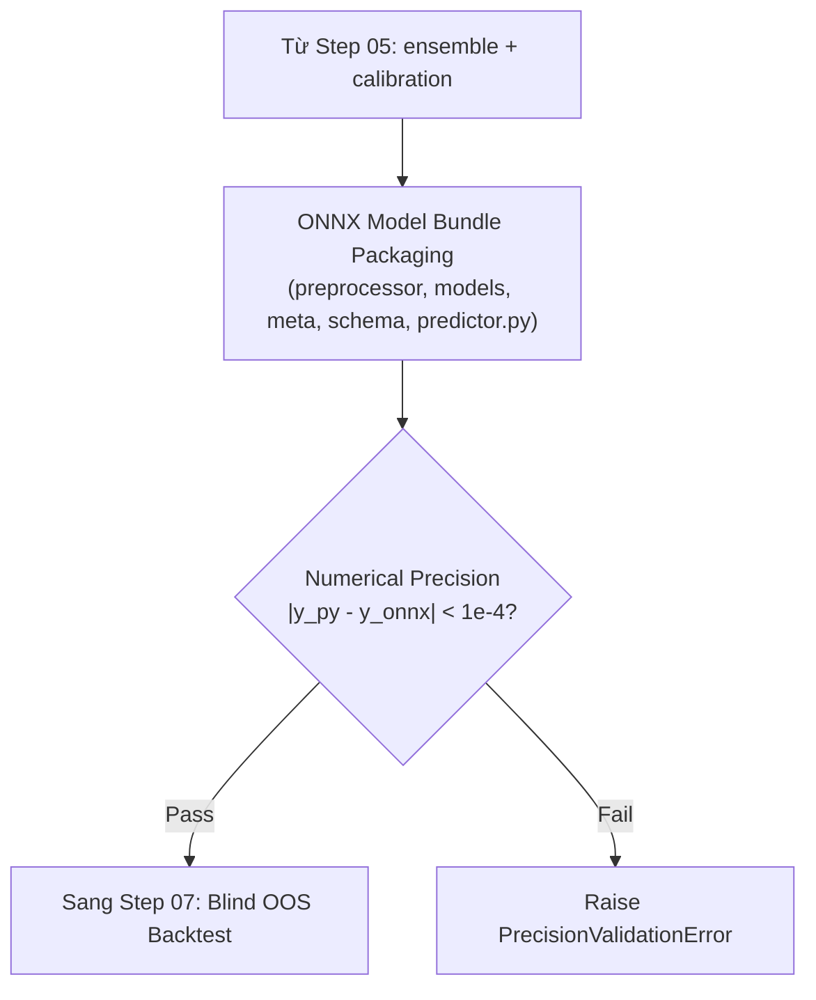

# Step 06 — Design: ONNX Bundle & Precision Validation

## Data flow



## Source layout

```
src/quantautoml/packaging/
├── bundle.py             # Đóng gói Model Bundle (.onnx, metadata, schema)
├── schema.py             # Tạo và kiểm tra features_schema.json (Data Contract)
├── validator.py          # Kiểm tra sai số số học float32 (|y_py - y_onnx| < 10^-4)
└── templates/
    └── predictor_template.py # Mã nguồn predictor.py độc lập (~50 dòng numpy/onnxruntime)
tests/unit/  test_packaging.py
```

## Non-Functional Requirements

1. **Numerical Precision Contract:** $\max |\hat{y}_{python} - \hat{y}_{onnx}| < 10^{-4}$ trên chuẩn `float32`.
2. **Inference Latency Target:** $< 5.0\text{ ms}$ cho batch 1 dòng trên CPU tiêu chuẩn.
3. **Data Drift Warning:** Kích hoạt `DistributionShiftWarning` khi feature input có $z\text{-score} > 3.0$ so với Train contract.

## Công nghệ

| Component | Technology | Rationale |
| :--- | :--- | :--- |
| Inference Runtime | `onnx`, `onnxruntime` | Đóng gói bundle gọn nhẹ, thực thi độc lập nền tảng. |

## Design rule

- **Decoupled Production Inference:** `predictor.py` độc lập hoàn toàn, không phụ thuộc vào codebase huấn luyện, chỉ dùng `numpy` và `onnxruntime`.
