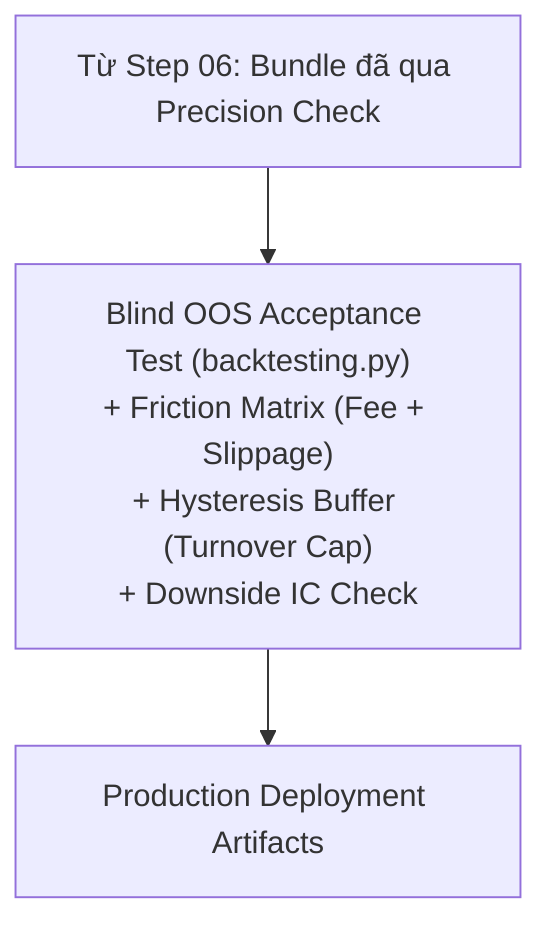

# Step 07 — Design: Friction Cost Model, Hysteresis Buffer & OOS Evaluation

## Data flow



## Friction Cost Model & Net Sharpe

Lợi nhuận ròng của chiến lược sau khi trừ ma sát thị trường:
$$R_{net, t} = R_{gross, t} - \text{Turnover}_t \times (\text{Fee}_{bps} + \text{Slippage}_{bps})$$
Trong đó $\text{Turnover}_t = \frac{1}{2} \sum_j |w_{j, t} - w_{j, t^-}|$.
Dải đệm trễ (Hysteresis Buffer): Một tài sản trong Top 20% chỉ bị loại khỏi danh mục nếu thứ hạng của nó tụt xuống dưới phân vị $30\%$, giúp giảm thiểu đến $40-60\%$ số lượt giao dịch không cần thiết.

## Source layout

```
src/quantautoml/backtest/
├── friction.py           # Mô hình hóa ma trận chi phí (Taker Fee + Slippage) & Turnover
├── buffer.py             # Cơ chế Hysteresis Buffer Bands kiểm soát vòng quay danh mục
├── evaluator.py          # Đánh giá tiêu chí nghiệm thu (OOS IC, Net Sharpe sau phí, MDD)
└── runner.py             # Thực thi kiểm thử mù trên tập OOS độc lập
tests/integration/  test_friction_backtest.py
```

## Responsibilities

| Module / File | Trách nhiệm duy nhất | Interface / Exports chính | Dependencies |
| :--- | :--- | :--- | :--- |
| `backtest/friction.py` | Tính toán lợi nhuận ròng sau khi trừ chi phí giao dịch (Fee + Slippage) và Turnover. | `FrictionCostModel` | `numpy` |
| `backtest/buffer.py` | Kiểm soát vòng quay bằng dải đệm trễ Hysteresis Buffer Bands. | `HysteresisBuffer` | `numpy` |

## Non-Functional Requirement

- Nghiệm thu OOS bắt buộc tính **Net Sharpe sau chi phí ma sát** (RULE-09).
