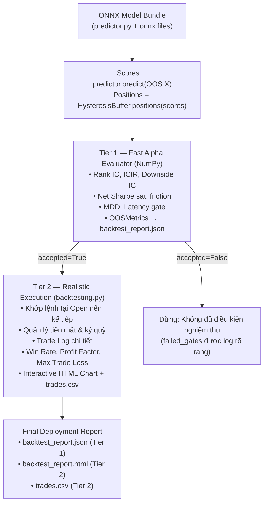
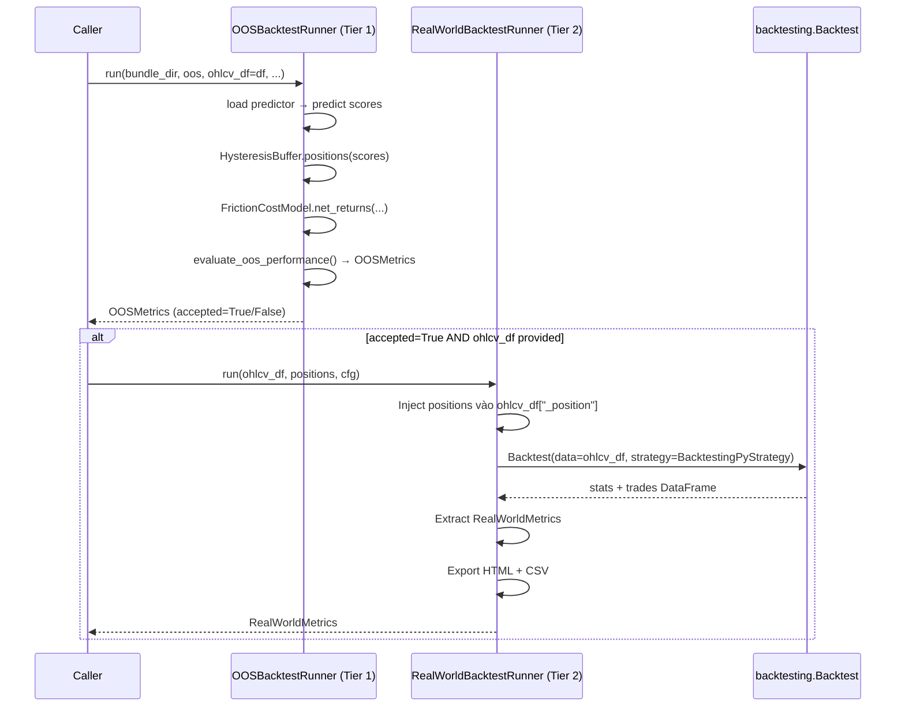

# Step 08-fix1 — Design: Dual-Tier Realistic Backtest (backtesting.py Integration)

**Step:** 08-fix1 — Realistic OOS Simulation Layer
**Date:** 2026-11-19

---

## 1. Kiến Trúc Tổng Thể (Dual-Tier)



---

## 2. Data Flow Chi Tiết



---

## 3. Source Layout

```
src/quantautoml/
└── backtest/
    ├── __init__.py                 # Export thêm: RealWorldBacktestRunner, RealWorldMetrics
    ├── friction.py                 # (Không đổi) FrictionCostModel
    ├── buffer.py                   # (Không đổi) HysteresisBuffer
    ├── evaluator.py                # (Không đổi) OOSMetrics, evaluate_oos_performance
    ├── runner.py                   # (Mở rộng nhỏ) OOSBacktestRunner.run() nhận ohlcv_df param
    ├── strategy.py                 # MỚI: BacktestingPyStrategy(Strategy) — adapter mỏng
    └── realworld_runner.py         # MỚI: RealWorldBacktestRunner, RealWorldMetrics

src/quantautoml/common/
└── config.py                       # Mở rộng: thêm RealWorldConfig

tests/unit/
└── test_realworld_runner.py        # MỚI: Unit test strategy & runner với OHLCV giả lập nhỏ

tests/integration/
└── test_realworld_backtest.py      # MỚI: Integration test đầy đủ pipeline với bundle thật
```

---

## 4. Interface Contracts

### `RealWorldConfig` (thêm vào `common/config.py`)
```python
class RealWorldConfig(BaseModel):
    model_config = ConfigDict(frozen=True, extra="forbid")

    cash: float = Field(default=1_000_000.0, gt=0)
    commission: float = Field(default=0.0005, ge=0)   # 0.05% per trade (taker fee)
    margin: float = Field(default=1.0, gt=0)           # 1.0 = không dùng đòn bẩy
    trade_on_close: bool = False                        # False = khớp tại Open nến kế tiếp
    out_html: str | None = None                         # Đường dẫn xuất HTML report
    out_trades_csv: str | None = None                   # Đường dẫn xuất trade log CSV
    ohlcv_open_col: str = "Open"
    ohlcv_high_col: str = "High"
    ohlcv_low_col: str = "Low"
    ohlcv_close_col: str = "Close"
    ohlcv_volume_col: str = "Volume"
```

### `RealWorldMetrics` (Pydantic, frozen)
```python
class RealWorldMetrics(BaseModel):
    model_config = ConfigDict(frozen=True)

    n_trades: int
    win_rate: float               # Tỷ lệ trade thắng [0, 1]
    profit_factor: float          # Gross Profit / Gross Loss
    avg_holding_bars: float       # Thời gian nắm giữ trung bình (nến)
    max_trade_loss_pct: float     # Lỗ tối đa trong 1 trade (%)
    equity_final: float           # Vốn cuối kỳ
    equity_peak: float            # Vốn đỉnh
    return_pct: float             # Tổng lợi nhuận (%)
    buy_hold_return_pct: float    # So sánh với Buy & Hold (%)
    sharpe_ratio_bt: float        # Sharpe tính bởi backtesting.py (annualized)
    sortino_ratio: float
    calmar_ratio: float
    max_drawdown_pct: float       # MDD (%) tính bởi backtesting.py
```

### `BacktestingPyStrategy` (`backtest/strategy.py`)
```python
from backtesting import Strategy  # lazy import

class BacktestingPyStrategy(Strategy):
    """Phát lệnh Market theo pre-computed _position column.

    Lệnh được phát ở bar t và khớp tại Open[t+1] (trade_on_close=False).
    """

    def init(self) -> None:
        self._pos = self.I(lambda x: x, self.data["_position"])

    def next(self) -> None:
        target = self._pos[-1]   # {-1, 0, +1}
        current = 1 if self.position.is_long else (-1 if self.position.is_short else 0)
        if target == current:
            return
        if self.position:
            self.position.close()
        if target == 1:
            self.buy()
        elif target == -1:
            self.sell()
```

---

## 5. Non-Functional Requirements

| Requirement | Ngưỡng |
| :--- | :--- |
| Thời gian chạy Tier 2 (4000 nến 5 phút) | ≤ 10 giây trên CPU tiêu chuẩn |
| Nhất quán vị thế Tier 1 vs Tier 2 | 100% — cùng một `positions` array |
| Import `backtesting` trong `predictor.py` | Tuyệt đối CẤM (RULE-07) |
| Báo cáo HTML | Tự động mở/lưu khi `out_html` được cấu hình |
| `backtesting.py` không thuộc core dependency | Lazy import, `ImportError` có hướng dẫn |
