# System Architecture & Technical Infrastructure: Quant AutoML Pipeline

**System:** Quant AutoML Pipeline  
**Version:** `v1.0.0-PROD-SPEC` (Updated with Quant Master Review)  
**Architecture Status:** Approved  

> File này chứa kiến trúc **tổng thể**. Công thức toán học, data flow và layout chi tiết của từng step nằm trong `DESIGN.md` của thư mục step tương ứng.

---

## 1. System Overview

Quant AutoML Pipeline là hệ thống tự động hóa xây dựng mô hình dự báo phục vụ giao dịch định lượng (Quantitative Trading). Kiến trúc hệ thống tuân thủ 4 nguyên tắc cốt lõi:
1. **Zero Look-ahead Leakage:** Cô lập tuyệt đối dữ liệu tương lai trước khi thực hiện bất kỳ bước tính toán nào.
2. **Metric Consistency & Mathematical Soundness:** Nhất quán tối ưu hóa theo Rank IC (Spearman), bảo toàn tính khả vi liên tục $C^2$ trong tối ưu hóa toán học và bảo toàn thứ hạng (Rank Invariance) trong hiệu chuẩn xác suất.
3. **Earn Its Place & Anti-Overfitting:** Tích hợp kiểm soát giả thuyết đa chiều (FDR), phạt độ phức tạp mô hình, và chỉ chấp nhận Ensemble khi vượt trội baseline ít nhất 5% IC Sharpe.
4. **Friction-Aware Real-World Validation:** Nghiệm thu chiến lược bắt buộc tính đến ma trận chi phí ma sát (phí sàn + trượt giá), kiểm soát vòng quay danh mục qua dải đệm trễ (Hysteresis Buffer), và kiểm tra độ bền trong chu kỳ sụt giảm thị trường (Downside IC).

---

## 2. End-to-End Pipeline Architecture Diagram

```mermaid
flowchart TD
    subgraph DataStage["Step 01: Data Ingestion & Adaptive Temporal Split"]
        RawData["Raw Parquet / CSV\n(features & labels)"] --> Ingest["Ingestion & Timestamp Sync\n(UTC ISO-8601, float32)"]
        Ingest --> SplitCheck{"Adaptive Check:\nN >= 10,000?"}
        SplitCheck -->|"Yes"| StaticSplit["Static 5-Way Split (Purging & Embargo)\nTrain 60% | Cal-A 10% | Cal-B 10% | Val 10% | OOS 10%"]
        SplitCheck -->|"No (N < 10k)"| OOFSplit["OOF-Assisted Split (Purging & Embargo)\nTrain 80% (OOF for Cal-A/B) | Val 10% | OOS 10%"]
    end

    subgraph FeatureStage["Step 02: Leakage-Free Feature Funnel"]
        StaticSplit -->|"Train only: fit()\nAll: transform()"| Funnel["7-Stage Feature Funnel\nF1 (NaN) -> F2 (Var) -> F3+7 (IC Stab + FDR) ->\nF4 (Fast dCor) -> F5 (Cluster) -> F6 (Regime) -> F8 (JMI)"]
        OOFSplit -->|"Train only: fit()\nAll: transform()"| Funnel
    end

    subgraph ModelStage["Step 03-04: Tournament & Tuning"]
        Funnel -->|"Train (5-fold WF)"| Tourn["30-Trial Budget Tournament\n(Modern GBDT Trio: LightGBM, CatBoost, XGBoost)"]
        Tourn --> DecEng{"Decision Engine:\nDiversity < 0.88\nGain >= 1.5%\nWF Cons >= 60%?"}
        DecEng -->|"Yes"| EnsemblePool["Candidate Ensemble Pool\n(K <= 3 models)"]
        DecEng -->|"No"| SingleBest["Single Best Model"]
        EnsemblePool --> FullOptuna["Deep Optuna Tuning\n(TPE Multivariate + Hyperband)"]
        SingleBest --> FullOptuna
    end

    subgraph OptimizationStage["Step 05: Ensemble & Calibration"]
        FullOptuna -->|"Cal-B (or OOF)"| SLSQP["Smooth SLSQP Optimization (N=200 Bootstrap)\nObjective: Pearson on Rank-Transformed Data (C2)\nBounds [0.05, 0.60] + Shrinkage 1/K"]
        SLSQP -->|"Cal-A (or OOF)"| Calib["Temperature Scaling (T > 0)\n100% Rank Invariant, ECE < 0.05"]
    end

    subgraph PackagingStage["Step 06-07: Packaging & Friction-Aware Acceptance"]
        Calib --> Bundle["ONNX Model Bundle Packaging\n(preprocessor, models, meta, schema, predictor.py)"]
        Bundle --> PrecisionCheck{"Numerical Precision\n|y_py - y_onnx| < 1e-4?"}
        PrecisionCheck -->|"Pass"| OOSTest["Blind OOS Acceptance Test (backtesting.py)\n+ Friction Matrix (Fee + Slippage)\n+ Hysteresis Buffer (Turnover Cap)\n+ Downside IC Check"]
        PrecisionCheck -->|"Fail"| ErrorStop["Raise PrecisionValidationError"]
        OOSTest --> Report["Production Deployment Artifacts"]
    end
```

## 3. Chi tiết theo Step

| Step | Nội dung thiết kế |
| :--- | :--- |
| 01 | [`01-ingestion-split/DESIGN.md`](01-ingestion-split/DESIGN.md) — data flow, layout `data/` |
| 02 | [`02-feature-selection/DESIGN.md`](02-feature-selection/DESIGN.md) — Funnel, công thức FDR / Term Structure |
| 03 | [`03-model-selection/DESIGN.md`](03-model-selection/DESIGN.md) — Tournament, Decision Engine |
| 04 | [`04-tuning/DESIGN.md`](04-tuning/DESIGN.md) — Deep Optuna |
| 05 | [`05-ensemble-calibration/DESIGN.md`](05-ensemble-calibration/DESIGN.md) — công thức SLSQP $C^2$, Temperature Scaling |
| 06 | [`06-packaging/DESIGN.md`](06-packaging/DESIGN.md) — ONNX Bundle, Precision, NFR |
| 07 | [`07-backtest/DESIGN.md`](07-backtest/DESIGN.md) — Friction Cost Model, Hysteresis Buffer |

---

## 4. Technology Stack & Technical Infrastructure

| Layer / Component | Technology | Rationale / Purpose |
| :--- | :--- | :--- |
| **Runtime & Language** | Python $\ge 3.12$ | Tối ưu hiệu năng CPU và kiểu gõ hiện đại. |
| **Data Processing** | `polars`, `pandas`, `numpy` (ép kiểu `float32`) | Đọc parquet siêu tốc, xử lý ma trận không tạo bản sao thừa. |
| **Feature Analytics & Math** | `scipy.stats`, `scikit-learn` | Fast Distance Correlation, Benjamini-Hochberg FDR, Hierarchical Clustering. |
| **Machine Learning Pool** | **LightGBM, CatBoost, XGBoost** (Modern GBDT Trio) | Tối ưu hóa cho tabular quant, kích thước file nhỏ, suy luận $< 1.5\text{ ms/row}$. |
| **Hyperparameter Tuning** | `optuna` (`TPESampler(multivariate=True)`, `HyperbandPruner`) | Tìm kiếm Bayesian đa biến với cơ chế tỉa sớm thông minh. |
| **Optimization Engine** | `scipy.optimize.minimize(method='SLSQP')` | Quy hoạch phi tuyến lồi với ràng buộc hộp và tổng trọng số. |
| **Inference Runtime** | `onnx`, `onnxruntime` | Đóng gói bundle gọn nhẹ, thực thi độc lập nền tảng. |
| **Testing & CI Gates** | `pytest`, `pytest-cov` | Kiểm thử TDD, kiểm tra Zero Leakage, Rank Invariance, và Precision $< 10^{-4}$. |

---

## 5. Non-Functional Requirements (NFRs) & Safety Guards

1. **Numerical Precision Contract:** $\max |\hat{y}_{python} - \hat{y}_{onnx}| < 10^{-4}$ trên chuẩn `float32`.
2. **Inference Latency Target:** $< 5.0\text{ ms}$ cho batch 1 dòng trên CPU tiêu chuẩn.
3. **Data Drift Warning:** Kích hoạt `DistributionShiftWarning` khi feature input có $z\text{-score} > 3.0$ so với Train contract.
4. **Fallback Mechanism:**
   - Nếu nghiệm SLSQP không vượt qua Equal Weights ($1/K$) ít nhất 5% IC Sharpe, fallback về $W = [1/K, \dots, 1/K]$.
   - Nếu Diversity giữa các mô hình $< 0.12$ (tương quan $> 0.88$), fallback về Single Best Model.
