# System Architecture & Technical Infrastructure: Quant AutoML Pipeline

**System:** Quant AutoML Pipeline  
**Version:** `v1.0.0-PROD-SPEC` (Updated with Quant Master Review)  
**Architecture Status:** Approved  

---

## 1. System Overview

Quant AutoML Pipeline là hệ thống tự động hóa xây dựng mô hình dự báo phục vụ giao dịch định lượng (Quantitative Trading). Kiến trúc hệ thống tuân thủ 4 nguyên tắc cốt lõi:
1. **Zero Look-ahead Leakage:** Cô lập tuyệt đối dữ liệu tương lai trước khi thực hiện bất kỳ bước tính toán nào.
2. **Metric Consistency & Mathematical Soundness:** Nhất quán tối ưu hóa theo Rank IC (Spearman), bảo toàn tính khả vi liên tục $C^2$ trong tối ưu hóa toán học và bảo toàn thứ hạng (Rank Invariance) trong hiệu chuẩn xác suất.
3. **Earn Its Place & Anti-Overfitting:** Tích hợp kiểm soát giả thuyết đa chiều (FDR), phạt độ phức tạp mô hình, và chỉ chấp nhận Ensemble khi vượt trội baseline ít nhất 5% IC Sharpe.
4. **Friction-Aware Real-World Validation:** Nghiệm thu chiến lược bắt buộc tính đến ma trận chi phí ma sát (phí sàn + trượt giá), kiểm soát vòng quay danh mục qua dải đệm trễ (Hysteresis Buffer), và kiểm tra độ bền trong chu kỳ sụt giảm thị trường (Downside IC).

---

## 2. End-to-End Pipeline Architecture Diagram

```mermaid
flowchart TD
    subgraph DataStage["Giai đoạn 1: Data Ingestion & Adaptive Temporal Split"]
        RawData["Raw Parquet / CSV\n(features & labels)"] --> Ingest["Ingestion & Timestamp Sync\n(UTC ISO-8601, float32)"]
        Ingest --> SplitCheck{"Adaptive Check:\nN >= 10,000?"}
        SplitCheck -->|"Yes"| StaticSplit["Static 5-Way Split (Purging & Embargo)\nTrain 60% | Cal-A 10% | Cal-B 10% | Val 10% | OOS 10%"]
        SplitCheck -->|"No (N < 5k)"| OOFSplit["OOF-Assisted Split (Purging & Embargo)\nTrain 80% (OOF for Cal-A/B) | Val 10% | OOS 10%"]
    end

    subgraph FeatureStage["Giai đoạn 2: Leakage-Free Feature Funnel"]
        StaticSplit -->|"Train only: fit()\nAll: transform()"| Funnel["7-Stage Feature Funnel\nF1 (NaN) -> F2 (Var) -> F3+7 (IC Stab + FDR) ->\nF4 (Fast dCor) -> F5 (Cluster) -> F6 (Regime) -> F8 (JMI)"]
        OOFSplit -->|"Train only: fit()\nAll: transform()"| Funnel
    end

    subgraph ModelStage["Giai đoạn 3: Tournament & Tuning"]
        Funnel -->|"Train (5-fold WF)"| Tourn["30-Trial Budget Tournament\n(Modern GBDT Trio: LightGBM, CatBoost, XGBoost)"]
        Tourn --> DecEng{"Decision Engine:\nDiversity < 0.88\nGain >= 1.5%\nWF Cons >= 60%?"}
        DecEng -->|"Yes"| EnsemblePool["Candidate Ensemble Pool\n(K <= 3 models)"]
        DecEng -->|"No"| SingleBest["Single Best Model"]
        EnsemblePool --> FullOptuna["Deep Optuna Tuning\n(TPE Multivariate + Hyperband)"]
        SingleBest --> FullOptuna
    end

    subgraph OptimizationStage["Giai đoạn 4: Ensemble & Calibration"]
        FullOptuna -->|"Cal-B (or OOF)"| SLSQP["Smooth SLSQP Optimization (N=200 Bootstrap)\nObjective: Pearson on Rank-Transformed Data (C2)\nBounds [0.05, 0.60] + Shrinkage 1/K"]
        SLSQP -->|"Cal-A (or OOF)"| Calib["Temperature Scaling (T > 0)\n100% Rank Invariant, ECE < 0.05"]
    end

    subgraph PackagingStage["Giai đoạn 5: Packaging & Friction-Aware Acceptance"]
        Calib --> Bundle["ONNX Model Bundle Packaging\n(preprocessor, models, meta, schema, predictor.py)"]
        Bundle --> PrecisionCheck{"Numerical Precision\n|y_py - y_onnx| < 1e-4?"}
        PrecisionCheck -->|"Pass"| OOSTest["Blind OOS Acceptance Test (backtesting.py)\n+ Friction Matrix (Fee + Slippage)\n+ Hysteresis Buffer (Turnover Cap)\n+ Downside IC Check"]
        PrecisionCheck -->|"Fail"| ErrorStop["Raise PrecisionError"]
        OOSTest --> Report["Production Deployment Artifacts"]
    end
```

---

## 3. Mathematical Formulations & Core Engines

### 3.1. Smooth SLSQP Objective ($C^2$ Differentiability)
Để tránh bế tắc gradient do hàm bậc thang của Spearman Rank, trước khi tối ưu SLSQP, vector dự đoán của các mô hình được chuẩn hóa thứ hạng:
$$\tilde{Y}_i = \frac{\text{Rank}(\hat{Y}_i)}{N} \in [0, 1], \quad \tilde{Y}_{target} = \frac{\text{Rank}(Y_{true})}{N} \in [0, 1]$$
Tổ hợp dự đoán ensemble: $\hat{Y}_{ens}(w) = \sum_{i=1}^K w_i \tilde{Y}_i$.  
Hàm mục tiêu SLSQP được định nghĩa qua hệ số tương quan Pearson khả vi liên tục:
$$\min_{w} \quad f(w) = - \frac{\text{Cov}(\hat{Y}_{ens}(w), \tilde{Y}_{target})}{\sigma_{\hat{Y}_{ens}(w)} \cdot \sigma_{\tilde{Y}_{target}}}$$
Thỏa mãn ràng buộc:
$$\sum_{i=1}^K w_i = 1, \quad 0.05 \le w_i \le 0.60 \quad (\forall i \in [1, K])$$

### 3.2. Temperature Scaling (Rank Invariance Contract)
Hiệu chuẩn xác suất được thực hiện qua một tham số nhiệt độ duy nhất $T > 0$:
$$\hat{P}_i = \sigma\left(\frac{z_i}{T}\right) = \frac{1}{1 + e^{-z_i / T}}$$
Do hàm $g(z) = z/T$ và hàm sigmoid $\sigma(u)$ là các hàm đồng biến nghiêm ngặt trên $\mathbb{R}$:
$$\forall a, b: \quad z_a > z_b \iff \sigma\left(\frac{z_a}{T}\right) > \sigma\left(\frac{z_b}{T}\right)$$
$\implies$ **Rank IC trước và sau khi hiệu chuẩn xác suất là đồng nhất $100\%$:**
$$\text{Rank IC}(\hat{P}, Y) \equiv \text{Rank IC}(z, Y)$$

### 3.3. Multi-Horizon Term Structure & FDR Control
Với tập các features ứng viên, p-values của các kiểm định giả thuyết được sắp xếp: $p_{(1)} \le p_{(2)} \le \dots \le p_{(M)}$.  
Ngưỡng phát hiện sai Benjamini-Hochberg tại mức ý nghĩa $\alpha = 0.05$:
$$k = \max \left\{ i : p_{(i)} \le \frac{i}{M} \alpha \right\}$$
Điều kiện cấu trúc kỳ hạn (Term Structure Monotonicity):
$$\text{ICIR}(h=1) \ge \text{ICIR}(h=5) \ge \text{ICIR}(h=10) \ge \text{ICIR}(h=21) - \epsilon_{tolerance}$$

### 3.4. Friction Cost Model & Net Sharpe
Lợi nhuận ròng của chiến lược sau khi trừ ma sát thị trường:
$$R_{net, t} = R_{gross, t} - \text{Turnover}_t \times (\text{Fee}_{bps} + \text{Slippage}_{bps})$$
Trong đó $\text{Turnover}_t = \frac{1}{2} \sum_j |w_{j, t} - w_{j, t^-}|$.  
Dải đệm trễ (Hysteresis Buffer): Một tài sản trong Top 20% chỉ bị loại khỏi danh mục nếu thứ hạng của nó tụt xuống dưới phân vị $30\%$, giúp giảm thiểu đến $40-60\%$ số lượt giao dịch không cần thiết.

---

## 4. Technology Stack & Technical Infrastructure

| Layer / Component | Technology | Rationale / Purpose |
| :--- | :--- | :--- |
| **Runtime & Language** | Python $\ge 3.12$ | Tối ưu hiệu năng CPU và kiểu gõ hiện đại. |
| **Data Processing** | `polars`, `pandas`, `numpy` (ép kiểu `float32`) | Đọc parquet siêu tốc, xử lý ma trận không tạo bản sao thừa. |
| **Feature Analytics & Math** | `scipy.stats`, `scikit-learn` | Fast Distance Correlation, Benjamini-Hochberg FDR, Hierarchical Clustering. |
| **Machine Learning Pool** | **LightGBM, CatBoost, XGBoost** (Modern GBDT Trio) | Tối ưu hóa cho tabular quant, kích thước file nhỏ, suy luận $< 1.5\text{ ms/row}$. |
| **Hyperparameter Tuning** | `optuna` (`TPESampler(multivariate=True)`, `HyperbandPruner`) | Tìm kiếm Bayesian đa biến với cơ chế tỉa sớm thông minh. |
| **Optimization Engine** | `scipy.optimize.minimize(method='SLSQP')` | Quy hoạch phi tuyến lồi với ràng buộc hộp và tổng trọng số. |
| **Inference Runtime** | `onnx`, `onnxruntime` | Đóng gói bundle gọn nhẹ, thực thi độc lập nền tảng. |
| **Testing & CI Gates** | `pytest`, `pytest-cov` | Kiểm thử TDD, kiểm tra Zero Leakage, Rank Invariance, và Precision $< 10^{-4}$. |

---

## 5. Non-Functional Requirements (NFRs) & Safety Guards

1. **Numerical Precision Contract:** $\max |\hat{y}_{python} - \hat{y}_{onnx}| < 10^{-4}$ trên chuẩn `float32`.
2. **Inference Latency Target:** $< 5.0\text{ ms}$ cho batch 1 dòng trên CPU tiêu chuẩn.
3. **Data Drift Warning:** Kích hoạt `DistributionShiftWarning` khi feature input có $z\text{-score} > 3.0$ so với Train contract.
4. **Fallback Mechanism:**
   - Nếu nghiệm SLSQP không vượt qua Equal Weights ($1/K$) ít nhất 5% IC Sharpe, fallback về $W = [1/K, \dots, 1/K]$.
   - Nếu Diversity giữa các mô hình $< 0.12$ (tương quan $> 0.88$), fallback về Single Best Model.
