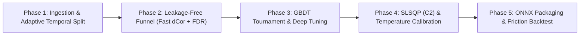

# System Phases & Decomposition: Quant AutoML Pipeline

**System:** Quant AutoML Pipeline  
**Version:** `v1.0.0-PROD-SPEC` (Updated with Quant Master Review)  
**Strategy:** Phân rã thành 5 giai đoạn (phases) độc lập. Mỗi giai đoạn đại diện cho một sub-system hoàn chỉnh có thể phát triển, kiểm thử độc lập (unit & integration tests) và nghiệm thu trước khi bước sang giai đoạn tiếp theo.

---

## Roadmap Overview

---

## Phase Breakdown

### Phase 1: Data Ingestion, Task Inference & Adaptive Temporal Splitter *(Foundation)*
- **Mục tiêu:** Xây dựng nền tảng nạp dữ liệu, đồng bộ hóa chuỗi thời gian, tự động suy luận loại bài toán và phân chia dữ liệu thích ứng (Adaptive Temporal Split) kèm Purging & Embargo.
- **Sub-systems & Deliverables:**
  1. `DataIngestion`: Đọc `features` và `labels` (`.parquet`/`.csv`), chuẩn hóa UTC ISO-8601, inner join theo timestamp, sắp xếp tăng dần đơn điệu ($shuffle = False$), ép kiểu `float32`.
  2. `TaskInference`: Tự động phân loại Binary Classification, Multiclass Classification ($3 \le nunique \le 10$), hoặc Unsupervised.
  3. `AdaptiveTemporalSplitter`:
     - Nếu $N \ge 10,000$: Phân chia tĩnh 5 vùng: Train (60%), Cal-A (10%), Cal-B (10%), Val (10%), OOS (10%).
     - Nếu $N < 5,000$: Phân chia Train (80%), Val (10%), OOS (10%); sinh OOF (Out-of-Fold) metadata cho Cal-A/Cal-B nhằm chống nhiễu mẫu nhỏ.
     - Cơ chế **Purging & Embargo** $h$ nến triệt tiêu serial correlation giữa các ranh giới.
- **Tiêu chí kiểm thử độc lập (Independent Verification):**
  - Unit tests xác nhận không có bất kỳ dòng nào của tập tương lai bị lẫn vào tập quá khứ.
  - Kiểm tra khoảng cách giữa các split ranh giới đúng bằng $h$ nến embargo.
  - Tự động nhận diện chính xác bài toán từ vector $Y$ và tự động chuyển đổi chế độ split theo số dòng $N$.
- **Trạng thái:** Done

---

### Phase 2: Leakage-Free Feature Funnel (Fast dCor & FDR Control)
- **Mục tiêu:** Xây dựng phễu thanh lọc tính năng thông minh, kết hợp Hard Gate cho rác rõ ràng và Soft Evidence Scoring, kiểm soát đa giả thuyết (FDR) và tối ưu độ phức tạp tính toán.
- **Sub-systems & Deliverables:**
  1. `NaNInfTriage (F1)`: Phân loại MCAR/MAR/MNAR, sinh cột indicator, tính điểm kết hợp $\text{Score} = \text{MI} \times (1 - \text{NaN\_Ratio})$.
  2. `MultiMetricVarianceFilter (F2)`: Đánh giá đồng thời Hệ số biến thiên ($CV$), Peak Rolling Variance ($w=63$), và Unique Ratio.
  3. `ICStabilityFilter (F3+7)`: Đo tính ổn định $P(Y \mid X)$ trên $h_{target}$, kiểm soát tỷ lệ phát hiện sai **Benjamini-Hochberg (FDR $\le 0.05$)**, và kiểm tra tính đơn điệu suy giảm kỳ hạn trên $\{1, 5, 10, 21\}$.
  4. `FastNonlinearCollinearityFilter (F4)`: Đo phụ thuộc phi tuyến bằng Fast Distance Correlation ($\mathcal{O}(N \log N)$ hoặc Subsampling khi $N > 5,000$, dCor $> 0.85$).
  5. `ICBehaviorClusterFilter (F5)`: Gom cụm phân cấp theo khoảng cách tương quan hành vi IC $1 - |\text{corr}(\text{IC}_i, \text{IC}_j)|$, giữ lại đại diện Max-MI/Rank-IC.
  6. `RegimeSynergyFilter (F6)`: Đánh giá MI theo Regime (Bull/Bear/Sideways) và bộ lọc bảo vệ cặp Synergistic Features.
  7. `JMIFeatureSelector (F8)`: Tối ưu hóa tập Golden Feature Set theo thuật toán Joint Mutual Information.
- **Tiêu chí kiểm thử độc lập (Independent Verification):**
  - Kiểm thử xác nhận không có ngoại lệ hoặc data leakage (`fit` chỉ trên Train).
  - Thuật toán dCor chạy nhanh với $N > 10,000$ mà không bị tràn bộ nhớ RAM.
- **Trạng thái:** Done

---

### Phase 3: Modern GBDT Tournament & Deep Hyperparameter Optimization
- **Mục tiêu:** Thiết lập cơ chế đấu loại công bằng giữa 3 mô hình GBDT hiện đại (LightGBM, CatBoost, XGBoost), tự động ra quyết định Single Model vs. Ensemble, và tinh chỉnh siêu tham số chuyên sâu.
- **Sub-systems & Deliverables:**
  1. `ModelTournament`: Cấp ngân sách đồng nhất 30 trials `RandomSampler` cho **LightGBM, CatBoost, XGBoost** trên 5-fold Expanding Window Walk-Forward (Train). Xếp hạng bằng IC Sharpe.
  2. `ModelDecisionEngine`: Đánh giá 3 điều kiện (Diversity correlation $< 0.88$, Marginal Gain $+1.5\%$ Rank IC, Walk-Forward Consistency $\ge 60\%$) để quyết định chọn Ensemble hay Single Best Model (trần $K \le 3$).
  3. `DeepOptunaTuner`: Tối ưu hóa chuyên sâu với `TPESampler(multivariate=True)` kết hợp `HyperbandPruner`, hàm mục tiêu: $\text{IC Sharpe}_{WF} - 0.05 \times \text{Complexity\_Score}$.
- **Tiêu chí kiểm thử độc lập (Independent Verification):**
  - Tournament hoàn thành đúng ngân sách và chọn ra đúng Top Models.
  - Decision Engine fallback về Single Model khi độ tương quan giữa các mô hình quá cao ($> 0.88$).
  - Optuna tự động tỉa sớm (prune) các nhánh kém hiệu quả.
- **Trạng thái:** In Progress

---

### Phase 4: Convex Ensemble Optimization ($C^2$ Objective) & Temperature Calibration
- **Mục tiêu:** Tối ưu hóa trọng số kết hợp mô hình theo phương pháp quy hoạch phi tuyến có hàm mục tiêu khả vi bậc hai liên tục trên Cal-B và hiệu chuẩn xác suất bằng Temperature Scaling trên Cal-A.
- **Sub-systems & Deliverables:**
  1. `SLSQPEnsembleOptimizer`: Giải bài toán tối ưu lồi SLSQP trên tập **Cal-B** với ràng buộc $0.05 \le w_i \le 0.60$ và $\sum w_i = 1$. **Hàm mục tiêu:** Tối đa hóa Pearson Correlation trên ma trận dự đoán đã Rank-Transform ($\tilde{Y} \in [0, 1]$), đảm bảo khả vi $C^2$ và hội tụ cực nhanh.
  2. `BootstrapShrinkageEngine`: Chạy Bootstrap $N=200$ lần (lấy mẫu $80\%$), tính vector trung vị, áp dụng Shrinkage về $1/K$ và 5% Guard Rail.
  3. `ProbabilityCalibrator`: Tự động áp dụng **Temperature Scaling** (hoặc Platt Scaling nếu nhị phân) trên tập **Cal-A**, cam kết $\text{ECE} < 0.05$ và **bảo toàn 100% Rank IC ban đầu** (loại bỏ Isotonic Regression).
- **Tiêu chí kiểm thử độc lập (Independent Verification):**
  - Trọng số $w$ luôn nằm trong khoảng $[0.05, 0.60]$ và có tổng bằng 1.
  - Quá trình hiệu chuẩn không làm thay đổi thứ tự phân hạng của các mẫu (Rank Invariance test).
- **Trạng thái:** Planned.

---

### Phase 5: ONNX Model Bundle Packaging & Friction-Aware Blind OOS Backtesting
- **Mục tiêu:** Đóng gói toàn bộ pipeline thành gói phân phối độc lập chuẩn ONNX Model Bundle và tổ chức kiểm thử mù (Blind Test) nghiệm thu hiệu suất thực tế có tính chi phí ma sát và giới hạn vòng quay.
- **Sub-systems & Deliverables:**
  1. `ONNXBundleExporter`: Xuất `preprocessor.onnx`, `model_*.onnx`, `ensemble_meta.json`, và `features_schema.json` (kiểu dữ liệu `np.float32`).
  2. `Predictor`: Module runtime độc lập `predictor.py` (~50 dòng code thuần `numpy` & `onnxruntime`), hỗ trợ kiểm tra `DistributionShiftWarning` ($z\text{-score} > 3.0$).
  3. `PrecisionValidator`: Kiểm tra sai số số học bắt buộc $\max |\hat{y}_{py} - \hat{y}_{onnx}| < 10^{-4}$ trên tập Validation.
  4. `BacktestRunner`: Nghiệm thu độc lập trên tập **OOS** (Blind Test) qua `backtesting.py`:
     - Áp dụng **Ma trận phí giao dịch + Trượt giá** thực tế.
     - Cơ chế **Hysteresis Buffer Bands** để kiểm soát vòng quay danh mục.
     - Kiểm tra tiêu chí: Out-of-Sample Rank IC $> 0.035$, ICIR $> 0.40$, **Net Sharpe $> 1.20$**, MDD $< 18\%$, Latency $< 5\text{ ms}$, và Downside IC ổn định trong các kỳ sụt giảm thị trường.
- **Tiêu chí kiểm thử độc lập (Independent Verification):**
  - Chạy `predictor.py` không cần import bất kỳ module huấn luyện nào.
  - Báo cáo backtest phản ánh lợi nhuận thực tế sau chi phí giao dịch.
- **Trạng thái:** Planned.
