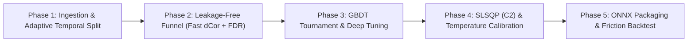

# System Phases & Decomposition: Quant AutoML Pipeline

**System:** Quant AutoML Pipeline  
**Version:** `v1.0.0-PROD-SPEC` (Updated with Quant Master Review)  
**Strategy:** Phân rã thành 5 giai đoạn (phases) độc lập. Mỗi giai đoạn đại diện cho một sub-system hoàn chỉnh có thể phát triển, kiểm thử độc lập (unit & integration tests) và nghiệm thu trước khi bước sang giai đoạn tiếp theo.

> File này là **nguồn duy nhất cho trạng thái phase** (agent cập nhật dòng `Trạng thái` tại đây). Mục tiêu, deliverables và tiêu chí kiểm thử chi tiết nằm trong `PHASE.md` của thư mục step tương ứng.

---

## Roadmap Overview

## Mapping Phase → Step

| Phase | Step folder(s) |
| :--- | :--- |
| Phase 1 | [`01-ingestion-split/`](01-ingestion-split/PHASE.md) |
| Phase 2 | [`02-feature-selection/`](02-feature-selection/PHASE.md) |
| Phase 3 | [`03-model-selection/`](03-model-selection/PHASE.md), [`04-tuning/`](04-tuning/PHASE.md) |
| Phase 4 | [`05-ensemble-calibration/`](05-ensemble-calibration/PHASE.md) |
| Phase 5 | [`06-packaging/`](06-packaging/PHASE.md), [`07-backtest/`](07-backtest/PHASE.md) |

---

## Phase Status

### Phase 1: Data Ingestion, Task Inference & Adaptive Temporal Splitter *(Active / Foundation)*
- **Chi tiết:** [`01-ingestion-split/PHASE.md`](01-ingestion-split/PHASE.md)
- **Trạng thái:** Done

### Phase 2: Leakage-Free Feature Funnel (Fast dCor & FDR Control)
- **Chi tiết:** [`02-feature-selection/PHASE.md`](02-feature-selection/PHASE.md)
- **Trạng thái:** Planned.

### Phase 3: Modern GBDT Tournament & Deep Hyperparameter Optimization
- **Chi tiết:** [`03-model-selection/PHASE.md`](03-model-selection/PHASE.md), [`04-tuning/PHASE.md`](04-tuning/PHASE.md)
- **Trạng thái:** Planned.

### Phase 4: Convex Ensemble Optimization ($C^2$ Objective) & Temperature Calibration
- **Chi tiết:** [`05-ensemble-calibration/PHASE.md`](05-ensemble-calibration/PHASE.md)
- **Trạng thái:** Planned.

### Phase 5: ONNX Model Bundle Packaging & Friction-Aware Blind OOS Backtesting
- **Chi tiết:** [`06-packaging/PHASE.md`](06-packaging/PHASE.md), [`07-backtest/PHASE.md`](07-backtest/PHASE.md)
- **Trạng thái:** Planned.
