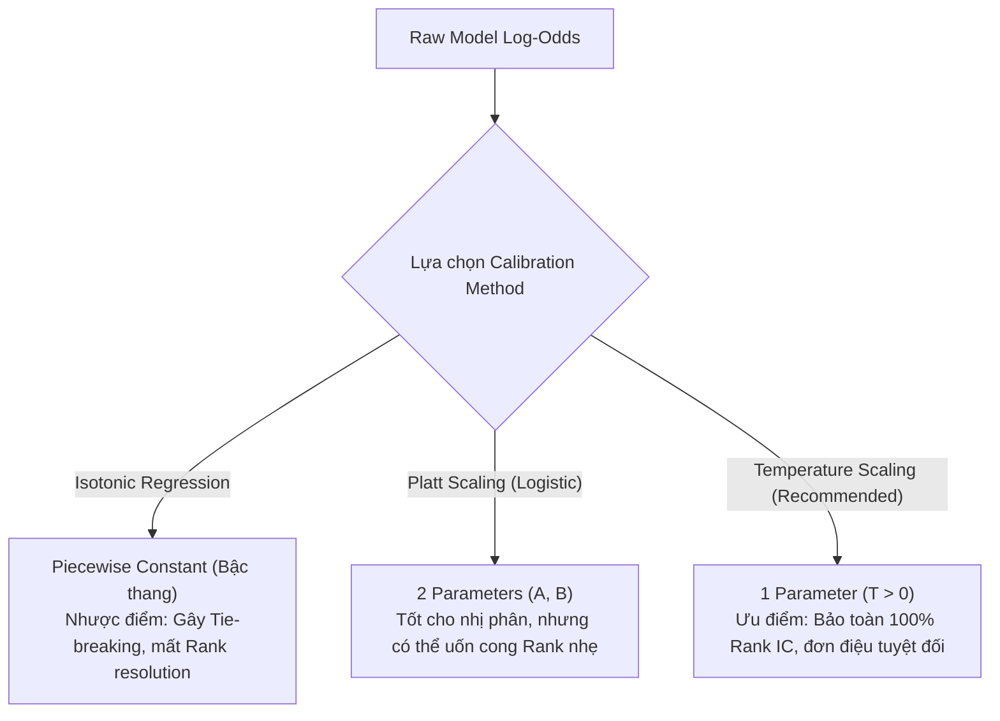

# Architectural & Quantitative Trade-offs: Quant AutoML Pipeline

**System:** Quant AutoML Pipeline  
**Version:** `v1.0.0-PROD-SPEC` (Updated with Quant Master Review)  
**Date:** 2026-11-01  
**Status:** Approved  

Tài liệu này phân tích chi tiết các hướng tiếp cận kỹ thuật, sự đánh đổi (trade-offs), ưu và nhược điểm (pros and cons) đằng sau các quyết định kiến trúc và toán học cốt lõi của hệ thống.

---

## 1. Probability Calibration: Temperature Scaling vs. Platt vs. Isotonic Regression

### So sánh các hướng tiếp cận:
| Tiêu chí | Isotonic Regression | Platt Scaling (Sigmoid) | Temperature Scaling (Được chọn) |
| :--- | :--- | :--- | :--- |
| **Bản chất toán học** | Phi tham số, đơn điệu cục bộ (Piecewise constant step function). | Tham số hóa Logistic 2 tham số: $\sigma(Ax + B)$. | Tham số hóa nhiệt độ 1 tham số: $\sigma(x / T), T > 0$. |
| **Bảo toàn thứ hạng (Rank Invariance)** | ❌ **Kém:** Tạo các đoạn phẳng dẫn đến nhiều mẫu có cùng xác suất (ties). | ⚠️ **Khá:** Giữ thứ tự nếu $A > 0$, nhưng có thể méo biên. | ✅ **Hoàn hảo (100%):** Do hàm chia cho hằng số $T > 0$ là phép biến đổi đơn điệu thuần nhất. |
| **Khả năng overfit mẫu nhỏ** | Rất cao nếu $N < 1,000$. | Thấp (chỉ 2 tham số). | Cực thấp (chỉ tối ưu đúng 1 tham số vô hướng $T$). |
| **Tác động đến Rank IC** | Có thể làm giảm Rank IC do mất độ phân giải thứ hạng. | Giữ nguyên hoặc giảm nhẹ. | **Tuyệt đối không làm thay đổi Rank IC ban đầu.** |

> **Quyết định:** Loại bỏ Isotonic Regression khỏi pipeline. Chuẩn hóa dùng **Temperature Scaling** làm phương pháp mặc định để tối ưu hóa ECE (Expected Calibration Error) mà không làm tổn hại đến khả năng phân hạng alpha của mô hình.

---

## 2. SLSQP Ensemble Objective: Direct Rank IC vs. Standardized Pearson on Rank-Transformed Data

### So sánh các hướng tiếp cận:
- **Hướng tiếp cận A (Direct Rank IC):** Tối ưu hóa trực tiếp hàm Spearman Correlation giữa $\sum w_i \hat{y}_i$ và $y$.
  - *Pros:* Trực diện với mục tiêu đánh giá cuối cùng của chiến lược.
  - *Cons:* Hàm xếp hạng (Ranking) là hàm rời rạc/bậc thang, có đạo hàm bằng $0$ ở mọi điểm liên tục và gián đoạn tại các điểm hoán đổi. Thuật toán `SLSQP` (dựa trên đạo hàm Gradient và ma trận xấp xỉ Hessian Quasi-Newton) sẽ bị kẹt ngay tại điểm khởi đầu (Zero-gradient trap) hoặc hội tụ ngẫu nhiên không ổn định.
- **Hướng tiếp cận B (Pearson Correlation trên Rank-Transformed Data - Được chọn):** Trước khi đưa vào SLSQP, biến đổi vector dự đoán $\hat{y}_i$ của từng model thành giá trị phân hạng chuẩn hóa $\tilde{y}_i = \text{Rank}(\hat{y}_i) / N \in [0, 1]$. Tối ưu hóa Pearson Correlation (hoặc tương đương tối thiểu hóa sai số bình phương có chuẩn hóa) giữa $\sum w_i \tilde{y}_i$ và $\tilde{y}_{true}$.
  - *Pros:* Hàm mục tiêu lúc này thuộc lớp khả vi liên tục bậc hai $C^2$. `SLSQP` hội tụ với tốc độ siêu nhanh (vài mili-giây), tìm được nghiệm tối ưu toàn cục/cục bộ chặt chẽ với các ràng buộc lồi $0.05 \le w_i \le 0.60$ và $\sum w = 1$.
  - *Cons:* Xấp xỉ tiệm cận của Rank IC chứ không phải Rank IC rời rạc gốc (nhưng sai số tiệm cận $\to 0$ khi $N$ đủ lớn).

> **Quyết định:** Sử dụng **Hướng tiếp cận B**. Đảm bảo tính vững chắc về mặt toán giải tích và độ ổn định của thuật toán tối ưu.

---

## 3. Data Partitioning: Static 5-Way Split vs. Adaptive Split (OOF-Assisted)

### Vấn đề:
Việc chia tĩnh cứng nhắc `Train (60%) | Cal-A (10%) | Cal-B (10%) | Val (10%) | OOS (10%)` rất hoàn hảo cho tập dữ liệu lớn ($N \ge 10,000$), nhưng nếu người dùng chạy trên dữ liệu nến ngày (Daily, $N \approx 1,250$ nến):
- Tập Cal-B chỉ có $125$ nến. Tối ưu hóa ma trận trọng số SLSQP trên $125$ nến với Bootstrap sẽ bị nhiễu ước lượng cực lớn (*Estimation Risk / Markowitz Curse*).

### So sánh các hướng tiếp cận:
| Phương án | Cơ chế | Ưu điểm (Pros) | Nhược điểm (Cons) | Áp dụng |
| :--- | :--- | :--- | :--- | :--- |
| **Static 5-Way** | Cố định 5 phân vùng thời gian độc lập. | Triệt tiêu 100% rủi ro rò rỉ; cấu trúc pipeline đơn giản, dễ giải thích. | Tốn kém dữ liệu; Cal-A và Cal-B bị thiếu mẫu nếu $N$ nhỏ. | Khi $N \ge 10,000$ (nến 1m, 5m, 15m, 1h). |
| **Adaptive OOF-Assisted** | Dùng Out-of-Fold (OOF) predictions từ 5-fold Walk-Forward của tập Train để làm dữ liệu cho Cal-A & Cal-B; chỉ giữ lại 3 vùng thời gian: `Train (80%) | Val (10%) | OOS (10%)`. | Tối đa hóa kích thước dữ liệu huấn luyện ($80\%$ thay vì $60\%$); tập Caliberation có kích thước lớn ngang Train. | Độ phức tạp khi điều phối pipeline tăng; phải quản lý cẩn thận OOF metadata. | Khi $N < 5,000$ (nến Daily hoặc thời gian ngắn). |

> **Quyết định:** Hệ thống áp dụng **Adaptive Partitioning**: 
> - Nếu $N \ge 10,000$: Kích hoạt chuẩn Static 5-Way Split (`Train 60% / Cal-A 10% / Cal-B 10% / Val 10% / OOS 10%`).
> - Nếu $N < 5,000$: Tự động gom Cal-A và Cal-B vào luồng OOF của 5-fold Walk-Forward trên Train (Train 80% / Val 10% / OOS 10%) để triệt tiêu lỗi thiếu mẫu thống kê.

---

## 4. Multi-Horizon Gate (F3+7): "Any Horizon" vs. "FDR-Controlled + Term Structure Monotonicity"

### Vấn đề:
Tiêu chí cũ: *"Chỉ cần $\text{ICIR} > 0.3$ ở **bất kỳ** horizon nào trong $\{1, 5, 10, 21\}$"*.
- **Hậu quả:** Gây ra lỗi toán học nghiêm trọng về **Multiple Testing (Data Snooping Bias)**. Với 1,000 features rác hoàn toàn ngẫu nhiên, xác suất có ít nhất 1 horizon đạt $\text{ICIR} > 0.3$ ngẫu nhiên là rất cao.

### Giải pháp & Đánh đổi:
- **Phương án mới (Được chọn):**
  1. Horizon mục tiêu chính ($h_{target}$) bắt buộc phải thỏa mãn: $\text{ICIR}(h_{target}) > 0.30$.
  2. Áp dụng điều chỉnh **Benjamini-Hochberg (FDR $\le 0.05$)** trên tập các features được thử nghiệm.
  3. Kiểm tra tính **Đơn điệu suy giảm của cấu trúc kỳ hạn (Term Structure Monotonicity):** Dự báo tài chính thường có quy luật phân rã thông tin mượt mà theo thời gian. Nếu $h=1$ có IC âm, $h=5$ có IC dương vọt lên, rồi $h=10$ lại sụp đổ, feature đó $99\%$ là overfit/nhiễu.

> **Quyết định:** Bắt buộc áp dụng kiểm soát FDR và kiểm tra tính đơn điệu của IC decay.

---

## 5. Candidate Model Pool: Thêm Random Forest vs. Tinh giản GBDT Trio (LightGBM, CatBoost, XGBoost)

### So sánh:
- **Phương án 1 (Bao gồm Random Forest từ scikit-learn):**
  - *Pros:* Tăng tính đa dạng kiến trúc (Bagging song song vs. Boosting tuần tự).
  - *Cons:* Cây của Random Forest không sâu có giới hạn và không có leaf-wise histogram tối ưu như GBDT. Khi xuất sang file `.onnx`, mô hình RF thường nặng hàng trăm MB, thời gian suy luận tăng vọt lên $> 15\text{ ms/row}$, vi phạm nghiêm ngặt yêu cầu latency $< 5\text{ ms}$.
- **Phương án 2 (Bộ 3 GBDT: LightGBM + CatBoost + XGBoost - Được chọn):**
  - *Pros:* Đạt độ đa dạng thuật toán tối ưu cho dữ liệu dạng bảng (LightGBM dùng Leaf-wise histogram; CatBoost dùng Oblivious/Symmetric Trees & Target Encoding chống rò rỉ; XGBoost dùng Exact/Depth-wise greediness). Trọng lượng ONNX siêu nhẹ ($< 5\text{ MB}$), latency suy luận cực thấp ($< 1.5\text{ ms/row}$).
  - *Cons:* Đều thuộc họ Boosting (tuy nhiên 3 cơ chế xây cây và chia nhánh hoàn toàn khác biệt).

> **Quyết định:** Loại bỏ `RandomForestClassifier/Regressor` khỏi tournament mặc định, tập trung toàn bộ ngân sách 30 trials vào **LightGBM**, **CatBoost**, và **XGBoost**.

---

## 6. Backtest Evaluation: Unconstrained Ranking vs. Turnover-Constrained Portfolio with Friction

### So sánh:
- **Unconstrained Ranking (Long Top 20% / Short Bottom 20% mỗi nến):**
  - *Pros:* Đo lường sức mạnh thuần túy (Theoretical Alpha) của mô hình.
  - *Cons:* Nếu mô hình đổi vị thế liên tục ở mỗi nến (Turnover $\approx 100\%$/nến), sau khi trừ phí giao dịch (ví dụ: Taker $0.05\%$) và trượt giá ($0.02\%$), Sharpe Ratio từ $+2.0$ trên lý thuyết sẽ rơi xuống $-3.0$ trong thực tế.
- **Turnover-Constrained & Friction Matrix (Được chọn):**
  - *Pros:* 
    1. Đưa vào ma trận chi phí ma sát rõ ràng: $\text{Net Return} = \text{Gross Return} - \text{Turnover} \times (\text{Fee} + \text{Slippage})$.
    2. Cơ chế **Hysteresis Buffer Bands**: Chỉ thay thế một tài sản trong Top 20% nếu thứ hạng của nó tụt xuống dưới mức 30% (ngăn chặn việc ra vào lệnh chỉ vì dao động thứ hạng nhỏ ở ranh giới).
  - *Cons:* Đòi hỏi logic backtesting phức tạp hơn.

> **Quyết định:** Chuẩn hóa việc đánh giá nghiệm thu OOS phải phản ánh **Net Sharpe Ratio (sau phí ma sát)** và có cơ chế buffer band kiểm soát vòng quay danh mục.

---

## 7. F1 NaN Triage: Continuous vs. Discrete (Bool & Categorical) Handling

### Vấn đề:
Trong dữ liệu dạng bảng định lượng (đặc biệt là phái sinh VN30F), ngoài các biến số thực liên tục (giá, khối lượng, returns, indicators), hệ thống còn chứa các biến nhị phân (boolean) và biến định danh (categorical) đã qua ordinal-encoding (ví dụ: `is_expiry_day`, `session_phase`, `trend_regime`).
Nếu đối xử với các cột này hoàn toàn như biến liên tục trong tầng F1:
1. **Ước lượng MI sai lệch & chậm:** Hàm `mutual_info_classif` của scikit-learn mặc định dùng xấp xỉ liên tục qua $k$-NN (Kraskov-Stögbauer-Grassberger). Với biến rời rạc chỉ nhận vài giá trị nguyên, việc dùng $k$-NN liên tục bị chậm và gây sai số do hiện tượng trùng tọa độ (ties).
2. **Sinh cột trùng lặp (Redundancy / Dual Indicator):** Các cột boolean trong thực tế thường được ghi nhận dưới dạng `1.0` (khi có sự kiện) và `NaN` (khi không có sự kiện). Nếu F1 tự động sinh cột `is_nan_*`, cột mới này là bản sao phủ định đối xứng hoàn hảo ($is\_nan = 1 - col$), gây dư thừa chiều dữ liệu.

### So sánh các hướng tiếp cận:
| Tiêu chí | Phương án A: Bỏ qua (Skip) Bool & Categorical ở F1 | Phương án B: Xử lý đồng nhất như biến liên tục | Phương án C: Xử lý có nhận biết kiểu rời rạc (Được chọn) |
| :--- | :--- | :--- | :--- |
| **Bảo vệ chống dữ liệu rác** | ❌ **Rất nguy hiểm:** Cột bool/cat bị thiếu $> 60\%$ hoặc toàn NaN không bị lọc, lọt vào tầng sau làm hỏng ma trận/cây. | ✅ Tốt: Lọc sạch NaN/Inf qua Hard Gate. | ✅ Tốt: Áp dụng Hard Gate bình đẳng cho mọi loại dữ liệu. |
| **Độ chính xác tính MI** | Không tính được điểm để triage. | ⚠️ Kém: Dùng $k$-NN liên tục bị chậm và méo điểm do ties. | ✅ **Hoàn hảo:** Truyền `discrete_features` mask để tính MI theo công thức xác suất rời rạc giải tích, nhanh gấp $3-5$ lần. |
| **Tránh cột đối ngẫu thừa** | N/A | ❌ Dễ sinh thêm cột `is_nan` đối xứng với cột cờ $0/1$. | ✅ **Thông minh:** Không sinh `is_nan` nếu cột bool chỉ có 1 giá trị thực sự kèm NaN, mà chỉ impute bù. |

> **Quyết định:** Áp dụng **Phương án C**. F1 không bỏ qua bool/categorical nhưng nhận biết danh sách discrete features từ `FitContext` để tối ưu hóa MI rời rạc và ngăn chặn sinh cờ đối ngẫu trùng lặp.
