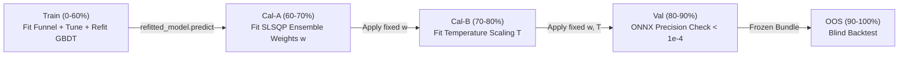
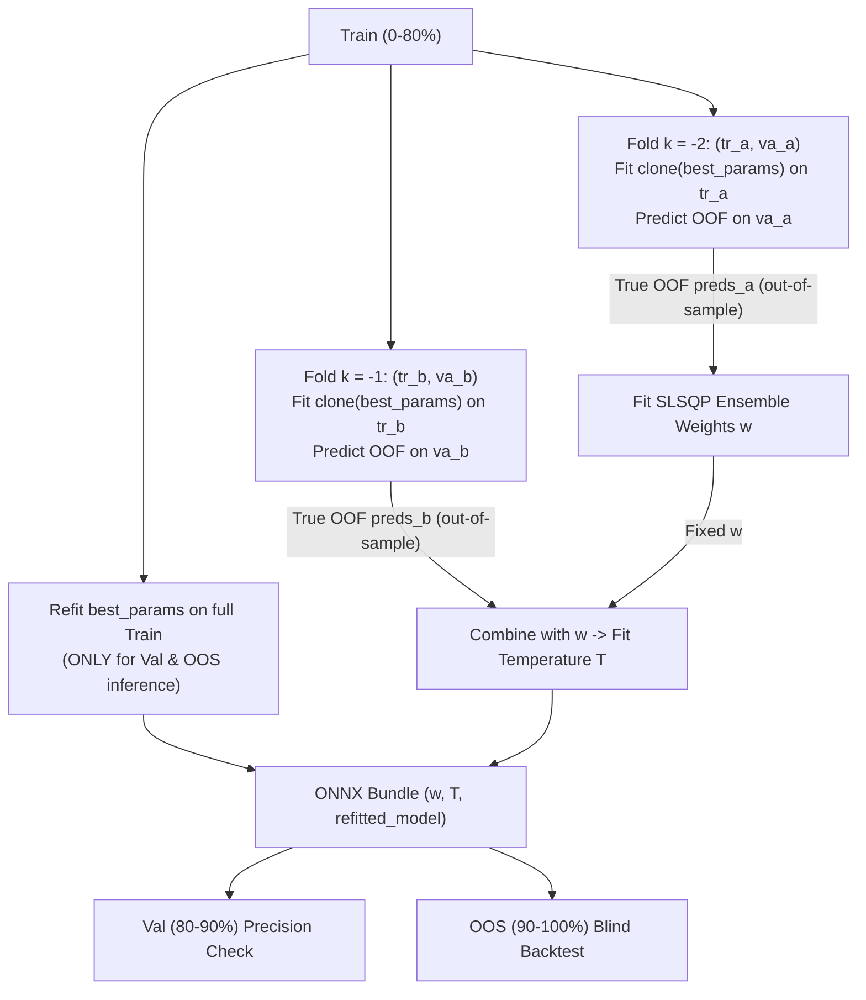

# System Architecture & Data Flow Changes — `v1.1-fix1`

## 1. Tổng Quan Kiến Trúc Cải Tiến

`v1.1-fix1` giữ nguyên kiến trúc 6 tầng đơn hướng của `quantautoml` nhưng sửa lại **luồng dữ liệu nhân quả ở Phase 4 (Ensemble & Calibration)** và **công thức thống kê tại Phase 2, 3, 6** để loại bỏ rò rỉ ngầm và thiên lệch ước lượng.

---

## 2. Luồng Dữ Liệu Nhân Quả Mới (Phase 1 Fix — Audit #1 & #2)

### 2.1. Chế độ `STATIC_5WAY` ($N \ge 10{,}000$)

- **Trước `v1.1-fix1`:** Fit Ensemble trên `Cal-B` (tương lai) rồi mang ngược `w` về `Cal-A` (quá khứ) để fit `T`.
- **Sau `v1.1-fix1`:** Thuần nhân quả theo thời gian `Train → Cal-A (SLSQP w) → Cal-B (Temp T) → Val → OOS`. `T` được hiệu chuẩn trên regime gần `Val`/`OOS` nhất.

### 2.2. Chế độ `OOF_ASSISTED` ($N < 10{,}000$)

- **Đảm bảo RULE-01:** Mọi dự đoán đi vào SLSQP (`va_a`) và Temperature Scaling (`va_b`) đều được tạo ra từ model **chưa từng thấy** các dòng `va_a` / `va_b` (với purging/embargo đúng `horizon_h` nến giữa `tr` và `va`).

---

## 3. Công Thức Toán Học Cải Tiến

1. **F2 Near-Constant Check (Phase 1 — Audit #6):**
   $$\text{top\_freq\_ratio}(X_j) = \frac{\max_v \text{count}(X_j = v)}{N_{\text{valid}}}$$
   Loại cột nếu $n_{\text{unique}} < 2$ hoặc $\text{top\_freq\_ratio} > \tau_{\text{freq}}$ (mặc định $0.995$). Đại lượng này **bất biến theo cỡ mẫu $N$**: cột `session_progress` (50 giá trị đều nhau) có $\text{top\_freq\_ratio} \approx 0.02 \ll 0.995$ dù $N = 1{,}000$ hay $N = 1{,}000{,}000$.

2. **F3+7 Autocorrelation-Safe p-value (Phase 2 — Audit #3):**
   Trên chuỗi $M$ cửa sổ `rolling_ic` không chồng lấn $\{r_1, \dots, r_M\}$ tại `target_horizon`:
   $$t = \frac{\bar{r}}{s_r / \sqrt{M}}, \qquad p = 2 \cdot (1 - F_{t_{M-1}}(|t|))$$
   Sau đó đưa vector $p$-value này vào Benjamini-Hochberg ($\text{FDR} \le 0.05$).

3. **Daily-Aggregated Net Sharpe (Phase 3 — Audit #8):**
   Gom lợi nhuận ròng theo ngày giao dịch $d$: $R_{\text{day}, d} = \prod_{t \in d} (1 + r_{\text{net}, t}) - 1$, sau đó:
   $$\text{Net Sharpe}_{\text{daily}} = \frac{\bar{R}_{\text{day}}}{s(R_{\text{day}})} \times \sqrt{252}$$
   Tránh méo mó do autocorrelation nến 5 phút và overnight gap.
