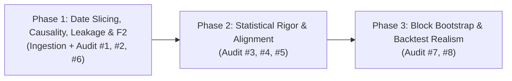

# System Phases & Decomposition — `v1.1-fix1`

**System:** Quant AutoML Pipeline (`v1.1-fix1` — Quant Audit Remediation)
**Branch:** `develop/v1.1`
**Strategy:** Chia 8 hạng mục khắc phục thành 3 Phase độc lập, ưu tiên xử lý dứt điểm rò rỉ dữ liệu & tính nhân quả trước, sau đó nâng cấp độ chặt thống kê của phễu/CV, và cuối cùng là độ tin cậy của Bootstrap & Backtesting.

---

## Roadmap Overview

---

## Phase Breakdown

### Phase 1: Ingestion Date Slicing, Causality, Leakage & Feature Filter Rigor *(Active)*
- **Objective:** Bổ sung cắt khoảng thời gian `date_from`/`date_to` ngay đầu bước Ingestion, triệt tiêu hoàn toàn rò rỉ in-sample ở `OOF_ASSISTED`, sửa thứ tự nhân quả `Cal-A`/`Cal-B`, và sửa lỗi F2 `unique_ratio` loại nhầm biến rời rạc/chu kỳ.
- **Key Deliverables:**
  1. **Ingestion Date-Range Slicing (`data/ingestion.py`, `common/config.py`):** Cấu hình `date_from` / `date_to` (ISO-8601, tùy chọn 1 đầu hoặc cả 2 đầu) cắt `features` và `labels` ngay sau khi chuẩn hóa timestamp UTC, trước mọi xử lý khác (không look-ahead vượt quá `date_to`).
  2. **True OOF Predictions cho Phase 4 (`OOF_ASSISTED`):** Bổ sung sinh OOF predictions sạch từ từng fold Train để `pipeline.py` truyền vào `BootstrapShrinkageEngine` và `TemperatureCalibrator` khi $N < 10{,}000$.
  3. **Causal Order `Cal-A → Cal-B`:** Fit trọng số SLSQP Ensemble trên `Cal-A` (60–70%), sau đó fit Temperature Scaling trên `Cal-B` (70–80%) trên xác suất đã trộn.
  4. **Sample-Size-Invariant F2 Filter:** Thay cổng drop chính từ `unique_ratio` sang `max_top_freq_ratio` (mặc định `0.995`), đặt mặc định `min_unique_ratio = 0.0` (tùy chọn opt-in), và xử lý dead gate `max_peak_var_ratio`.
- **Independent Testability:**
  - Unit test xác nhận `date_from`/`date_to` cắt đúng inclusive, hỗ trợ cả định dạng ngày (`YYYY-MM-DD`, end-of-day cho `date_to`) lẫn datetime ISO-8601, từ chối `date_from > date_to`, ném `InvalidDataError` khi rỗng, và dữ liệu ngoài khoảng không ảnh hưởng tới encoding/join/`fwd_ret_h`.
  - Integration test chứng minh trong `OOF_ASSISTED`, dự đoán dùng cho Phase 4 **không bao giờ** trùng khớp với `refitted_model.predict(train_subset)` và bất biến khi phá dữ liệu tương lai.
  - Unit & integration test xác nhận `Cal-A` độc lập với mọi biến đổi của `Cal-B` (ensemble weights chỉ phụ thuộc `Cal-A`).
  - Unit test xác nhận biến rời rạc (`session_progress`, `hour`, `body`, `cluster_kmeans`) trên $N = 60{,}000$ không bị F2 loại nhầm, trong khi cột near-constant ($\ge 99.5\%$ một giá trị) bị loại đúng.
- **Status:** Done

---

### Phase 2: Statistical Rigor & Objective Alignment *(Done)*
- **Objective:** Khắc phục sai lệch thống kê trong F3+7 (FDR & Monotonicity), ổn định hóa ước lượng `IC Sharpe` trong Walk-Forward CV, và thống nhất định nghĩa Score xuyên suốt từ Tournament đến ONNX Predictor.
- **Prerequisites:** Phase 1 Done.
- **Key Deliverables:**
  1. **Autocorrelation-Safe BH-FDR & Post-Target Monotonicity (`features/ic_stability.py`):** Tính p-value từ chuỗi `rolling_ic` không chồng lấn; kiểm tra suy giảm đơn điệu từ `target_horizon` trở đi.
  2. **Rolling-IC Sharpe in CV & Aligned Pruner (`models/tournament.py`, `models/tuner.py`):** Tính `IC Sharpe` trên chuỗi rolling IC nội bộ của các fold (tăng bậc tự do ước lượng); đồng bộ đơn vị báo cáo của `HyperbandPruner`.
  3. **Unified Multiclass Score & Ensemble Scaling (`pipeline.py`, `models/`, `ensemble/`, `packaging/`):** Dùng đúng `classes` thật ở mọi tầng; đảm bảo tính nhất quán thang đo giữa SLSQP và `predictor.py` mà vẫn giữ sai số ONNX $< 10^{-4}$.
- **Independent Testability:**
  - Test trên chuỗi autoregressive tổng hợp xác nhận BH-FDR không bị false positive tràn lan; test feature đạt đỉnh ở $h=5$ không bị loại bởi monotonicity gate.
  - Test xác nhận model có IC ổn định cao luôn thắng model IC thấp nhưng 5 fold ngẫu nhiên sát nhau.
  - Test multiclass với nhãn không đều (vd `[-2, 0, 5]`) cho score khớp tuyệt đối giữa Python và ONNX Predictor.
- **Status:** Done

---

### Phase 3: Time-Series Bootstrap & Production Backtest Realism *(Done)*
- **Objective:** Nâng cấp thống kê bất định của trọng số Ensemble và độ tin cậy nghiệm thu OOS theo chuẩn quỹ định lượng thực chiến.
- **Prerequisites:** Phase 2 Done.
- **Key Deliverables:**
  1. **Moving Block Bootstrap & OOF Hurdle Gate (`ensemble/bootstrap.py`):** Lấy mẫu theo khối liên tiếp (`block_size >= 2 * horizon_h`) và đánh giá Hurdle `+5%` trên dự đoán out-of-sample (không in-sample).
  2. **Daily Net Sharpe, DSR & Execution Alignment (`backtest/evaluator.py`, `backtest/runner.py`):** Báo cáo Daily-aggregated Net Sharpe ($\times\sqrt{252}$) và Deflated Sharpe Ratio (DSR); hỗ trợ tùy chọn khớp `Open[t+1]` cho Tier 1.
  3. **Multi-Window Walk-Forward OOS (`backtest/walkforward.py`, `pipeline.py`):** Đánh giá chiến lược trên nhiều cửa sổ OOS nối tiếp thay vì chỉ 1 đoạn 10% cuối cùng.
- **Independent Testability:**
  - Test xác nhận Block Bootstrap giữ nguyên cấu trúc block liên tiếp và Hurdle gate không bị lạc quan giả trên dữ liệu nhiễu thuần.
  - Test so sánh Daily Net Sharpe trên dữ liệu có overnight gap; test Walk-Forward OOS đảm bảo mọi cửa sổ tuân thủ purging/embargo $h$ nến.
- **Status:** Done
