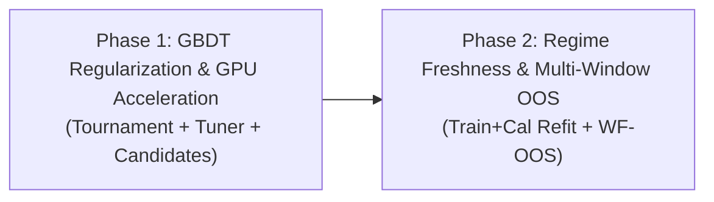

# System Phases & Decomposition — `v1.1-fix2`

**System:** Quant AutoML Pipeline (`v1.1-fix2` — GBDT Regularization & OOS Robustness)
**Branch:** `develop/v1.1`
**Commit Policy:** 1 commit cho mỗi Phase hoàn chỉnh.

---

## Roadmap Overview

---

## Phase Breakdown

### Phase 1: GBDT Regularization, Search-Space Hardening & GPU Acceleration *(Done)*
- **Objective:** Siết chặt regularization với biên "điểm ngọt" trong `ModelTournament` & `DeepOptunaTuner` để chặn overfit mà không bị underfit, đồng thời bật tăng tốc GPU (CUDA) cho XGBoost & CatBoost.
- **Key Deliverables:**
  1. Hàm tính cận động theo cỡ mẫu Train cho `min_child_samples` (LightGBM) và `min_child_weight` (XGBoost).
  2. Biên siêu tham số cân bằng: `max_depth` / `depth` $\in [3, 7]$, `num_leaves` $\in [7, 47]$, `learning_rate` $\in [0.01, 0.08]$, `n_estimators` $\in [50, 300]$, `l2_leaf_reg` $\in [2.0, 20.0]$.
  3. Hỗ trợ `models.device = "auto" | "cpu" | "cuda"` cho XGBoost (`device="cuda"`) và CatBoost (`task_type="GPU"`, `bootstrap_type="Bernoulli"`), giữ LightGBM trên CPU, đảm bảo ONNX parity `< 1e-4`.
  4. Bộ unit test xác minh biên tham số, co giãn động và chọn thiết bị GPU/CPU.
- **Independent Testability:**
  - Unit test trên `n=250` và `n=50_000` xác nhận `min_child_samples` co giãn đúng (`>= 50` khi `n=50_000`, `>= 10` khi `n=250`), `max_depth <= 7`, `num_leaves <= 47`, `learning_rate <= 0.08`.
  - Unit test xác nhận `device="cpu"` không gọi GPU, `device="auto"` phát hiện GPU an toàn, và model train trên GPU vẫn export ONNX với sai số `< 1e-4`.
  - Toàn bộ `uv run pytest tests/` PASS 100%.
- **Status:** Done

---

### Phase 2: Regime Freshness & Multi-Window Walk-Forward OOS *(Queued after `v1.1-optimize3`)*
- **Objective:** Khắc phục việc bỏ trống 20% dữ liệu gần OOS nhất (Cal-A/Cal-B) và loại bỏ rủi ro đánh giá OOS trên 1 đoạn duy nhất.
- **Prerequisites:** Phase 1 Done.
- **Key Deliverables:**
  1. Tùy chọn `models.refit_on_train_cal: bool = False` (opt-in) trong `pipeline.py`.
  2. Module `src/quantautoml/backtest/walkforward.py` hỗ trợ chạy nghiệm thu trên nhiều cửa sổ OOS nối tiếp có purging/embargo `horizon_h`.
- **Independent Testability:**
  - Zero-leakage test chứng minh `refit_on_train_cal` không bao giờ chạm `Val`/`OOS`; Walk-Forward OOS test xác nhận mọi ranh giới cách nhau đúng `horizon_h` nến.
- **Status:** Planned
