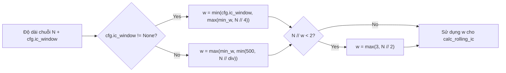
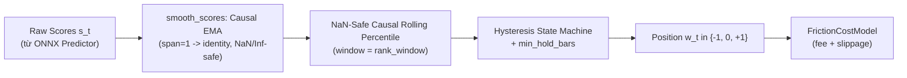

# System Architecture — `v1.1-optimize3`

**Scope:** Cải tiến toán học và luồng dữ liệu cho 3 điểm chạm: Rolling IC Window (Phase 1), Causal Hysteresis Execution (Phase 2), và Cross-Regime Diagnostics (Phase 3).

---

## 1. Vấn đề Toán học của Rolling IC trên Dữ liệu Intraday (Phase 1)

Khi nhãn mục tiêu có kỳ hạn $h > 1$ (ví dụ `tb5_label` trên nến 5 phút), chuỗi $(X_t, y_t)$ có độ tự tương quan theo phiên/regime rất cao. Nếu tính Spearman Rank IC trên cửa sổ quá ngắn $W = 50$ nến (~4 giờ, chưa tới 1 phiên):

- Trong nhiều cửa sổ con, thị trường đi 1 chiều hoặc biên độ hẹp khiến $\text{Var}(y_{t:t+W})$ rất thấp hoặc bị chi phối bởi 1 nhịp nhiễu vi mô.
- Hệ quả là **Nghịch lý Simpson**: $\text{RankIC}(\hat{y}, y) > 0$ trên toàn đoạn và trên cửa sổ $W=500$, nhưng $\mathbb{E}[\text{RankIC}_W] < 0$ khi $W=50$:
  - Thực nghiệm trên `v3` `cal_a` ($N = 7{,}585$, đầu vào của `BootstrapShrinkageEngine`): `overall_IC = +0.1120` (trước `T`), `ICIR(500) = +0.4752`, nhưng `ICIR(50) = -0.1564`.
  - Thực nghiệm trên `v3` `oos` ($N = 7{,}585$): `overall_IC = +0.0846`, `ICIR(500) = +0.4970`, nhưng `ICIR(50) = -0.0447`.

### Công thức chọn cửa sổ thích ứng (`_resolve_ic_window` & `fold_subwindow_ics`)

- **Trong `BootstrapShrinkageEngine` (`cal_a` ở chế độ `STATIC_5WAY` thường dài `N ≈ 7,585`; hoặc `va_a` ở chế độ `OOF_ASSISTED`):**
  - Khi `ic_window is None`: `min_w = 10`, `div = 10`, trần `500` → với `N = 7,585`, `w = min(500, 758) = 500` (`15` cửa sổ không chồng lấp, khớp với `backtest.ic_window = 500`).
  - Khi `ic_window` được cấu hình tường minh (vd `500`): clamp bởi `max(10, N // 4)` để trên chuỗi lớn (`7,585 // 4 = 1,896 >= 500`) vẫn giữ nguyên `500`, còn trên mẫu nhỏ (`OOF_ASSISTED` `N = 380` hoặc unit test `N = 200`) vẫn có ít nhất `4` cửa sổ thay vì suy biến về `2` cửa sổ (`ddof=1`, 1 bậc tự do).
  - **Validate biên gọi trực tiếp & Sửa điều kiện fallback trong `_calc_series_ic_sharpe`:** Nếu `ic_window` được truyền trực tiếp qua Python `< 3`, ném lỗi sớm (`InvalidDataError`/`ValueError`) vì `calc_rank_ic` yêu cầu tối thiểu 3 cặp. Chỉ fallback sang `calc_rank_ic(pred, target)[0]` khi số cửa sổ hợp lệ `< 2`, `np.ptp(valid) == 0.0`, hoặc `std(valid, ddof=1) <= 1e-12` (khớp hoàn toàn `calc_icir()`, không fallback chỉ vì `mean == 0.0` khiến `IC Sharpe == 0.0`, tránh trộn lẫn thang đo `Rank IC` và `IC Sharpe` trong cổng `RULE-05`).
- **Trong `fold_subwindow_ics` (`tournament.py` / `tuner.py`, mỗi fold test trên `Train` dài `N ≈ 4,563`):**
  - Khi `ic_window is None`: `min_w = 20`, `div = 4`, trần `500` → với `N = 4,563`, `w = 500` (`9` cửa sổ/fold × 5 folds = **45 cửa sổ không chồng lấp**).
  - Khi `ic_window is not None`: kiểm tra `ic_window >= 3` (nếu không → `InvalidDataError`), đặt `sub_w = min(ic_window, max(20, N // 4))`.
  - Với fold nhỏ (`N < 40` hoặc `< 2` cửa sổ hợp lệ): fallback về `[float(calc_rank_ic(pred, y_fold)[0])]`.

---

## 2. Luồng Tín hiệu Nhân quả trong Hysteresis Buffer (Phase 2)

- **Validate cấu hình:** `HysteresisBuffer.__init__` kiểm tra `signal_ema_span >= 1` và `min_hold_bars >= 0` (`ValueError` nếu vi phạm).
- **Causal EMA (`smooth_scores`, an toàn với `NaN`/`±inf`):**
  - Khi `signal_ema_span == 1`: trả về nguyên bản `np.asarray(scores, dtype=np.float32)` (bảo toàn 100% tương thích ngược bit-for-bit); mảng rỗng trả mảng rỗng `float32`.
  - Khi `signal_ema_span > 1`: tích lũy bằng `float64` theo $\tilde{s}_t = \alpha s_t + (1 - \alpha)\tilde{s}_{t-1}$ với $\alpha = \frac{2}{\text{span} + 1}$, rồi cast về `np.float32`, chỉ dùng dữ liệu $\le t$ (`RULE-01`). Khởi tạo trạng thái tại giá trị hữu hạn (`np.isfinite`) đầu tiên; nếu $s_t$ không hữu hạn (`NaN`/`±inf`), xuất `NaN` tại bar $t$ nhưng giữ nguyên trạng thái EMA gần nhất để không đầu độc các bar $t+1\dots$
- **NaN-Safe `rolling_percentile(scores)` & tách biệt Raw Score (`RULE-02`):**
  - Giữ `rolling_percentile(scores)` thuần túy không tự smooth; `positions(scores)` gọi `self.positions_from_percentile(self.rolling_percentile(self.smooth_scores(scores)))`.
  - Khi `scores[t]` không hữu hạn (`NaN`/`±inf`), `rolling_percentile` bắt buộc trả `np.nan` tại bar $t$ (tránh bug cũ `(0 + 0.5*(0-1))/(w-1) < 0` làm `positions_from_percentile` mở lệnh Short giả trên bar `NaN`), và khi đếm hạng trong cửa sổ chỉ tính trên các phần tử hữu hạn (trả `NaN` nếu số phần tử hữu hạn `< 2`, trả `0.5` nếu bằng nhau; bit-identical khi toàn bộ cửa sổ hữu hạn).
  - `OOSBacktestRunner` vẫn truyền **raw** `scores` (từ `Predictor.predict`) vào `evaluate_oos_performance()` để `rank_ic`, `icir`, `downside_ic` luôn đo alpha gốc của model bundle.
- **Minimum Holding Period (`min_hold_bars`):**
  - Khi đang phẳng (`state == 0`) và mở vị thế ở bar $t$ (`0 → ±1`): đặt `held = 1` (tính bar $t$ là bar giữ thứ nhất).
  - Ở bar tiếp theo, khi đang giữ vị thế (`state != 0`):
    - Nếu `np.isnan(p)`: đặt `state = 0.0`, `held = 0` (ưu tiên an toàn khi mất tín hiệu).
    - Ngược lại, kiểm tra **trước**: nếu `held < min_hold_bars`, giữ nguyên `state`, tăng `held += 1`, và bỏ qua logic thoát/đảo chiều ở bar đó.
    - Chỉ khi `held >= min_hold_bars` mới xét điều kiện thoát `exit_pct` (nếu thoát về `0` thì đặt `held = 0` và xét mở mới `enter_pct` với `held = 1`; nếu tiếp tục giữ nguyên `state != 0` thì tăng `held += 1`).
    - Ví dụ `min_hold_bars = 5`: mở ở bar $t$ (`held=1`), bắt buộc giữ qua $t+1\,(2), t+2\,(3), t+3\,(4), t+4\,(5)$, và từ bar $t+5$ (`held >= 5`) mới được phép thoát. Với `min_hold_bars = 0` hoặc `1`, hành vi khớp với phiên bản gốc (mở ở $t$, bar $t+1$ đã có `held=1 >= min_hold_bars`).

---

## 3. Kiến trúc Chẩn đoán Đa Regime (Phase 3)

- `backtest/diagnostics.py` là module **read-only** nhận `bundle_dir` đã đóng gói và từ điển `segments: dict[str, Segment]` (`cal_a`, `cal_b`, `val`, `oos`), cùng lệnh CLI `quantautoml diagnose --run-dir <dir>` đọc từ artifacts đã lưu (`01_data/segments/*.npz`, `01_data/02_task.json`, `05_packaging/bundle/`, `config.toml`; nếu thiếu `[backtest]` trong `config.toml` thì fallback về `BacktestConfig()` mặc định).
- Tái sử dụng helper tính return/alignment và `evaluate_oos_performance` dùng chung với `runner.py` (không nhân bản logic cắt `close` / `next_open`), chạy `Predictor.predict()` thuần inference (không gọi `fit()`, không sửa bất kỳ file nào trong bundle, `latency_ms = None` để không lặp benchmark 200 lần trên mỗi segment).
- Dùng schema `SegmentDiagnostic` riêng (không dùng `OOSMetrics.accepted` / `failed_gates` vốn đánh trượt gate `"latency"` khi `latency_ms=None`), ghi song song cho cả `execution_price = "close"` và `"next_open"`: `rank_ic`, `icir`, `gross_sharpe`, `net_sharpe`, `daily_net_sharpe`, `deflated_sharpe_ratio`, `max_drawdown`, `mean_turnover`, `downside_ic`, `n_stress_bars`, `n_overnight_gaps`, và `quant_gates` (5 gate định lượng, không gồm `"latency"`).
- Xử lý biên an toàn: nếu segment không tồn tại (`OOF_ASSISTED`), thiếu `y`, ngắn hơn `rank_window + 2`, thiếu cột `Open` (cho nhánh `next_open`), hoặc `BacktestError` (giá `Close`/`Open` chứa `NaN`/`<= 0`, timestamps không tăng ngặt), ghi `"status": "skipped", "reason": "..."` thay vì ném exception làm hỏng toàn bộ báo cáo.
- Xuất tệp riêng **`06_backtest/03_regime_diagnostics.json`** (tránh trùng tên với `02_realworld_report.json` của Tier 2) và không làm thay đổi logic gate của `01_backtest_report.json`. Lưu ý khi benchmark `next_open` + Tier 2 qua `quantautoml run`: `OOSBacktestRunner` chỉ tự kích hoạt `RealWorldBacktestRunner` khi Tier 1 `accepted == true`.
