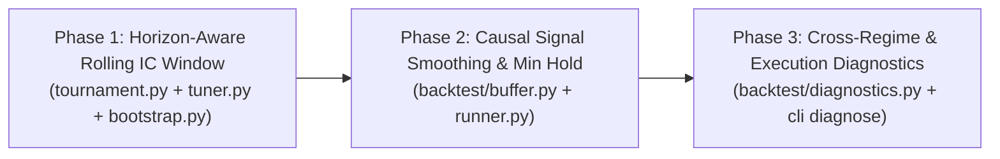

# System Phases & Decomposition — `v1.1-optimize3`

**System:** Quant AutoML Pipeline (`v1.1-optimize3` — IC Window Alignment, Turnover Control & Regime Diagnostics)  
**Branch:** `develop/v1.1`  
**Strategy:** Phân rã thành 3 giai đoạn độc lập, kiểm thử và bàn giao riêng rẽ theo thứ tự ưu tiên rủi ro định lượng cao nhất trước. Thực hiện trước `v1.1-fix2` Phase 2 để bảo đảm thước đo `IC Sharpe` và kiểm soát vòng quay đã chuẩn hóa trước khi chạy `Multi-Window Walk-Forward OOS`.  
**Commit Policy:** 1 commit duy nhất cho mỗi Phase hoàn chỉnh.

---

## Roadmap Overview

---

## Phase Breakdown

### Phase 1: Horizon-Aware Rolling IC Window & Ensemble Diagnostics *(Done)*
- **Objective:** Loại bỏ ngưỡng trần quá nhỏ (`50` / `63` nến) khi tính rolling IC Sharpe trong `BootstrapShrinkageEngine` (chạy trên `Cal-A` / OOF), `ModelTournament` và `DeepOptunaTuner`, chấm đúng dấu `ICIR` trên dữ liệu intraday nhiều tự tương quan và minh bạch hóa quyết định hurdle `RULE-05`.
- **Key Deliverables:**
  1. `ModelsConfig.ic_window: int | None = None` (`ge=20`) và `EnsembleConfig.ic_window: int | None = None` (`ge=20`).
  2. Hàm chọn cửa sổ thích ứng trong `tournament.py` (`fold_subwindow_ics`) và `bootstrap.py` (`_resolve_ic_window`, `_calc_series_ic_sharpe`), tự mở rộng lên tối đa `500` nến khi đủ mẫu (`N >= 5,000`), clamp an toàn theo `n // 4` trên mẫu nhỏ và sửa lỗi fallback lẫn thang đo `score == 0.0`.
  3. Bổ sung `ic_window_used`, `single_model_scores`, `overall_rank_ic` vào `EnsembleWeightsResult` cho cả nhánh `n_models == 1` và `n_models > 1`.
  4. Unit tests theo TDD trong `test_models_config.py`, `test_ensemble_config.py`, `test_tournament.py`, `test_tuner.py`, `test_bootstrap_shrinkage.py`; đồng bộ `scripts/generate_config.py` và `docs/CONFIGURATION.md`.
- **Independent Testability:**
  - Unit test trên chuỗi dài (`n=4500..7500`) xác nhận `window` tự động chọn `500` và không bị kẹt ở `50`/`63`.
  - Unit test trên mẫu nhỏ (`n=60..250`) và `ic_window` tường minh lớn hơn `n // 4` xác nhận clamp an toàn (không suy biến còn 2 cửa sổ) và không làm hỏng test cũ.
  - Nhánh `n_models == 1` điền đầy đủ `ic_window_used`, `single_model_scores`, `overall_rank_ic`.
  - Toàn bộ `uv run pytest tests/` PASS 100%.
- **Status:** Done

---

### Phase 2: Causal Signal Smoothing & Minimum Holding Period *(Active)*
- **Objective:** Giảm hao hụt Sharpe do chi phí ma sát (`mean_turnover ~ 0.037/bar`) bằng cách làm mượt điểm tín hiệu nhân quả và áp đặt thời gian giữ vị thế tối thiểu phù hợp horizon của nhãn (`tb5_label`).
- **Prerequisites:** Phase 1 Done.
- **Key Deliverables:**
  1. `BacktestConfig.signal_ema_span: int = 1` (`ge=1`) và `BacktestConfig.min_hold_bars: int = 0` (`ge=0`).
  2. Method `smooth_scores()` (EMA nhân quả an toàn với `NaN`/`±inf`), `rolling_percentile()` NaN-safe (không sinh percentile âm giả khi `scores[t]` là `NaN`), và logic `min_hold_bars` trong `HysteresisBuffer` (`src/quantautoml/backtest/buffer.py`), truyền từ `OOSBacktestRunner` (vẫn chấm `evaluate_oos_performance` bằng raw `scores`).
  3. Unit test trong `test_backtest_config.py`, `test_buffer.py`, và `test_runner.py` xác nhận tính nhân quả tuyệt đối (`RULE-01`), xử lý `NaN` an toàn ở cả `smooth_scores` lẫn `positions()`, biên `min_hold_bars` chính xác (không off-by-one), nối dây `OOSBacktestRunner`, và giảm turnover rõ rệt trên tín hiệu nhiễu.
- **Independent Testability:**
  - Causality test: thay đổi `scores[t+1:]` bất kỳ không làm thay đổi `positions[:t+1]` dù 1 bit.
  - Backward-compatibility test: với `signal_ema_span=1, min_hold_bars=0`, đầu ra giống hệt bit-for-bit phiên bản trước.
- **Status:** In Progress

---

### Phase 3: Cross-Regime Diagnostic & Realistic Execution Verification *(Planned)*
- **Objective:** Đánh giá độ ổn định của model bundle qua nhiều regime biến động khác nhau (`cal_a`, `cal_b`, `val`, `oos`) và kiểm chứng độ nhạy thực thi (`close` vs `next_open` và Tier 2 `backtesting.py`).
- **Prerequisites:** Phase 2 Done.
- **Key Deliverables:**
  1. Module `src/quantautoml/backtest/diagnostics.py` (read-only, tái sử dụng helper tính return/metric chung từ `runner.py`) đánh giá 1 bundle đã đóng gói trên danh sách segment (`cal_a`, `cal_b`, `val`, `oos`) và so sánh `close` vs `next_open`, dùng `SegmentDiagnostic` tách khỏi gate `"latency"` (tránh fail giả khi `latency_ms=None`), xử lý mượt segment thiếu/ngắn/giá lỗi (`status="skipped"`), xuất `06_backtest/03_regime_diagnostics.json`.
  2. Lệnh CLI `quantautoml diagnose --run-dir <dir>` trong `src/quantautoml/cli.py` (fallback về `BacktestConfig()` nếu `config.toml` thiếu `[backtest]`, không làm thay đổi hành vi mặc định của `quantautoml run`).
  3. Unit/CLI test trong `test_backtest_diagnostics.py` và `test_cli.py` kiểm tra zero-leakage (không `fit()`, không sửa file trong bundle) và xác minh báo cáo JSON hợp lệ; đồng bộ `docs/OUTPUTS.md` và `docs/STRUCTURE.md`.
  4. Thử nghiệm thực tế trên `tb5_label` với `execution_price = "next_open"` và Tier 2 (`RealWorldBacktestRunner`; lưu ý Tier 2 chỉ tự chạy qua `OOSBacktestRunner` khi Tier 1 `accepted=true`).
- **Independent Testability:**
  - Chạy `evaluate_bundle_segments` trên bundle mẫu tạo ra bảng metric đầy đủ cho từng segment (hoặc `skipped` có lý do rõ ràng) mà không thay đổi bất kỳ byte nào trong bundle.
- **Status:** Planned
